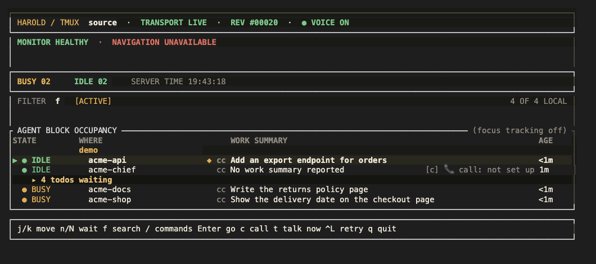
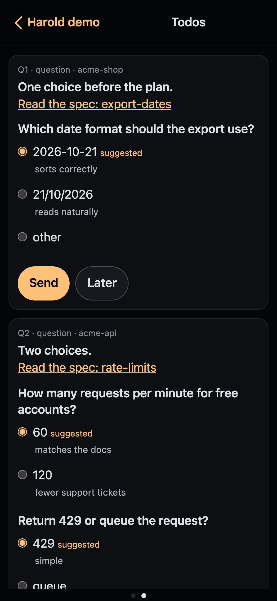

# Harold

Talk to your coding agents: at the desk, on your phone with text or voice.

Harold watches the coding agents you run in tmux and tells you when one finishes its turn. At your desk it speaks up; when you are away it sends the turn-end update to your phone, and your reply goes back to the right agent. The work keeps moving while you make coffee.

## What it does for you

- When an agent's turn ends, Harold says so at the desk.
- When you are away, it sends the turn-end update to the phone by iMessage or the web app.
- Your reply from the phone goes to the right pane.
- The dash shows every agent's state and your todos.
- The web app holds the chief's thread, the todo page and calls.



The dash lists each agent's state and work summary, with the todos under the chief.



The web app's todo page: answer the chief's questions from your phone.

## Install

1. On an Apple Silicon Mac (macOS 15 or newer), run `brew install python tmux grpcurl`.
2. Run the bootstrap, which verifies the release checksum and opens the configuration wizard:
   ```sh
   curl -fsSL https://raw.githubusercontent.com/kahgeh/harold/main/scripts/bootstrap.sh | sh
   ```
3. Connect your agents with the [hook setup guide](docs/how-tos/setup-agent-monitor-hooks.md).
4. Inside tmux, start the dash: `tmx-agent-dash`.

## Docs

- [Docs index](docs/README.md)
- [Install or reinstall Harold](docs/how-tos/setup.md) and [prerequisites](docs/prerequisites.md)
- [Hook setup](docs/how-tos/setup-agent-monitor-hooks.md)
- [The dash](tmx-agent-dash/README.md)
- [Architecture](docs/explanations/architecture.md) and [agent monitor](docs/references/agent-monitor/README.md)
- [Cut or install a release](docs/how-tos/release.md)
- [Dependency audits](docs/references/dependency-audits.md): always build with `--locked`, and send any `Cargo.lock` change through the rust-supply-chain-auditor first.

## Build features

Harold is built from Cargo features, one for each platform part. A build chooses its features. A setting does not.

| Feature | What it builds in | In `mac-defaults` | In `linux-defaults` |
| --- | --- | --- | --- |
| `imessage` | The iMessage channel. macOS only. | yes | no |
| `calls` | Calls at the desk and in the web app, and the echo test page. macOS only. | yes | no |

- `mac-defaults` is the default set, and the Mac package uses it.
- `linux-defaults` is the set for the Linux package. It has no feature yet, because both features need macOS.
- Build another mix by hand. For example, `cargo build --no-default-features --features calls` builds a Mac without iMessage.
- Run `harold --build-features` to print the features of a build, one on each line.
- A build refuses a setting that needs a missing feature, and names the setting. Remove the setting from `config/local.toml`.
- Before every merge and release, run `scripts/check_features.sh`. It checks `linux-defaults`, no feature and each feature alone.

## Status

Early development.

## Licence

Harold is licensed under the MIT licence, copyright (c) 2026 kahgeh. See [LICENSE](LICENSE).

The web app's script and the release binaries contain third-party code under its own licence: Datastar (MIT) and OpenSSL (Apache-2.0). Their licence texts are in [LICENSES/](LICENSES/). Each Rust crate in the binaries keeps its own licence, shown on crates.io for the versions in `Cargo.lock`.
