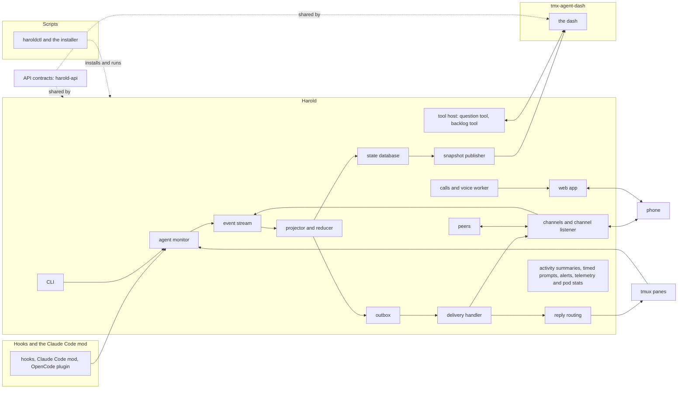
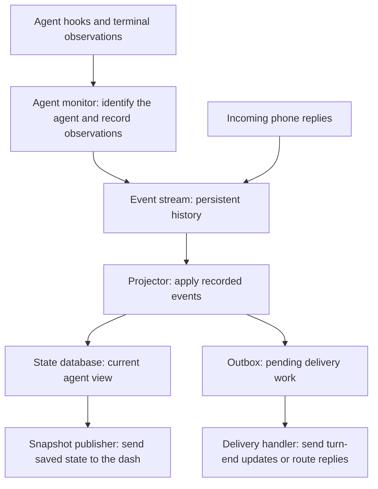

# Architecture: Harold

What Harold is made of and how its parts talk, kept true by the pod that builds it. The architect reads this file before it reviews a spec or a merge.

## Purpose

Harold watches the coding agents in the user's tmux panes on each Mac, tells the user when one finishes, at the desk or on the phone, and routes the user's replies back to the right pane. It also hosts tools the chief of pods uses: the question tool and the backlog tool.

## Components

| Component | Responsibility | Code |
| --- | --- | --- |
| agent monitor | Finds agents with the process inventory, and works out their state from hooks, reports and screen adapters | `harold/src/agent/` |
| event stream and state database | Stores accepted observations and messages in order, and the current agent view, the outbox and the checkpoint | `harold/src/store.rs`, `harold/src/store/` |
| projector and reducer | Reads the event stream, works out each agent's state, and stages delivery work in the outbox | `harold/src/store.rs`, `harold/src/agent/reducer.rs` |
| delivery handler | Reads the outbox, and leaves out, speaks or sends each turn-end update | `harold/src/outbound/`, `harold/src/projector.rs`, `harold/src/tmux.rs` |
| channels and channel listener | Send to the phone by iMessage or Telegram, and record the user's replies in the event stream | `harold/src/channels/` |
| reply routing | Decides which Mac owns a reply by its routing tag or the latest notifier, picks the pane by the tag or the other fallbacks, and types it there | `harold/src/inbound/` |
| peers | Hub and member on two Macs, and the peer RPCs between them | `harold/src/peers.rs` |
| snapshot publisher | Sends snapshots to clients over `WatchAgentStates` | `harold/src/agent/snapshot.rs`, `harold/src/main.rs` |
| tool host, question tool, backlog tool | Hosts tools with their own storage and gRPC services (ADR 0001) | `harold/src/tools.rs`, `harold/src/tools/` |
| calls and voice worker | Voice calls with the chief, and the process that turns lines into audio and speech into text | `harold/src/voice_input.rs`, `harold/src/voice_input/`, `harold/src/voice_worker.py` |
| web app | The phone's web app: the thread, push and calls | `harold/src/web_app/`, `harold/static/web_app/`, `harold/templates/web_app/` |
| activity summaries | Optional work summaries that Claude Code writes from an agent's evidence | `harold/src/activity_summary.rs` |
| timed prompts | Text typed into a pane at a set time each day | `harold/src/timed_prompts.rs` |
| alerts | HyperDX alerts typed to the chief | `harold/src/alerts.rs` |
| telemetry and pod stats | OpenTelemetry export, and pod counts from the pod registry | `harold/src/telemetry.rs`, `harold/src/pod_stats.rs` |
| CLI | `harold` and its subcommands: `tool`, `speak`, `send-message-to-away-device` and the rest | `harold/src/cli.rs` |
| haroldctl and the installer | Install, start, stop and check the service | `scripts/` |
| hooks, Claude Code mod, OpenCode plugin | Tell Harold what an agent did | `hooks/` |
| tmx-agent-dash | The dash: agent rows, todo rows, voice and messaging switches | `tmx-agent-dash/` |
| API contracts | The protobuf definitions shared by Harold, the dash and the tools | `harold-api/` |

## Interfaces

What other components or products depend on, each with where its contract is written:

- **The Harold gRPC service** (`harold-api/proto/harold.proto`): `WatchAgentStates`, `TurnComplete`, `ReportAgentState`, `SpeakLine`, `SendMessageToAwayDevice`, `Call`, `SetTtsMuted`, `SetMessagingPaused`, and the peer RPCs `ReportNotification` and `ForwardReply`. Contracts: the proto and the [agent monitor reference](../references/agent-monitor/README.md#grpc-contract).
- **The tool services** (`harold-api/proto/tools/questions.proto`, `harold-api/proto/tools/backlog.proto`). Contracts: the [tools references](../references/tools/README.md).
- **Commands:** `harold` and `haroldctl`. Contracts: the [operation reference](../references/operation/README.md) and the tools references.
- **Hook payloads** from Claude Code, Codex and OpenCode. Contract: [Set up agent monitor hooks](../how-tos/setup-agent-monitor-hooks.md).
- **Settings:** `default.toml` and `local.toml`, read in that order, with `local.toml` laid over `default.toml`. Contract: `harold/config/local.template.toml` and each feature's reference page.
- **The web app's HTTP routes.** Contract: the [web app reference](../references/away-app/README.md).
- **Lines Harold types into panes:** the answers line, alerts, timed prompts and phone replies. Contracts: the [questions reference](../references/tools/questions.md), the [telemetry reference](../references/telemetry/README.md), the [timed prompts reference](../references/timed-prompts/README.md) and the [inbound routing reference](../references/inbound-message-routing/README.md).
- **The alert address:** `POST /alert` on `[telemetry] alert_listen`, where HyperDX's webhooks post. Contract: the [telemetry reference](../references/telemetry/README.md).
- **The pod registry:** Harold reads the vault's `products.toml` for pod stats. Contract: the [telemetry reference](../references/telemetry/README.md).
- **The routing tag** on replies. Contract: the [inbound routing reference](../references/inbound-message-routing/README.md).
- **Files in Harold's data folder:** under the store folder, the event stream (`log/`) and `harold-state.db`; beside it, each tool's database (`tools/<tool>`) and the web app's key (`web-push/vapid.pem`). Contracts: the [operation reference](../references/operation/README.md), the [tools references](../references/tools/README.md) and the [web app reference](../references/away-app/README.md).
- **Telemetry:** export is on by default, over OTLP gRPC to the collector at `http://localhost:4317`, and `[telemetry] export = false` sets it off. Contract: the [telemetry reference](../references/telemetry/README.md).

## Decisions

One line per architectural decision, oldest first. Each date is the commit that brought the decision into the page that records it.

- 2026-08-24: Identity comes before state: an incarnation, not a pane, owns a state, so a new agent in an old pane starts at Unknown. [Agent monitor reference](../references/agent-monitor/README.md#incarnation-identity)
- 2026-08-24: Hooks win during a grace period, then conclusive screen evidence decides, so a late repaint or a missed hook does not leave a wrong state. [Agent monitor reference](../references/agent-monitor/README.md#reconciliation-contract)
- 2026-08-24: The projector stages the outbox in the same transaction as the state and the checkpoint, so a retryable delivery failure never undoes a recorded event. [Agent monitor reference](../references/agent-monitor/README.md#projection-and-storage)
- 2026-10-11: Two Macs run as hub and member, with a shared secret on the peer RPCs, because Telegram lets only one process read a bot's replies. [Inbound routing reference](../references/inbound-message-routing/README.md)
- 2026-10-16: The event stream lives in an OpenData log and the state in Turso, both inside the Harold process, so no other service has to run. [Operation reference](../references/operation/README.md)
- 2026-10-18: The web app is served on loopback and carried to the phone by `tailscale serve`, so nothing listens beyond the Mac. [Web app reference](../references/away-app/README.md)
- 2026-10-18: ADR 0001, tools are modules Harold hosts, so a new tool needs no change to the core store or the Harold gRPC service. [ADR 0001](../adr/0001-tools-are-modules-hosted-by-harold.md)
- 2026-10-18: ADR 0002, tool services trust local callers, because the gRPC listener has no transport authentication and only the peer RPCs carry a secret. [ADR 0002](../adr/0002-tool-services-trust-local-callers.md)
- 2026-10-18: ADR 0003, pod merge counts save the tip first, so a failed write changes nothing and a later poll counts the merges. [ADR 0003](../adr/0003-pod-merge-counts-save-the-tip-first.md)

## Departures from the standards

Each place Harold does not follow the organisation's `knowledge/standards.md`, why, and until when:

- **Other languages beside Rust.** The voice worker (`harold/src/voice_worker.py`), the installer (`scripts/*.py`) and the turn-complete hooks (`hooks/providers/`, `hooks/shared/`) are Python, `scripts/install.sh` and `scripts/bootstrap.sh` are shell, the Claude Code mod is TypeScript, and the OpenCode plugin and the web app's scripts (`harold/static/web_app/`) are JavaScript. Each fits the program it extends, and the standard raises another language as a question, not a breach. Until: not set.
- **axum's version.** Harold uses axum `0.8.8` (`harold/Cargo.toml`), unpinned, where the standard names `=0.8.7`. No one has said why. Until: not set.
- **Dependency audits** are not recorded in Harold's `README.md`, which the standard's practice suggests. Until: not set.

## How it works

### Follow one task

Suppose an agent is idle and you submit “Fix the login error.” With lifecycle hooks configured, the update reaches the dash like this:

1. The agent's start hook tells Harold that work has begun and supplies the task text. A **hook** is a small script a provider runs to report an agent action.
2. Harold checks which agent process is running in that pane and records the observation in the event stream.
3. Harold reads the recorded observation and updates its stored view of that agent to `Busy`, with the submitted instruction available as its work summary.
4. After saving that view, Harold publishes it to the dash. The dash can now show `Busy` and “Fix the login error.”

When the agent finishes, a completion hook can report its reply. Harold updates the agent to `Idle` and separately considers whether to tell you. Finishing a turn does not by itself prove the requested fix succeeded.

This flow has two useful records: **what Harold observed**, and **what Harold currently knows about each agent**. Keeping the observations lets Harold rebuild the current view after a restart.

### The main parts

The following diagram shows how observations become the dash's state and how messages lead to delivery work. These are responsibilities inside Harold; they are not separate services.

The **agent monitor** checks running processes, accepts hook reports, and reads terminal evidence. It handles agent observations one at a time so competing inputs cannot independently overwrite the current state.

The **event stream** stores accepted observations and messages in order. Harold keeps the event stream in an OpenData log (`opendata-log`, which stores its data with SlateDB on local disk) and its state in the Turso database `harold-state.db`, both inside the Harold process, with no other service.

The **projector** reads that history and updates the state database. For agent observations, a set of decision rules called the **reducer** determines the resulting state. The projector saves that state along with its position in the history, called a **checkpoint**. This records how far it has processed.

The **outbox** is a persistent list of delivery work, such as sending a turn-end update or routing a phone reply. The projector stages that work in the same database transaction as its state updates and checkpoint. Actual delivery happens afterward, so a retryable channel failure can remain pending without undoing the recorded event.

The **snapshot publisher** sends the saved agent view to clients through the `WatchAgentStates` gRPC stream. A snapshot is the complete current view. The dash receives one when it connects, followed by updated snapshots, so it can reconnect without reconstructing every change it missed.

See the [agent monitor reference](../references/agent-monitor/README.md#projection-and-storage) for the storage and API contracts.

### The question tool's todos

The question tool holds the chief's todos, of two kinds: questions to answer and instructions to follow by hand. Both live in the same `questions` table. The dash stores each tick of an instruction's step with `TickStep`, in the `ticks` column, so the ticks survive a dash restart. The `done` and `ignore` actions store a `DONE` or `IGNORE` answer, which goes in the next answers line at once. This stays inside the question tool, so it needs no ADR beyond ADR 0001. See the [questions reference](../references/tools/questions.md).

### Why the agent monitor uses several sources

A start hook may say an agent is busy while its terminal still displays the previous idle screen. Later, a completion hook might be missed even though the terminal clearly shows the agent idle at its prompt. Harold needs rules for both situations.

Each source answers a different question:

| Source | What it tells Harold | Limitation |
| --- | --- | --- |
| Process inventory | Which agent process is present in each pane | Presence alone does not establish Busy or Idle |
| Lifecycle hooks | The agent explicitly started or finished work | Hooks can be missed |
| Screen adapters | The visible terminal matches a configured Busy or Idle marker | The terminal can be stale, ambiguous, or changed by a provider update |

A **screen adapter** interprets the terminal format used by a particular agent. It returns observations for the agent monitor to record; it does not edit the state database.

After a hook fires, Harold gives the terminal a short grace period to repaint. During that period, the hook wins. Afterward, conclusive screen evidence can correct stale state. An unreadable or inconclusive screen preserves earlier evidence; without any conclusive evidence, the state is `Unknown`. CPU use and elapsed silence do not determine Busy or Idle.

Recording the evidence before applying these rules makes the result reproducible. A failed capture does not erase known state, and replaying the same history applies the same decisions. The [reconciliation contract](../references/agent-monitor/README.md#reconciliation-contract) defines the exact timing and precedence rules.

### Identity before state

Suppose an agent exits and you launch another in the same tmux pane. The pane still exists, but the new agent must not inherit the old agent's Busy state or work summary.

Harold therefore identifies the pane together with the agent process, its start time, and its provider. This combination is called an **incarnation**. Process start time matters because the operating system can reuse a process ID.

A replacement starts at `Unknown` with no work summary. Recorded events belonging to an older incarnation remain in history but cannot change the new incarnation's current view. The [identity reference](../references/agent-monitor/README.md#incarnation-identity) lists the exact fields.

### Keeping the work summary useful

Busy/Idle answers “Is it working?” The work summary answers “What is it working on?” Those values can change independently. An idle agent can keep the work summary of its last task, and Harold can learn a work summary even when screen state is inconclusive.

Hooks supply task text directly. Screen adapters can recover submitted instructions when hooks miss them. Harold keeps these sources separately and normally uses the most recent meaningful instruction. Idle prompts such as “Ask Codex to do anything” do not replace a work summary.

When activity summaries are on, a background Claude request turns the available instruction and completion reply into a short work summary. The agent monitor keeps working while it runs, and the source instruction remains available if generation fails. A result is accepted only while it still matches the same agent incarnation and activity, so a slow response cannot replace a newer task's work summary.

An activity summary condenses supplied evidence; it does not independently verify an agent's reported outcome. Generating one also does not send a phone notification. See [activity summaries](../references/agent-monitor/activity-summaries.md) for the evidence limits and [work-summary rules](../references/agent-monitor/README.md#work-summaries) for selection and clearing behavior.

### Recovering a submitted task from scrollback

A submitted instruction may scroll out of view before Harold reads it. For supported terminal formats, Harold can look through a bounded history tail to recover it. Busy/Idle classification continues to use the visible screen.

Old history creates an identity problem: text already in a pane may belong to a previous agent. On its first successful history capture, Harold records a baseline of prompt fingerprints (compact identifiers for recognizing the same submitted blocks) without adopting any existing prompt as new work. Later captures must establish continuity with that baseline before newly submitted text becomes eligible. If continuity is lost, Harold establishes another baseline.

This deliberately sacrifices some recovery: if Harold attaches after a task has begun, it may never recover that task from scrollback. The benefit is that retained pane history cannot silently become a replacement agent's task.

Raw terminal captures stay inside capture and parsing. Only eligible, sanitized, bounded instructions can become stored work summary evidence; raw captures are never stored, logged, published to clients, or sent to the summarizer. Parsing support varies by provider. The [screen-adapter reference](../references/agent-monitor/screen-adapters.md) covers supported formats, unsent drafts, baselines, and recovery limits.

### Turn-end updates and phone replies

A turn-end update and an agent-state update serve different purposes. The dash needs an updated view even when you are already looking at the agent and no turn-end update is needed.

A `TurnCompleted` event creates delivery work in the outbox. The delivery handler checks the `[notify]` settings and whether you are at the desk, then either leaves the update out, speaks it at the desk, or sends it through the away channel, iMessage or Telegram. Retryable delivery failures remain pending.

For a phone reply, the channel listener records an `InboundMessageReceived` event. The delivery handler resolves a live agent pane using the message's routing tag or the configured routing fallbacks, checks that an agent is still present, and submits the message to that pane through tmux.

Ordinary agent observations and activity summaries do not create delivery work. The [notification reference](../references/notification/README.md) and [inbound routing reference](../references/inbound-message-routing/README.md) describe channel decisions, routing, and failure behavior.

### Startup, restart, and shutdown

Harold reads its settings from `default.toml`, then lays `local.toml` over it, and export to the local collector is on by default.

On a fresh installation, Harold creates its state database with the complete current schema. Before accepting client traffic, it catches the stored view up to the event stream. It then loads the complete saved snapshot and starts publishing. The dash cannot connect halfway through that recovery and receive a partially rebuilt view.

Persistent observations, projected state, and accepted activity summaries survive restart. Temporary work, such as pending activity summary requests and scrollback fingerprints, does not. History capture establishes a fresh baseline when the agent monitor resumes.

During shutdown, Harold signals its background jobs to stop, closes the dash's streams, and lets in-flight requests drain. The agent monitor has a bounded stop period. Already committed events and state remain available on the next start.

See the [startup and shutdown sequence](../references/agent-monitor/README.md#startup-reconnect-and-shutdown) for the precise recovery behavior. To connect agents to Harold, follow [Set up agent monitor hooks](../how-tos/setup-agent-monitor-hooks.md).
