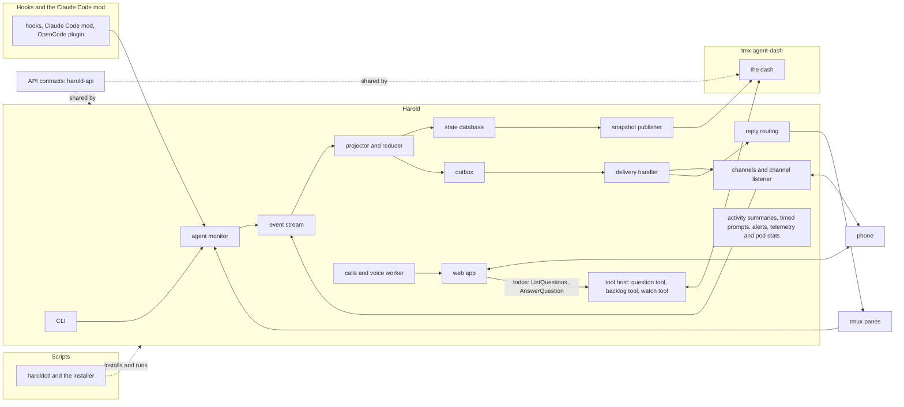
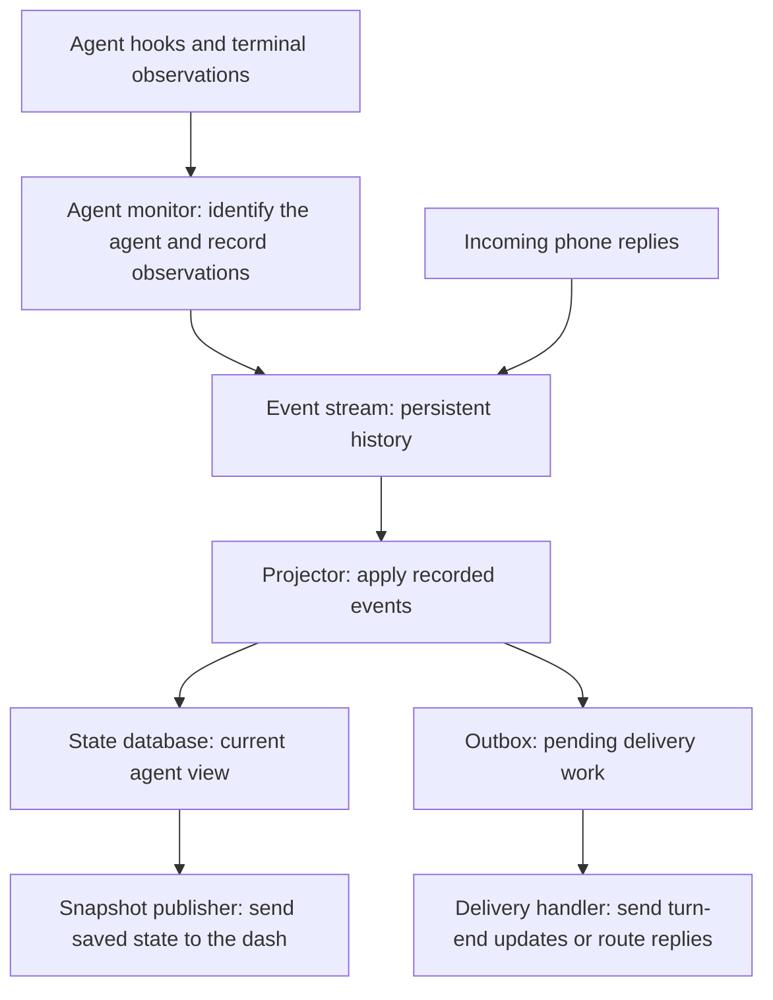

# Architecture: Harold

What Harold is made of and how its parts talk, kept true by the pod that builds it. The architect reads this file before it reviews a spec or a merge.

## Purpose

Harold watches the coding agents in the user's tmux panes on each Mac, tells the user when one finishes, at the desk or on the phone, and routes the user's replies back to the right pane. It also hosts tools: the question tool and the backlog tool, which the chief of pods uses, and the watch tool, which any agent can use.

## Components

| Component | Responsibility | Code |
| --- | --- | --- |
| agent monitor | Finds agents with the process inventory, and works out their state from hooks, reports and screen adapters | `harold/src/agent/` |
| event stream and state database | Stores accepted observations and messages in order, and the current agent view, the outbox and the checkpoint | `harold/src/store.rs`, `harold/src/store/` |
| projector and reducer | Reads the event stream, works out each agent's state, and stages delivery work in the outbox | `harold/src/store.rs`, `harold/src/agent/reducer.rs` |
| delivery handler | Reads the outbox, and leaves out, speaks or sends each turn-end update. The local model makes the update (`harold/src/outbound/tts.rs`), in a delivery or in a call | `harold/src/outbound/`, `harold/src/projector.rs`, `harold/src/tmux.rs` |
| channels and channel listener | Send to the phone by iMessage, and record the user's replies in the event stream | `harold/src/channels/` |
| reply routing | Decides which Mac owns a reply by its routing tag or the latest notifier, picks the pane by the tag or the other fallbacks, and types it there | `harold/src/inbound/` |
| snapshot publisher | Sends snapshots to clients over `WatchAgentStates` | `harold/src/agent/snapshot.rs`, `harold/src/main.rs` |
| tool host, question tool, backlog tool, watch tool, knowledge tool | Hosts tools with their own storage and gRPC services (ADR 0001). The dash and the web app are clients of the question tool. The knowledge tool indexes the vault by meaning with a local embedding model run by the embedding worker, in a tursodb database that buckwal keeps durable in a bucket, and answers the chief (`harold tool knowledge`), the web app's Notes page and the dash's `s` search. When `[knowledge.graph]` is on, it also keeps the **knowledge graph** in TypeDB, a separate store from the index: one graph writer checks, logs and applies every change, and two OpenData logs (a schema log and a data log) let Harold rebuild the graph from nothing. See the [knowledge reference](../references/tools/knowledge.md#the-knowledge-graph). See the diagram in the [knowledge reference](../references/tools/knowledge.md#how-the-parts-fit). | `harold/src/tools.rs`, `harold/src/tools/`, `harold/src/embed_worker.py` |
| calls, call answerer, voice worker and speech models | Voice calls with the chief, the call answerer (the small model that answers each turn and hands real work to the chief), the process that turns lines into audio and speech into text, and the check of the two speech models it loads: Harold downloads a missing one at start-up, pinned to a commit and checked file by file ([ADR 0011](../adr/0011-harold-downloads-missing-speech-models-at-start-up.md)) | `harold/src/voice_input.rs`, `harold/src/voice_input/` (`answerer.rs`, `hand_over.rs`, `models.rs`), `harold/src/voice_worker.py`, `harold/src/voice_download.py` |
| web app | The phone's web app: the thread, push, calls, the todos, which it shows and answers through the question tool's service, and the spec pages, which it renders from each product's spec files and offers to share one at a time. A second, loopback-only listener, the specs listener, serves the same pages to the browser on the Mac. Its page records page loads, requests and script errors as spans (`telemetry.js` and one vendored OpenTelemetry bundle) and posts them to Harold's `POST /telemetry/traces`, which keeps only the fields it allows and forwards them to the collector | `harold/src/web_app/` (`specs.rs` for the spec pages), `harold/static/web_app/`, `harold/templates/web_app/` |
| activity summaries | Optional work summaries that Claude Code writes from an agent's evidence | `harold/src/activity_summary.rs` |
| timed prompts | Text typed into a pane at a set time each day | `harold/src/timed_prompts.rs` |
| alerts | HyperDX alerts typed to the chief | `harold/src/alerts.rs` |
| telemetry and pod stats | OpenTelemetry export, and pod counts from the pod registry | `harold/src/telemetry.rs`, `harold/src/pod_stats.rs` |
| CLI | `harold` and its subcommands: `tool`, `speak`, `send-message-to-away-device` and the rest | `harold/src/cli.rs` |
| haroldctl and the installer | Install, start, stop and check the service | `scripts/` |
| hooks, Claude Code mod, OpenCode plugin | Tell Harold what an agent did | `hooks/` |
| tmx-agent-dash | The dash: agent rows, todo rows, voice and messaging switches, and the notes search (`s`) over the knowledge tool | `tmx-agent-dash/` |
| API contracts | The protobuf definitions shared by Harold, the dash and the tools | `harold-api/` |

## Interfaces

What other components or products depend on, each with where its contract is written:

- **The Harold gRPC service** (`harold-api/proto/harold.proto`): `WatchAgentStates`, `TurnComplete`, `ReportAgentState`, `SpeakLine`, `SendMessageToAwayDevice`, `Call`, `SetTtsMuted`, and `SetMessagingPaused`. Contracts: the proto and the [agent monitor reference](../references/agent-monitor/README.md#grpc-contract).
- **The tool services** (`harold-api/proto/tools/questions.proto`, `harold-api/proto/tools/backlog.proto`, `harold-api/proto/tools/watch.proto`, `harold-api/proto/tools/knowledge.proto`). Contracts: the [tools references](../references/tools/README.md).
- **Commands:** `harold` and `haroldctl`. Contracts: the [operation reference](../references/operation/README.md) and the tools references.
- **Hook payloads** from Claude Code, Codex and OpenCode. Contract: [Set up agent monitor hooks](../how-tos/setup-agent-monitor-hooks.md).
- **Settings:** `default.toml` and `local.toml`, read in that order, with `local.toml` laid over `default.toml`. Contract: `harold/config/local.template.toml` and each feature's reference page.
- **The web app's HTTP routes**, and the specs listener's two page routes. Contract: the [web app reference](../references/away-app/README.md).
- **Lines Harold types into panes:** the answers line, alerts, timed prompts, the chief's restart reminder, phone replies (a web app reply may end with `📷 <path>`, ADR 0010), `WATCH` lines and hand-overs from a call. A hand-over is the one writer that may type into a `Busy` Claude Code pane (ADR 0009). Contracts: the [questions reference](../references/tools/questions.md), the [call answerer reference](../references/voice-input/call-answerer.md), the [watch reference](../references/tools/watch.md), the [telemetry reference](../references/telemetry/README.md), the [timed prompts reference](../references/timed-prompts/README.md) (which also covers the restart reminder) and the [inbound routing reference](../references/inbound-message-routing/README.md).
- **The alert address:** `POST /alert` on `[telemetry] alert_listen`, where HyperDX's webhooks post. Contract: the [telemetry reference](../references/telemetry/README.md).
- **The pod registry:** Harold reads the vault's `products.toml` for pod stats. Contract: the [telemetry reference](../references/telemetry/README.md).
- **The routing tag** on replies. Contract: the [inbound routing reference](../references/inbound-message-routing/README.md).
- **Files in Harold's data folder:** under the store folder, the event stream (`log/`) and `harold-state.db`; beside it, each tool's database (`tools/<tool>`; the knowledge tool's `tools/knowledge/index` is the local copy of a database buckwal keeps in a bucket, and `tools/knowledge/worker` holds the embedding worker's script; the knowledge graph keeps `tools/knowledge/graph/schema-log`, `tools/knowledge/graph/data-log` and `tools/knowledge/graph/typedb`, all at mode 0700), the web app's key (`web-push/vapid.pem`), its paired devices (`web-app/devices.json`, fingerprints only) and pairing lock (`web-app/pairing-lock.json`), both mode 0600 in a folder at 0700, the echo test's runs (`echo-test/`, one JSON file per run) and the web app's photos (`app-photos/`, folder mode 0700, files 0600; the hourly prune deletes an upload no reply names after 1 hour, and a photo when its thread row goes, at 30 days). Also beside it, `speech-models/` (folder mode 0700): the download script `voice_download.py` (file mode 0600) and, for each speech model Harold has checked, a record of its files' paths, sizes and sha256 (`<org>--<name>@<commit>.json`, mode 0600). Contracts: the [operation reference](../references/operation/README.md), the [tools references](../references/tools/README.md) and the [web app reference](../references/away-app/README.md).
- **Telemetry:** export is on by default, over OTLP gRPC to the collector at `http://localhost:4317`, and `[telemetry] export = false` sets it off. Harold also forwards the web app's browser spans as OTLP JSON to `[telemetry] otlp_http_endpoint`, `http://localhost:4318`, because a browser cannot speak gRPC. Contract: the [telemetry reference](../references/telemetry/README.md).

## Decisions

One line per architectural decision, oldest first. Each date is the commit that brought the decision into the page that records it.

- 2026-08-24: Identity comes before state: an incarnation, not a pane, owns a state, so a new agent in an old pane starts at Unknown. [Agent monitor reference](../references/agent-monitor/README.md#incarnation-identity)
- 2026-08-24: Hooks win during a grace period, then conclusive screen evidence decides, so a late repaint or a missed hook does not leave a wrong state. [Agent monitor reference](../references/agent-monitor/README.md#reconciliation-contract)
- 2026-08-24: The projector stages the outbox in the same transaction as the state and the checkpoint, so a retryable delivery failure never undoes a recorded event. [Agent monitor reference](../references/agent-monitor/README.md#projection-and-storage)
- 2026-10-11: Two Macs run as hub and member, with a shared secret on the peer RPCs, because Telegram lets only one process read a bot's replies. [Inbound routing reference](../references/inbound-message-routing/README.md)
- 2026-10-21: The hub and member setup of 2026-10-11 is removed with Telegram. Two Macs share replies through iMessage, with no peer RPC, and the gRPC server listens on the Mac only. [ADR 0008](../adr/0008-harold-reaches-the-phone-by-imessage-only.md)
- 2026-10-16: The event stream lives in an OpenData log and the state in Turso, both inside the Harold process, so no other service has to run. [Operation reference](../references/operation/README.md)
- 2026-10-18: The web app is served on loopback and carried to the phone by `tailscale serve`, so nothing listens beyond the Mac. [Web app reference](../references/away-app/README.md)
- 2026-10-18: ADR 0001, tools are modules Harold hosts, so a new tool needs no change to the core store or the Harold gRPC service. [ADR 0001](../adr/0001-tools-are-modules-hosted-by-harold.md)
- 2026-10-18: ADR 0002, tool services trust local callers, because the gRPC listener has no transport authentication and only the peer RPCs carry a secret. [ADR 0002](../adr/0002-tool-services-trust-local-callers.md)
- 2026-10-18: ADR 0003, pod merge counts save the tip first, so a failed write changes nothing and a later poll counts the merges. [ADR 0003](../adr/0003-pod-merge-counts-save-the-tip-first.md)
- 2026-10-20: ADR 0004, tools may read Harold's agent list and pod facts through two read-only ports, so the watch tool can hand a model what a pod check needs. [ADR 0004](../adr/0004-tools-may-read-agents-and-pods.md)
- 2026-10-20: ADR 0005, a tool may run a hosted model with the tools a skill allows, unchecked, because the skill's author decides what a run may do. [ADR 0005](../adr/0005-a-tool-may-run-a-hosted-model-with-the-tools-a-skill-allows.md)
- 2026-10-20: ADR 0006, answers go to the chief early, and a set-aside question returns after a line is typed, a `later` or a dismiss that leaves nothing waiting and no answer unsent, so "later" still means after everything else. [ADR 0006](../adr/0006-answers-go-to-the-chief-early.md)
- 2026-10-21: ADR 0007, the web app reaches the todos through the question tool's gRPC service, as the dash does, so a phone on the tailnet can answer them. [ADR 0007](../adr/0007-the-web-app-reaches-todos-through-the-question-service.md)
- 2026-10-21: ADR 0008, Harold reaches the phone by iMessage only and its gRPC server stays on the Mac, so every Mac reads every reply from its own `chat.db` and nothing passes between Macs. [ADR 0008](../adr/0008-harold-reaches-the-phone-by-imessage-only.md)
- 2026-10-23: ADR 0009, a call is answered by a small model and real work goes to the chief as a hand-over, typed into the chief's pane even while it is busy, so a call no longer waits for a large model. [ADR 0009](../adr/0009-a-call-is-answered-by-a-small-model.md)
- 2026-10-23: ADR 0010, photos reach the chief as files: the phone shrinks a photo, Harold stores it in `app-photos/` without decoding it, and the line typed to the chief names its absolute path. [ADR 0010](../adr/0010-photos-reach-the-chief-as-files.md)
- 2026-10-23: ADR 0011, Harold downloads a missing speech model at start-up, from Hugging Face, pinned to a commit and checked file by file, with no token, while the voice worker stays offline; on the iPhone's hotspot the start-up download waits, and a tapped call starts it. [ADR 0011](../adr/0011-harold-downloads-missing-speech-models-at-start-up.md)
- 2026-10-23: ADR 0012, browser libraries are vendored as one bundle built from a pinned, audited npm lockfile, and browser spans reach the collector only through Harold's route, which keeps allowed fields and cuts URLs to their path. [ADR 0012](../adr/0012-browser-libraries-are-vendored-as-one-bundle-built-from-a-pinned-audited-npm-lockfile.md)
- 2026-10-23: ADR 0013, the web app admits only paired devices, by a device-secret cookie whose fingerprint Harold keeps, and a device is paired by typing a fixed code kept in a file outside the repository, which five wrong tries lock for good. [ADR 0013](../adr/0013-the-web-app-admits-only-paired-devices-by-a-device-secret-cookie-whose-fingerprint-harold-keeps.md)
- 2026-10-24: ADR 0014, the vault is indexed by meaning inside Harold, with a local model and a buckwal-durable tursodb, so the chief, the web app and the dash can find a vault note by what it means. [ADR 0014](../adr/0014-the-vault-is-indexed-by-meaning-inside-harold-with-a-local-model-and-a-buckwal-durable-tursodb.md)
- 2026-10-24: ADR 0015, the question tool reads the spec files the chief names, only inside a registered product's specs folder, so a todo whose spec changed after it was asked is marked and cannot be answered. [ADR 0015](../adr/0015-the-question-tool-reads-the-spec-files-the-chief-names.md)
- 2026-10-25: "Relegate to idea" replaced Later on a question, in the dash and the web app: it goes through `AnswerQuestion` as the kind `RELEGATE`, `DeferQuestion` and the deferred state are gone, and the answers line asks the chief to keep the question as an idea note. The notes in [ADR 0006](../adr/0006-answers-go-to-the-chief-early.md) and [ADR 0007](../adr/0007-the-web-app-reaches-todos-through-the-question-service.md) say what no longer holds.
- 2026-10-25: ADR 0016, typed relations between vault notes live in TypeDB, rebuilt from two OpenData logs, so the chief's relations survive a lost TypeDB database. [ADR 0016](../adr/0016-typed-relations-between-vault-notes-live-in-typedb-rebuilt-from-two-opendata-logs.md)
- 2026-10-25: ADR 0017, Harold serves each product's specs as pages in the web app and on a loopback-only listener, todo links point at those pages, and a spec leaves the machines only when the user presses **Share**, one spec at a time. [ADR 0017](../adr/0017-harold-serves-the-specs-and-a-spec-leaves-the-machines-only-when-the-user-shares-it.md)
- 2026-10-25: ADR 0018, every post and delete from a web app page goes through Datastar, which sends `Datastar-Request: true`, and the same-origin check reads that header. The call's raw audio post and the browser trace exporter are the two exceptions the user approved; only the user approves another. [ADR 0018](../adr/0018-every-web-app-post-goes-through-datastar-and-only-the-user-approves-an-exception.md)

## Departures from the standards

Each place Harold does not follow the organisation's `knowledge/standards.md`, why, and until when:

- **Other languages beside Rust.** The voice worker (`harold/src/voice_worker.py`), the embedding worker (`harold/src/embed_worker.py`, a second Python worker beside it), the installer (`scripts/*.py`) and the turn-complete hooks (`hooks/providers/`, `hooks/shared/`) are Python, `scripts/install.sh` and `scripts/bootstrap.sh` are shell, the Claude Code mod is TypeScript, and the OpenCode plugin and the web app's scripts (`harold/static/web_app/`) are JavaScript. Each fits the program it extends, and the standard raises another language as a question, not a breach. Until: not set.
- **The TypeDB server is a long-lived child process that is not a Rust crate.** When `[knowledge.graph]` is on, Harold starts the TypeDB Community Edition server (MPL-2.0) on the first graph call, on `127.0.0.1` only, and stops it after `idle_minutes` without a call, as it does the embedding worker. You install the binary, and Harold downloads nothing. The supply-chain auditors do not cover a binary, so the check is by hand: the [dependency audits](../references/dependency-audits.md) hold its row. Until: not set.
- **Two paths to Turso.** Harold's `turso =0.8.3` (`mimalloc`) and buckwal's `turso_core =0.8.3` (`fs`, `json`, `uuid`, `encryption`, `conn_raw_api`) both resolve to the one `turso_core 0.8.3` in `Cargo.lock`, with the features joined. buckwal is a git dependency pinned to a commit (`harold/Cargo.toml`), not a crates.io release. Until: buckwal is published or the pin moves.
- **buckwal's telemetry runs through Harold's subscriber.** Harold never calls `buckwal::telemetry::init`, which installs a second global subscriber. The export filters and `ALLOWED_FIELDS` in `harold/src/telemetry.rs` accept the target `buckwal`, so its spans and log records are exported under `service.name = harold`. Until: not set.
- **axum's version.** Harold uses axum `0.8.8` (`harold/Cargo.toml`), unpinned, where the standard names `=0.8.7`. No one has said why. Until: not set.
- **Dependency audits** live in the table in `docs/references/dependency-audits.md`, linked from the README, to keep the front page short. Until: not set.
- **Licences of shipped third-party code** are in `LICENSES/`: Datastar (the web app's script), OpenTelemetry JS (the web app's browser bundle, built by `scripts/build_web_otel.sh`), Mermaid and its packages (the spec pages' browser bundle, built by `scripts/build_web_mermaid.sh`) and OpenSSL (linked statically into the release binaries).

## How it works

Harold inventories configured agent processes in tmux, combines explicit lifecycle hooks with provider-specific visible-screen evidence, and stores the resulting current state durably. Existing stop hooks also report completed turns for turn-end updates and non-destructive work-summary updates.

The public agent-state stream starts with a complete current snapshot, then sends later revisions. Raw pane captures remain inside the screen adapter; only classified state and a normalized work summary can cross the acquisition boundary. The [agent-monitor reference](../references/agent-monitor/README.md) and the [hook setup guide](../how-tos/setup-agent-monitor-hooks.md) give the detail.

### Follow one task

Suppose an agent is idle and you submit “Fix the login error.” With lifecycle hooks configured, the update reaches the dash like this:

1. The agent's start hook tells Harold that work has begun and supplies the task text. A **hook** is a small script a provider runs to report an agent action.
2. Harold checks which agent process is running in that pane and records the observation in the event stream.
3. Harold reads the recorded observation and updates its stored view of that agent to `Busy`, with the submitted instruction available as its work summary.
4. After saving that view, Harold publishes it to the dash. The dash can now show `Busy` and “Fix the login error.”

When the agent finishes, a completion hook can report its reply. Harold updates the agent to `Idle` and separately considers whether to tell you. Finishing a turn does not by itself prove the requested fix succeeded.

This flow has two useful records: **what Harold observed**, and **what Harold currently knows about each agent**. Keeping the observations lets Harold rebuild the current view after a restart.

### The main parts

The following diagram shows how observations become the dash's state and how messages lead to delivery work. These are responsibilities inside Harold; they are not separate services.

The **agent monitor** checks running processes, accepts hook reports, and reads terminal evidence. It handles agent observations one at a time so competing inputs cannot independently overwrite the current state.

The **event stream** stores accepted observations and messages in order. Harold keeps the event stream in an OpenData log (`opendata-log`, which stores its data with SlateDB on local disk) and its state in the Turso database `harold-state.db`, both inside the Harold process, with no other service.

The **projector** reads that history and updates the state database. For agent observations, a set of decision rules called the **reducer** determines the resulting state. The projector saves that state along with its position in the history, called a **checkpoint**. This records how far it has processed.

The **outbox** is a persistent list of delivery work, such as sending a turn-end update or routing a phone reply. The projector stages that work in the same database transaction as its state updates and checkpoint. Actual delivery happens afterward, so a retryable channel failure can remain pending without undoing the recorded event.

The **snapshot publisher** sends the saved agent view to clients through the `WatchAgentStates` gRPC stream. A snapshot is the complete current view. The dash receives one when it connects, followed by updated snapshots, so it can reconnect without reconstructing every change it missed.

See the [agent monitor reference](../references/agent-monitor/README.md#projection-and-storage) for the storage and API contracts.

### The question tool's todos

The question tool holds the chief's todos, of two kinds: questions to answer and instructions to follow by hand. Both live in the same `questions` table. The dash stores each tick of instructions' step with `TickStep`, in the `ticks` column, so the ticks survive a dash restart. The dash stores each pick with `SavePicks` in the `picks` column of the `questions` table, so picks survive a dash restart and carry to the next question version for unchanged decisions, and the chief reads them with `ShowQuestion`. The `done` and `ignore` action rows store a `DONE` or `IGNORE` answer, which goes in the next answers line at once. This stays inside the question tool, so it needs no ADR beyond ADR 0001, except for one thing: the tool reads only the spec files the chief names, and only inside a registered product's specs folder, to mark a changed spec ([ADR 0015](../adr/0015-the-question-tool-reads-the-spec-files-the-chief-names.md)). See the [questions reference](../references/tools/questions.md).

### The spec pages and the specs listener

Harold shows each product's specs as pages, so a spec stays on the user's machines unless the user shares it. `web_app/specs.rs` reads the pod registry through the `Products` port, as the question tool does, and renders the files `<repo>/.superpowers/pod/specs/<id>.md` with `pulldown-cmark`. Raw HTML shows as text, and Mermaid draws the diagrams in the page, from one vendored bundle. The web app serves the pages at `/specs` and `/specs/{product}/{id}`, behind the login, pairing and same-origin checks. The **Share** button posts `/specs/{product}/{id}/share`, and Harold puts one fixed reply in the thread for the chief, which has the PnEM publish that spec as a private artifact.

A second listener, `[web_app] specs_listen` (`127.0.0.1:4331`), serves the same two page routes and three static files to the browser on the Mac. It is open only with `[telemetry] pod_registry`. It has no login check and answers only `GET`, so any local process can read the specs, as it can read the files, and none can make the chief publish one. `tailscale serve` does not forward to it. The question tool gives each todo its `spec_page`, and the listing gives `local_specs_url`, so the web app card and the dash `o` open the spec page. See [ADR 0017](../adr/0017-harold-serves-the-specs-and-a-spec-leaves-the-machines-only-when-the-user-shares-it.md) and the [web app reference](../references/away-app/README.md#specs).

Every post and delete from a web app page goes through Datastar. A script sets its signals with Datastar's `mergePatch` and starts the request with Datastar's `post` action; a template uses `@post`. The same-origin check accepts a post or a delete only with `Datastar-Request: true`. It accepts `application/octet-stream` only on `POST /call/audio`, and `application/json` only on `POST /telemetry/traces`. These two are the approved exceptions, and only the user approves another. Every moved post sets `retry: 'never'`, `retryMaxCount: 0` and `openWhenHidden: true`, and an asset test fails on a `fetch` post that is not the call audio. See [ADR 0018](../adr/0018-every-web-app-post-goes-through-datastar-and-only-the-user-approves-an-exception.md).

### The watch tool's model launch

The watch tool is the one place where Harold starts a model that can use tools. Its trust boundary, step by step:

- **Who names what.** Any local agent runs `harold tool watch start` and names the watch, its skill and, by its working directory, its folder. The tool does not trust the folder: it must be an absolute path to an existing folder, and Harold stores its canonical form. The skill is a folder name under `<folder>/.claude/skills/`, and its `SKILL.md` must lie, links followed, inside that folder or inside a watch skill folder the user lists in `[watch] skill_folders` (so a skill kept in the chief-of-pods repository or an organisation repository can be linked in). This is checked at `start` and again at every run. A watch skill folder is shared trust: anyone who can change a listed folder changes what every watch linking there does at its next run.
- **What the model may use.** The skill's `allowed-tools` goes to Claude Code as `--allowedTools`, exactly as written and unchecked. The skill's author decides what a run may do ([ADR 0005](../adr/0005-a-tool-may-run-a-hosted-model-with-the-tools-a-skill-allows.md)). The caller can change the skill while the watch runs.
- **What the model sees, and where it goes.** The model gets a fixed system prompt (the answer format), the skill's text and the facts from the `agents` and `pods` ports ([ADR 0004](../adr/0004-tools-may-read-agents-and-pods.md)). The facts, the skill's text, the files the run reads and the output of the commands it runs go to Anthropic's hosted model.
- **What comes out.** Harold types one line of at most 300 characters, in the fixed `WATCH` forms, and only into the chief's pane or the pane of the agent in the watch's own folder, under the timed prompts' checks. Nothing from the run reaches a log or an export.

See the [watch reference](../references/tools/watch.md).

### Why the agent monitor uses several sources

A start hook may say an agent is busy while its terminal still displays the previous idle screen. Later, a completion hook might be missed even though the terminal clearly shows the agent idle at its prompt. Harold needs rules for both situations.

Each source answers a different question:

| Source | What it tells Harold | Limitation |
| --- | --- | --- |
| Process inventory | Which agent process is present in each pane | Presence alone does not establish Busy or Idle |
| Lifecycle hooks | The agent explicitly started or finished work | Hooks can be missed |
| Screen adapters | The visible terminal matches a configured Busy or Idle marker | The terminal can be stale, ambiguous, or changed by a provider update |

A **screen adapter** interprets the terminal format used by a particular agent. It returns observations for the agent monitor to record; it does not edit the state database.

After a hook fires, Harold gives the terminal a short grace period to repaint. During that period, the hook wins. Afterward, conclusive screen evidence can correct stale state. An unreadable or inconclusive screen preserves earlier evidence; without any conclusive evidence, the state is `Unknown`. CPU use and elapsed silence do not determine Busy or Idle.

Recording the evidence before applying these rules makes the result reproducible. A failed capture does not erase known state, and replaying the same history applies the same decisions. The [reconciliation contract](../references/agent-monitor/README.md#reconciliation-contract) defines the exact timing and precedence rules.

### Identity before state

Suppose an agent exits and you launch another in the same tmux pane. The pane still exists, but the new agent must not inherit the old agent's Busy state or work summary.

Harold therefore identifies the pane together with the agent process, its start time, and its provider. This combination is called an **incarnation**. Process start time matters because the operating system can reuse a process ID.

A replacement starts at `Unknown` with no work summary. Recorded events belonging to an older incarnation remain in history but cannot change the new incarnation's current view. The [identity reference](../references/agent-monitor/README.md#incarnation-identity) lists the exact fields.

### Keeping the work summary useful

Busy/Idle answers “Is it working?” The work summary answers “What is it working on?” Those values can change independently. An idle agent can keep the work summary of its last task, and Harold can learn a work summary even when screen state is inconclusive.

Hooks supply task text directly. Screen adapters can recover submitted instructions when hooks miss them. Harold keeps these sources separately and normally uses the most recent meaningful instruction. Idle prompts such as “Ask Codex to do anything” do not replace a work summary.

When activity summaries are on, a background Claude request turns the available instruction and completion reply into a short work summary. The agent monitor keeps working while it runs, and the source instruction remains available if generation fails. A result is accepted only while it still matches the same agent incarnation and activity, so a slow response cannot replace a newer task's work summary.

An activity summary condenses supplied evidence; it does not independently verify an agent's reported outcome. Generating one also does not send a phone notification. See [activity summaries](../references/agent-monitor/activity-summaries.md) for the evidence limits and [work-summary rules](../references/agent-monitor/README.md#work-summaries) for selection and clearing behavior.

### Recovering a submitted task from scrollback

A submitted instruction may scroll out of view before Harold reads it. For supported terminal formats, Harold can look through a bounded history tail to recover it. Busy/Idle classification continues to use the visible screen.

Old history creates an identity problem: text already in a pane may belong to a previous agent. On its first successful history capture, Harold records a baseline of prompt fingerprints (compact identifiers for recognizing the same submitted blocks) without adopting any existing prompt as new work. Later captures must establish continuity with that baseline before newly submitted text becomes eligible. If continuity is lost, Harold establishes another baseline.

This deliberately sacrifices some recovery: if Harold attaches after a task has begun, it may never recover that task from scrollback. The benefit is that retained pane history cannot silently become a replacement agent's task.

Raw terminal captures stay inside capture and parsing. Only eligible, sanitized, bounded instructions can become stored work summary evidence; raw captures are never stored, logged, published to clients, or sent to the summarizer. Parsing support varies by provider. The [screen-adapter reference](../references/agent-monitor/screen-adapters.md) covers supported formats, unsent drafts, baselines, and recovery limits.

### Turn-end updates and phone replies

A turn-end update and an agent-state update serve different purposes. The dash needs an updated view even when you are already looking at the agent and no turn-end update is needed.

A `TurnCompleted` event creates delivery work in the outbox. The delivery handler checks the `[notify]` settings and whether you are at the desk, then either leaves the update out, speaks it at the desk, or sends it through the away channel, iMessage. Retryable delivery failures remain pending. Each channel has its own list of agents in `[notify]`, and one resolver finds the chief's pane for every part of Harold.

For a phone reply, the channel listener records an `InboundMessageReceived` event. The delivery handler resolves a live agent pane using the message's routing tag or the configured routing fallbacks, checks that an agent is still present, and submits the message to that pane through tmux. A reply typed in the web app may carry a photo: its `InboundMessageReceived` payload then holds `photo`, a file name in `app-photos/`, and the line typed into the chief's pane ends with `📷` and that file's absolute path, which Claude Code reads ([ADR 0010](../adr/0010-photos-reach-the-chief-as-files.md)).

Ordinary agent observations and activity summaries do not create delivery work. The [notification reference](../references/notification/README.md) and [inbound routing reference](../references/inbound-message-routing/README.md) describe channel decisions, routing, and failure behavior.

### Startup, restart, and shutdown

Harold reads its settings from `default.toml`, then lays `local.toml` over it, and export to the local collector is on by default.

On a fresh installation, Harold creates its state database with the complete current schema. Before accepting client traffic, it catches the stored view up to the event stream. It then loads the complete saved snapshot and starts publishing. The dash cannot connect halfway through that recovery and receive a partially rebuilt view.

Persistent observations, projected state, and accepted activity summaries survive restart. Temporary work, such as pending activity summary requests and scrollback fingerprints, does not. History capture establishes a fresh baseline when the agent monitor resumes.

During shutdown, Harold signals its background jobs to stop, closes the dash's streams, and lets in-flight requests drain. The agent monitor has a bounded stop period. Already committed events and state remain available on the next start.

See the [startup and shutdown sequence](../references/agent-monitor/README.md#startup-reconnect-and-shutdown) for the precise recovery behavior. To connect agents to Harold, follow [Set up agent monitor hooks](../how-tos/setup-agent-monitor-hooks.md).
