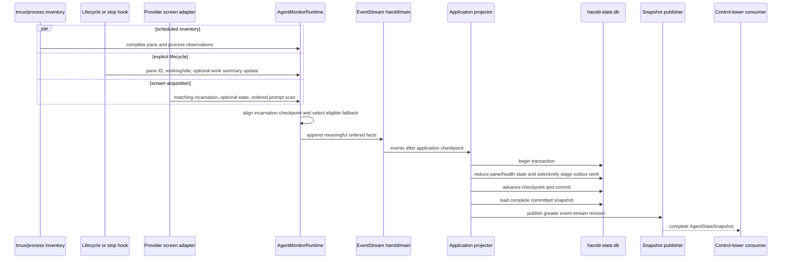
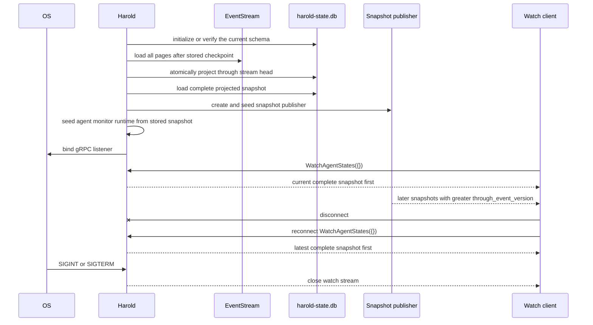

# Agent Monitor Reference

The agent monitor discovers configured agent processes in tmux panes or Rex blocks (the setting `[agent_monitor] multiplexer`), records lifecycle and provider-screen observations, projects current pane state, and serves complete snapshots over gRPC.

## Problem

A pane name does not answer whether its current agent process is working, idle, or newly replaced. Operators need concrete answers to questions such as: which process does this row describe, which input wins when a hook and the terminal disagree, what survives a restart, and what does a reconnecting consumer receive? They also need those answers without storing terminal history or exposing raw pane content.

## Architecture

The agent monitor has one durable write path and one current-state projection path.

```text
┌──────────────────────────────┐
│ Acquisition adapters         │
└──────────────┬───────────────┘
               │ typed observations
               v
┌──────────────────────────────┐
│ AgentMonitorRuntime          │
└──────────────┬───────────────┘
               │ ordered append
               v
┌──────────────────────────────┐
│ EventStream: harold/main     │
└──────────────┬───────────────┘
               │ version order
               v
┌──────────────────────────────┐
│ Application projector        │
└──────────────┬───────────────┘
               │ atomic commit
               v
┌──────────────────────────────┐
│ harold-state.db              │
└──────────────┬───────────────┘
               │ complete snapshot
               v
┌──────────────────────────────┐
│ WatchAgentStates consumers   │
└──────────────────────────────┘
```

Inventory, screen capture, and lifecycle adapters produce typed inputs. `AgentMonitorRuntime` serializes agent-event decisions, deduplicates observations only after successful append, and revalidates departure. The application projector reads durable events in stream-version order and is the only writer of the current projection. The snapshot publisher distributes committed database state; it is not a second state store.

### Incarnation identity

Every pane-scoped agent event identifies the complete current agent incarnation:

| Field | Meaning |
| --- | --- |
| `pane_id` | The pane ID: a tmux pane, such as `%22`, or a Rex block, such as `block:01a18fe6-c4f7-7b52-a9f2-9682b5c097c7` |
| `pane_pid` | Long-lived pane-root process ID. A row for an agent on a Rex host carries the agent process ID on that host. |
| `agent_pid` | Selected configured agent process ID |
| `agent_started_at_ms` | OS-reported agent-process start time |
| `provider_id` | Named provider ID, or `unknown` for an ambiguous provider match |

Any change creates a new incarnation. A replacement begins at `Unknown` with no lifecycle state, screen state, explicit work summary, or fallback work summary. Events for a different incarnation remain in history but are ignored by the current projection.

## Interaction diagrams

### Observation, projection, and publication



### Startup, reconnect, and shutdown



## Durable event contract

Agent events use the existing ordered `harold/main` `EventStream`. Append batches are atomic at the event-stream boundary.

| Event | Durable fields | Projection effect |
| --- | --- | --- |
| `AgentPaneObserved` | Pane metadata, provider display data, full incarnation, observation time | Inserts or refreshes the matching pane. A new incarnation replaces the row and starts `Unknown` with empty evidence. |
| `AgentPaneDeparted` | Full incarnation, observation time | Removes the row only when the full incarnation still matches. |
| `AgentLifecycleObserved` | Full incarnation, `Working`/`Blocked`/`Done`/`Idle`/`Error`, adapter ID, `Unchanged`/`Clear`/`Set` work summary update, observation time | Updates matching hook evidence and explicit-summary candidate, and records the adapter ID as the pane's lifecycle adapter. A report that repeats the pane's state, from the same adapter, with an `Unchanged` work summary only restarts the report's grace. |
| `AgentScreenObserved` | Full incarnation, optional `Working`/`Blocked`/`Done`/`Idle`/`Error`, optional normalized fallback work summary, classifier ID (`tmux-visible-v1`, `rex-visible-v1` or `program_status`), observation time | Applies each present fact independently. An absent field preserves its candidate. A `program_status` observation has a state and no fallback work summary. |
| `AgentActivitySummaryGenerated` | Full incarnation, source basis version, activity summary, generation time | Sets a generated candidate only for the matching current incarnation and activity revision; does not change agent state or stage delivery. |
| `AgentMonitorHealthChanged` | Component, healthy/degraded flag, bounded reason code, observation time | Upserts health for the component. |
| `TtsMuteChanged` | `{muted}` | Upserts `settings.tts_muted`, advances the snapshot revision, and creates no delivery. |
| `MessagingPausedChanged` | `{paused}` | Upserts `settings.messaging_paused`, advances the snapshot revision, and creates no delivery. |
| `TurnCompleted` | Five turn-end update fields plus optional resolved incarnation and `Unchanged`/`Set` completion summary update | Always preserves turn-end update behavior. A matching resolved incarnation also supplies a non-destructive work summary update, and supplies `Done` evidence only while the pane has no lifecycle adapter. |

`ReportAgentState` resolves the current incarnation and appends `AgentPaneObserved` immediately before `AgentLifecycleObserved` in one batch. A resolved `TurnComplete` appends `AgentPaneObserved` immediately before `TurnCompleted`. An unresolved completion still appends `TurnCompleted` for a turn-end update but does not alter agent state.

Repeated inventory metadata and repeated captures of the same screen evidence do not append events. A screen event is appended when its state changes or the acquisition checkpoint proves a new eligible submitted occurrence. That occurrence can repeat the previous instruction text. State and work summary do not both need to be present.

## Reconciliation contract

### State

1. Inventory owns presence. A pane is departed only after two complete successful scans omit it and a fresh lookup confirms the exact incarnation is no longer current.
2. A lifecycle observation supplies `Working`, `Blocked`, `Done`, `Idle` or `Error`, records its adapter as the pane's lifecycle adapter, and clears the prior screen-state epoch. It does not clear a `program_status` record that refines it (rules 3 to 5): only the next record replaces that record. A new incarnation starts with no lifecycle adapter.
3. A turn-complete supplies `Done` only for a pane with no lifecycle adapter. That state wins during `agent_monitor.hook_grace_ms` (2 seconds); at or after it, a conclusive screen observation can replace it. Inside the grace, an `Error` record of the agent's pid refines the `Done`: the agent is `Error`.
4. For a pane with a lifecycle adapter, a `Working` or `Blocked` report wins while it is under `agent_monitor.report_grace_ms` (30 seconds) old. Each repeated report restarts that period. At or after it, a conclusive screen observation replaces the report until the adapter reports again. Inside the grace, a `Blocked` record of the agent's pid refines a `Working` report: the agent is `Blocked`. Any other record still loses to the report until the grace ends.
5. For a pane with a lifecycle adapter, a `Done`, `Idle` or `Error` report wins with no repeats. When the screen has read `Working` for `agent_monitor.report_grace_ms` without a break, the screen observation replaces the report until the adapter reports again. A `Done`, `Idle` or `Error` reading and an inconclusive reading both break the run (any reading that is not `Working` or `Blocked` does); a failed capture does not. An `Error` record of the agent's pid refines a `Done` or `Idle` report at once: the agent is `Error`.
6. Within one visible grid, a matching working clause wins over a matching idle clause.
7. Inconclusive screen state preserves existing evidence. With no conclusive lifecycle or screen evidence, effective state is `Unknown`.
8. `last_transition_at_ms` changes only when effective state changes.

The projection changes only when an event is stored, so each period ends at a screen sample, not on a timer. The runtime holds a conflicting screen state back as an acquisition result and appends it at the first sample that meets rule 3, 4 or 5. Later identical samples are deduplicated within that lifecycle epoch. Work summary changes remain independent and can append during a grace period.

A record refines a report only when it is a `program_status` observation, because Harold makes that observation only for a record of the agent's pid. A screen reading refines nothing. For a working report, when the record changes to a state that does not refine the report, the runtime appends it at once, and the report decides again. For a done or idle report, the runtime holds the reading back. The hook report decides until the record has read working for the whole grace without a break. The grace is `agent_monitor.report_grace_ms` (30 seconds) for a pane with a lifecycle adapter. It is `agent_monitor.hook_grace_ms` (2 seconds) for a pane with no adapter, where a turn-complete supplies the `Done`. A reading that is not working breaks the run, and it waits until the grace ends.

One reduction (`reduce_state` in `harold/src/agent/reducer.rs`) gives the agent's state from the report and the screen evidence. The projection and the `agent blocked long` timer use it, so the timer fires only for an agent that the control-tower shows as `BLOCKED`.

The Claude Code mod reports `Working` every 10 seconds while a pane works, so its report stays under 30 seconds old unless three reports in a row are lost.

A `program_status` observation is a conclusive screen observation. It follows rules 3 to 7 in the place of a screen read. It takes the state of the program status record of the block, and each of the five record words gives the state with the same name. In rules 3 to 7, "working" means `Working` or `Blocked`, and "idle" means `Done`, `Idle` or `Error`. Rule 4 therefore applies to a `Working` or `Blocked` report, and rule 5 applies to a `Done`, `Idle` or `Error` report. A record counts only when its `owner.pid` is the agent's pid. With no usable record of the agent, Harold sends no `program_status` observation and reads the screen.

The record is the fourth source of evidence, next to the process inventory, the hooks and the screen adapters. Events are only triggers. Harold starts one `rex events` child process for each Rex session. A `program_status_changed` or `program_status_removed` event for a block causes one `program_status` call, and the answer of the call replaces the record of the block. Harold runs at most one call for each block at a time. When a call fails, Harold drops the record of the block. The next sample then makes one direct `program_status` call, and reads the screen only if that call also fails.

The `msg` of a record is the current step of the agent. Harold keeps it in memory only, and sends it only on `WatchAgentStates`, as `current_step`. It is not a source of work summaries, and a new `msg` is not new activity.

Harold keeps these facts about the state words:

- An old `Busy` event still reads as `Working`. Harold writes `Working` from now on.
- Stage 3 writes the event words `Blocked`, `Done` and `Error`. A Harold of stage 1 or 2 reads each of them as `Unknown` for a state, and as no observation for a screen read.
- The turn end from the hooks (`TurnComplete`) gives `Done`. It gave `Idle` before stage 3.
- A pane that stays `Blocked` for 15 minutes gives one log line, `agent blocked long` (`pane_id`, `provider_id`), for each blocked spell. The timer starts at the `observed_at_ms` of the first `blocked` record and restarts after a restart of Harold. A record that reads any other state clears the timer. A hook report does not clear it. The line comes only while the state is `Blocked`. An agent without a record keeps the old rule: the timer starts at the first sample that shows `Blocked` and clears at any sample that does not. The alert `agent-blocked-long` reads this line.
- An unknown state word in an event reads as `Unknown` for a state and as no observation for a screen read.
- An installed OpenCode plugin may send the old name `AGENT_STATE_BUSY`. The proto keeps it as an alias of `AGENT_STATE_WORKING`, so both names mean number 1.
- An older Harold cannot read the events that this Harold writes.

### Work summaries

Harold keeps an explicit candidate and a provider-screen candidate for each incarnation, with durable internal observation timestamps. The most recently observed substantive source candidate is selected, with explicit winning an equal-timestamp tie. When enabled, a valid generated activity description takes precedence for the same source revision. A new incarnation starts without any candidate. See [AI activity summaries](activity-summaries.md) for generation, fallback, and configuration.

| Input | Value | Explicit-summary effect |
| --- | --- | --- |
| `ReportAgentState.work_summary` | Absent | Preserve (`Unchanged`) |
| `ReportAgentState.work_summary` | Present, normalizes to empty | Clear explicit candidate; reveal fallback if one exists |
| `ReportAgentState.work_summary` | Present, normalizes non-empty and is not an exact configured idle placeholder | Set explicit candidate |
| `ReportAgentState.work_summary` | Exact normalized configured idle placeholder | Preserve (`Unchanged`) before event serialization |
| `TurnComplete.last_user_prompt` | Normalizes to empty | Preserve (`Unchanged`) because this proto3 scalar does not distinguish absent from empty |
| `TurnComplete.last_user_prompt` | Normalizes non-empty and is not an exact configured idle placeholder | Set explicit candidate when the completion resolves to the current incarnation |
| `TurnComplete.last_user_prompt` | Exact normalized configured idle placeholder | Clear the raw prompt and preserve (`Unchanged`) before event serialization |
| Provider-screen fallback | Inconclusive or no new submitted occurrence | Preserve prior fallback |
| Provider-screen fallback | Newly acquired substantive submitted occurrence | Replace the screen candidate and advance the activity revision, even for repeated text; it becomes the source fallback when newer than the explicit candidate |

All work summary inputs pass through the same terminal sanitizer. It removes C0 and C1 controls and complete ESC control sequences, collapses Unicode whitespace to single spaces, trims the result, and truncates it to 160 Unicode scalar values. Screen acquisition and the runtime defense reject only exact equality with a normalized configured idle fragment; a substantive prompt that merely mentions the placeholder remains valid. A conclusive state from the same observation remains usable, and placeholder/absence does not refresh or clear the prior screen candidate.

Lifecycle and completion input use only the matching provider's idle fragments when the incarnation names a currently configured provider. If the provider ID is missing, `unknown`, or no longer configured, Harold compares against every configured provider's fragments. An exact match becomes `Unchanged` before event serialization; completion also clears the raw prompt. Another provider's placeholder remains legitimate for a known provider, and text that merely contains a placeholder remains substantive. For example, `Explain why the UI says Ask Codex to do anything` is a valid instruction.

Placeholder rules apply when observations arrive. Changing the configuration does not retroactively change stored work summaries.

The public API exposes one optional effective work summary. When it is absent, the control-tower—not Harold—owns the exact display copy `No work summary reported`.

## Projection and storage

A fresh installation creates `<store.path>/harold-state.db` from one migration, `001_initial.sql`, which defines every table. Its checksum is recorded in `_migrations` and verified on subsequent opens. The application tables are:

| Table | Contents |
| --- | --- |
| `last_processed_event` | Last event-stream version processed for each namespace and partition |
| `delivery_outbox` | Pending and completed external delivery work, including retry state |
| `agent_panes` | Pane/display metadata, full incarnation, hook and screen evidence, the lifecycle adapter that last reported (`lifecycle_adapter_id`, empty until one does), explicit and fallback work summary candidates with internal timestamps, effective state/work summary, last transition, and last event version |
| `agent_monitor_health` | Component, healthy flag, bounded reason code, observation time, and last event version |
| `settings` | Key/value application settings; currently `tts_muted`, written by `TtsMuteChanged`, and `messaging_paused`, written by `MessagingPausedChanged` |

`agent_panes` includes `summary_basis_version`, `generated_work_summary`, and `generated_summary_basis_version` from creation. These keep an activity summary tied to its source revision while preserving the original source candidates. Migration `006_agent_states.sql` rebuilds `agent_panes` with the six-state rules. It changes each stored `busy` row to `working`. A stored `idle` or `unknown` row stays as it is. A store whose recorded migrations differ from this build's is rejected at start; Harold does not convert or reset it. A store made by v0.3.1 or earlier is such a store: install with `./scripts/install.sh --reinstall`, which archives the old data and starts a fresh store with voice not muted, messaging not paused and no panes.

The state database uses WAL mode, `synchronous = NORMAL`, and a five-second busy timeout. For each projection batch, Harold opens one immediate transaction, applies agent rows, stages only externally deliverable events, advances `last_processed_event`, and commits. An error rolls the whole transaction back.

Only `TurnCompleted`, `InboundMessageReceived`, and unknown event types are staged in the delivery outbox. Agent observation, generated-summary, and agent-monitor-health events are projection-only. Unknown event types remain visible to the existing permanent-delivery failure path instead of being silently skipped.

After commit, Harold loads the checkpoint, health, and panes with one query and publishes the complete snapshot if its `through_event_version` is greater than the in-memory revision. A revision can advance because of a non-agent event while pane content remains unchanged.

## gRPC contract

The canonical schema is `harold-api/proto/harold.proto`. The service exposes exactly these methods:

| Method | Request | Response semantics |
| --- | --- | --- |
| `TurnComplete` | Existing five scalar fields: `pane_id = 1`, `pane_label = 2`, `last_user_prompt = 3`, `assistant_message = 4`, `main_context = 5` | Unary `accepted = true` after durable append. Existing field numbers are unchanged. |
| `ReportAgentState` | `pane_id = 1`, `state = 2`, `adapter_id = 3`, `optional work_summary = 4` | Unary `accepted = true` after the pane-plus-lifecycle batch is durably appended. Projection may follow asynchronously. |
| `WatchAgentStates` | Empty request | Server stream whose first message is the complete current snapshot, followed by complete snapshots at greater revisions. There is nothing to replay from; a client reconnects and gets the latest complete snapshot. |
| `SetTtsMuted` | `muted = 1` | Unary; responds with the requested `muted` value after the `TtsMuteChanged` event is durably appended, or immediately when the value is unchanged. The new value is visible in a later snapshot. See [Notification](../notification/README.md#muting-voice). |
| `SetMessagingPaused` | `paused = 1` | Unary; responds with the requested `paused` value after the `MessagingPausedChanged` event is durably appended, or immediately when both the published snapshot and the in-process switch already hold that value. The away channel stops or resumes as soon as the event is appended; the new value is visible in a later snapshot. See [Operation](../operation/README.md#pausing-messaging). |
| `GetHaroldState` | Empty request | Unary and read-only; responds with the Harold state in `GetHaroldStateResponse`. See [GetHaroldState](#getharoldstate). An older Harold answers `Unimplemented`. |
| `GetRemoteOrder` | Empty request | Unary and read-only; responds with the product names in the remote order. See the [remote control reference](../control-tower/remote-control-rex-calls.md#the-harold-calls). |
| `SetRemoteOrder` | `products = 1` | Unary; saves the product names as the new remote order in `remote-order.json`. It is not read-only. See the [remote control reference](../control-tower/remote-control-rex-calls.md#the-harold-calls). |

`AgentStateSnapshot.tts_muted` is a plain proto3 `bool`. Proto3 does not write a `false` scalar on the wire, so a client such as `grpcurl` omits it unless it uses `-emit-defaults`. An absent `tts_muted` means `false`: the voice mute is off. To read the voice mute without this rule, run `harold get voice`. It calls `GetHaroldState`, which always writes both flags.

`harold get voice` and `harold get messaging` read the published agent snapshot. For about 20 ms after a switch changes, they can still show the old value. A caller that has just changed a switch must wait a short time and read it again.

`ReportAgentState.state` accepts `AGENT_STATE_WORKING`, `AGENT_STATE_BLOCKED`, `AGENT_STATE_DONE`, `AGENT_STATE_IDLE` and `AGENT_STATE_ERROR`. The old name `AGENT_STATE_BUSY` stays readable as a wire-name alias of `AGENT_STATE_WORKING` for installed plugins. Pane IDs have the tmux `%` plus decimal-digits form or the Rex `block:` plus block ID form. With `multiplexer = "rex"`, Harold refuses a `%` pane ID in a message or a spoken line, and with `"tmux"` it refuses a `block:` pane ID. A hook report from a pane of the other multiplexer is dropped without an error. Adapter and configured provider IDs match `[a-z0-9][a-z0-9._-]{0,63}`; provider ID `unknown` is reserved.

### `GetHaroldState`

`GetHaroldState` reports what Harold holds now. It does not copy the config file. It uses the same loopback listener as every other call. Each field has its own number, and the field list is pinned by a contract test.

| Field | Type | Meaning |
| --- | --- | --- |
| `tts_muted = 1` | `optional bool` | Whether the voice mute is on now |
| `messaging_paused = 2` | `optional bool` | Whether the messaging pause is on now |
| `release_version = 3` | `string` | Harold's release version (`source` for a source build) |
| `machine_name = 4` | `string` | The machine name of this machine |
| `multiplexer = 5` | `string` | `tmux` or `rex` |
| `rex_hosts = 6` | repeated `RexHostIcon` | One entry for each label in `[agent_monitor] rex_hosts` |
| `machine_host_icon = 7` | `string` | The host icon of this machine's `machine_name`; empty with none |
| `tts_engine = 8` | `string` | `server` or `command` |
| `chief_session = 9` | `string` | `notify.chief_session`; empty with none |

`RexHostIcon` holds `label = 1` and `host_icon = 2`. The host icon is empty when the label has no entry in `[agent_monitor.rex_host_marks]`.

The two flags are `optional`, so Harold writes them on the wire also when they are `false`. Harold always sets both. The answer never holds a token, key, pairing code, HyperDX key, phone number, iMessage recipient, TTS command line or path.

### `AgentStateSnapshot`

| Field | Type | Meaning |
| --- | --- | --- |
| `through_event_version = 1` | `uint64` | Highest durable event version included in the projection |
| `server_time_ms = 2` | `int64` | Snapshot load time |
| `monitor_health = 3` | repeated `AgentMonitorHealth` | Current component health |
| `panes = 4` | repeated `AgentPaneState` | Current live agent incarnations |
| `tts_muted = 5` | `bool` | Whether at-desk TTS is muted |
| `messaging_paused = 6` | `bool` | Whether away-channel messaging (iMessage, both directions) is paused |
| `harold_version = 7` | `string` | Harold's release version (`source` for a source build); empty when unknown |

`AgentMonitorHealth` contains `component = 1`, `state = 2`, `reason_code = 3`, and `observed_at_ms = 4`.

`AgentPaneState` contains:

| Field | Number | Type |
| --- | ---: | --- |
| `pane_id` | 1 | `string` |
| `tmux_target` | 2 | `string` |
| `session_name` | 3 | `string` |
| `window_index` | 4 | `uint32` |
| `pane_index` | 5 | `uint32` |
| `pane_pid` | 6 | `uint32` |
| `agent_pid` | 7 | `uint32` |
| `agent_started_at_ms` | 8 | `int64` |
| `provider_id` | 9 | `string` |
| `provider_display_name` | 10 | `string` |
| `working_directory` | 11 | `string` |
| `state` | 12 | `AgentState` (`Working`, `Blocked`, `Done`, `Idle`, `Error`, or `Unknown`) |
| `last_transition_at_ms` | 13 | `int64` |
| `work_summary` | 14 | `optional string` |
| `host` | 18 | `string`: the Rex host label, empty for this Mac |
| `host_icon` | 19 | `string`: the host's mark name, empty for this Mac and for a host with no icon |
| `window_name` | 20 | `string`: the name of the window that holds the pane, empty when the window has no name |
| `role` | 21 | `string`: `chief`, `coordinator` or `pnem`, empty for any other agent |
| `pod_product` | 22 | `string`: the product whose pod holds the pane, empty for any other agent |

`role` and `pod_product` come from the chief lookup and from each product's `agent-panes` file, and they are in memory only. See the [remote control reference](../control-tower/remote-control-rex-calls.md#the-harold-calls). An older control-tower skips both fields.

`window_name` comes from the `label` of the window in Rex's `session.view` (not the label of a pane), or from the tmux format field `#{window_name}`. It is in memory only: no event and no schema holds it. An older control-tower skips the field.

The pane message does not expose adapter IDs, classifier IDs, evidence provenance, raw screen text, internal work summary timestamps, or search behavior. The service has no search RPC or query field. Consumers perform search locally over the snapshots they already hold.

### RPC failure statuses

| Condition | Status |
| --- | --- |
| `ReportAgentState` has an invalid/unknown state, malformed pane ID, or malformed adapter ID | `INVALID_ARGUMENT` |
| The pane does not resolve to a live configured agent incarnation | `FAILED_PRECONDITION` |
| Inventory acquisition, durable append, or agent monitor runtime is unavailable | `UNAVAILABLE` |
| `TurnComplete` durable append fails | `INTERNAL` |

## Configuration

Optional Claude activity summary generation is configured separately under `[activity_summary]`; see the [complete settings reference](activity-summaries.md#configuration).

Default agent monitor configuration, from `harold/config/default.toml`:

```toml
[agent_monitor]
inventory_interval_ms = 2000
inventory_timeout_ms = 3000
screen_interval_ms = 2000
hook_grace_ms = 2000
report_grace_ms = 30000
host_unknown_after_ms = 180000

[[agents]]
id = "codex"
display_name = "Codex"
command_contains = ["codex"]
busy_all = ["Working", "esc to interrupt"]
idle_all = ["Ask Codex to do anything"]
summary_line_prefixes = ["›"]
screen_adapter = "codex-v1"
screen_history_lines = 2000
```

| Key | Constraint and behavior |
| --- | --- |
| `agent_monitor.inventory_interval_ms` | Positive integer; scheduled inventory period, default 2000 |
| `agent_monitor.inventory_timeout_ms` | Positive integer; inventory scan/resolve deadline in milliseconds, default 3000; the next tick's scan retries a failed one with the same deadline |
| `agent_monitor.screen_interval_ms` | Positive integer; scheduled visible-screen period, default 2000 |
| `agent_monitor.hook_grace_ms` | Non-negative; how long a turn-complete's `Done` state wins over the screen for a pane with no lifecycle adapter |
| `agent_monitor.multiplexer` | `"tmux"` (the default) or `"rex"`; the one multiplexer Harold works with. Harold reads it once, at start. Any other value stops Harold at start with `agent_monitor.multiplexer must be "tmux" or "rex"` |
| `agent_monitor.rex` | Optional path to the `rex` program. When it is not set, Harold tries the running server's own copy (`~/Library/Application Support/com.superlogical.rex/RexServer/Versions/Current/Rex Server.app/Contents/MacOS/rex`), then `rex` on the `PATH`, then `/Applications/Rex*.app/Contents/Helpers/Rex Server.rex/Contents/MacOS/rex` |
| `agent_monitor.report_grace_ms` | Non-negative, default 30000; how old a lifecycle adapter's `Working` report can be before the screen decides, and how long the screen must read `Working` without a break to replace an at-rest report (done, idle or error) |
| `agent_monitor.host_unknown_after_ms` | Non-negative, default 180000 (3 minutes); how long the agents of a Rex host that Harold cannot read keep their last state, counted from the last good read, before they show `unknown`. The same time applies to a block whose `process` call fails. `0` shows `unknown` at the first failed read |
| `agents[].id` | Unique bounded identifier; `unknown` is reserved |
| `agents[].display_name` | Non-empty display label |
| `agents[].command_contains` | At least one non-empty fragment; any fragment matches case-insensitively against the process's program, not its whole command line. The program is the file name of the `ps` command's first word; when that is `node`, `bun`, `deno`, `python` or `python3`, it is the file name of the second word instead |
| `agents[].busy_all` | Optional conjunctive, case-sensitive visible-grid fragments |
| `agents[].idle_all` | Optional conjunctive, case-sensitive visible-grid fragments and idle-placeholder rejection clauses |
| `agents[].summary_line_prefixes` | Optional exact, case-sensitive safe submitted-input prefixes for `generic-v1`; `codex-v1` recognizes its own styled `>` and `›` blocks |
| `agents[].screen_adapter` | `generic-v1` when omitted; accepts `generic-v1`, `codex-v1`, or `claude-v1`; unknown names fail startup |
| `agents[].idle_after_working` | `idle` when omitted; accepts `idle` or `done`; unknown values fail startup. With `done`, an agent on a Rex host whose record goes from working or blocked to idle with the same pid shows done. The shipped OpenCode entry sets `done`, because OpenCode reports idle at the end of a turn |
| `agents[].screen_history_lines` | Integer from 1 through 10,000; defaults to 2,000 history rows before the visible grid |

The defaults above are the ones in `harold/config/default.toml`, and that file decides them. Harold will not start without it, and it sets every `[agent_monitor]` key, so the fallback values built into `AgentMonitorSettings` in `harold/src/settings.rs` (1,000 ms inventory and 500 ms screen intervals) apply only to a key the file leaves out.

Tmux pane inventory uses tab-separated fields and explicitly requests UTF-8 output (`tmux -u`), so output framing does not depend on the daemon’s locale. Rows must contain exactly seven fields; embedded tabs are rejected as malformed rather than guessing their meaning.

### Rex

With `multiplexer = "rex"`, each inventory tick runs `rex ls --json --autostart=false`, then `session.view` for each session, then `rex block call … process` for each terminal block. `rex ls` runs alone. The `session.view` calls run in a pool of at most 8, and the `process` calls run in a pool of at most 8. When a call ends, the next call starts at once, so a slow call holds only its own place. Each step takes about the time of its slowest call. The label is `<session label>:<window>.<pane>`, with both numbers counted from 1 in the order `session.view` lists them. Harold looks for the agent in the foreground program first, then in `ancestors` (nearest parent first), and stops at the block's first process (`child`). The program is the file name of `argv0`; when `argv0` is an interpreter, it is the file name of `script`. A new agent pid gets one `ps -o lstart= -p <pid>` read. When more than one agent is new in a scan, these `ps` reads run in a pool of the same width.

A Rex screen read is a tail read: the block method `format` (with `max_bytes` = 1) gives the length of the output and an id, and `blob_read` with that id reads the last bytes (the screen's rows × columns × 4, at least 64 KiB) until `eof`. Harold drops the first line of a cut tail and keeps as many lines as the block has rows. The classifier id is `rex-visible-v1`. A read over 500 ms logs `agent screen read slow`.

A Rex call that fails or takes more than 3 seconds fails the listing, and the snapshot keeps its panes. The `agent monitor degraded` line then has `reason` = `rex_failed`, `rex_timeout` or `rex_absent` (no `rex` program, or no Rex server runs). Typing uses a paste event (`block.event`) for the text and `rex send-key` for Enter and single keys.

Process selection looks only at processes whose program matches a fragment, so `nvim CLAUDE.md` or a script under `~/.claude/` is not an agent, and a provider comes from the program alone. A pane with no agent program is never in the snapshot: `Unknown` is only an agent's state. Among matching processes, it prefers a matching process in the pane TTY's foreground process group. Otherwise it selects the shallowest matching descendant of the pane root, with PID as a deterministic tie-breaker. Multiple named provider matches produce provider `unknown` rather than choosing configuration order. Missing trustworthy process start time degrades inventory and does not create an incarnation.

The shipped named defaults cover Codex, Claude, and OpenCode state markers. Codex explicitly selects `codex-v1`. Claude explicitly selects `claude-v1`, which recognizes its running status row and otherwise behaves as `generic-v1` with its configured work summary prefix; it has no Claude-specific styled prompt parser. OpenCode uses `generic-v1` without `summary_line_prefixes`, so screen acquisition supplies state but no fallback work summary. Its opt-in lifecycle plugin can still send explicit work summaries. The `screen_adapter` setting defaults to `generic-v1`; selecting a provider ID alone does not select a parser.

See [provider screen adapters](screen-adapters.md) for capture timing, incarnation baselines, prompt selection, and provider limitations.

## Agents on Rex hosts

Some agents run on another machine, in a pane of that machine's Rex server. This section describes how Harold shows them. Harold shows each one in the control-tower and does nothing else with it.

### The setting

The setting `[agent_monitor] rex_hosts` is a list of host labels. A label is a name that this Mac's Rex knows for another Rex server, such as `omarchy`. `rex hosts list` lists the labels. The shipped list is empty.

- Each label has 1 to 32 letters, digits, `.` or `-`. A label that repeats is an error.
- The list needs `multiplexer = "rex"`. With `multiplexer = "tmux"`, a list that is not empty stops Harold at start.
- `[agent_monitor.rex_host_marks]` is the only source of host marks. It gives a host a mark: `"arch"`, `"linux"` or `"mac"`. A key is a label in `rex_hosts` or the `machine_name` of Harold's own machine. The `machine_name` key matches without case. A host with no entry has no mark. Harold does not read the icon that Rex keeps for a host.
- Harold refuses a key that names neither a label in `rex_hosts` nor `machine_name`. It also refuses a label in `rex_hosts` that equals `machine_name`, without case.
- `[control_tower] host_marker` picks how the control-tower draws the mark: `"glyph"` (the default), `"emoji"` or `"text"`.

### The pane id forms

A pane id has three forms.

| Where the pane is | Form | Example |
| --- | --- | --- |
| This Mac, tmux | `%<n>` | `%47` |
| This Mac, Rex | `block:<id>` | `block:01a1955f-74fd-7e5f-b71b-99ed90790ae0` |
| A Rex host | `rex:<label>/block:<id>` | `rex:omarchy/block:01a19080-9102-7989-944c-5dcb46fb894c` |

The first two forms are the local forms, and they mean this Mac. The third form is the host pane id. The label in it is the exact value that Harold passes to `rex -S`.

### Read-only

Harold only reads on a Rex host. It types nothing there, and it reads no screen and no transcript there. It keeps the agents of the Rex hosts in memory. They are not in `AgentSnapshot`, the reducer or the store. A Harold restart, or a renamed label, starts their incarnations again.

### The route that takes only local forms

Every writer calls `pane_route::route_pane(pane_id)` before it acts. The route looks at the shape of the id and reads no map and no setting.

| Pane id | Result |
| --- | --- |
| A valid `%<n>` | tmux |
| A valid `block:<id>` | Rex |
| A host pane id | Refused, with the reason `on_rex_host` |
| Any other id | Refused, with the reason `invalid_pane_id` |

The route runs before any lock, log line, `tmux` call or `rex` call. `rex::find_session` checks the id again and returns no session for an id that is not a valid `block:<id>`. The daemon's entry points also refuse a host pane id: `turn_complete` drops the report, and `send_message_to_away_device` and `speak_line` refuse it as `src_id`.

### When a host is offline

The Mac's own scan never waits for a Rex host. Each host has its own task, and each call has a 2-second limit. The host's `session.view`, `process` and `program_status` calls each run in a pool of at most 8, so a slow call holds only its own place. One read of a host has a limit of 10 seconds. A read is a scan of the host, and a scan fails when a call to list the slots fails, when no block answers its `process` call, or when the scan passes its 10-second limit. A failed status call does not fail the scan. After 3 failed reads in a row, Harold tries that host only every 30 seconds. While a host is offline, its agents keep their last state for about `host_unknown_after_ms`, then show `unknown`. Harold checks the time at a failed read, so the change can come up to about 40 seconds late. A block whose `process` call fails keeps its row for the same time. A host that never answered has no agents. When two labels in `rex_hosts` lead to one Rex server (the same `host_id`), Harold keeps the first label and leaves out the later one. Harold also reads the `host_id` of this Mac's own Rex server once, with `rex whoami --json`. A label that has this `host_id` is left out and logs a warning. If that read fails, Harold leaves out no label for this reason. Harold calls `whoami --json` on a host again only 30 seconds after a failed call, so an older Rex without it gets few calls.

### Grouping

The control-tower puts an agent on a Rex host in the group of the first word of its session name, as it does for every agent. A worker on omarchy and a worker on this Mac that belong to the same pod share one group. The [control-tower README](../../../control-tower/README.md#agents-on-other-rex-hosts) describes the WHERE column and the host marker.

### What a worker on omarchy has before the Linux Harold

Such a worker has its state and its current step in the control-tower, in the group of its pod. It has none of the following:

- turn-end updates
- questions on the user's phone
- Harold's typing rules for the lines it receives
- recaps

The chief's tools carry its lines with `rex send` and `pod say`. Typing into a Rex host from Harold waits for a Harold on that host.

## Metrics

The agent monitor sends eight metrics to the collector when export is on. The [telemetry reference](../telemetry/README.md#metrics) gives their units and buckets. The attribute `multiplexer` is `rex` or `tmux`, from `[agent_monitor] multiplexer`. The attribute `host` is the empty string for Harold's own machine. For an agent on a Rex host, and for the calls to that host, `host` is the host label from `rex_hosts`. At start, Harold records 0 on the `list` failure series (`failed`, `timeout`, `absent` and `malformed`) for each label. The metrics hold no screen, no transcript and no text of a line.

| Metric | What it shows | Attributes |
|---|---|---|
| `harold.multiplexer.calls` | The multiplexer calls, a count | `multiplexer`, `host`, `operation`, `outcome`, `purpose` (on `screen_read` only) |
| `harold.multiplexer.call.duration` | The time of each multiplexer call, in ms | `multiplexer`, `host`, `operation`, `outcome`, `purpose` (on `screen_read` only) |
| `harold.agents` | The agents in the snapshot, read at each export | `state`, `provider_id`, `multiplexer`, `host` |
| `harold.agent.state.duration` | The time an agent spent in the state it left, in s | `state`, `provider_id`, `multiplexer`, `host` |
| `harold.agent.state_observed` | The state observations, a count. `source` is `program_status` (a running stream), `program_status_call` (a direct call) or `screen`. `state` is `unknown` when the observation has no state | `source`, `state`, `provider_id`, `multiplexer` |
| `harold.agent.recap_read` | The transcript reads, a count. `result` is `found` (a new recap), `none` (new lines with no new recap) or `failed` | `result`, `provider_id` |
| `harold.multiplexer.sessions` | The sessions in the last inventory listing that worked | `multiplexer`, `host` |
| `harold.multiplexer.panes` | The panes in the last inventory listing that worked, with or without an agent | `multiplexer`, `host` |

A multiplexer call is one request to the multiplexer. Each call has one `operation`, the same word for Rex and tmux:

| `operation` | Rex call | tmux call |
|---|---|---|
| `list` | `ls` | `list-panes -a` |
| `layout` | `api call session.view` | none |
| `process` | `block call process` | none |
| `screen_size` | `block call size` | none |
| `screen_read` | `block call format` and `blob_read` | `capture-pane` |
| `status` | `block call program_status` | none |
| `type` | `api call block.event` | `send-keys -l` |
| `key` | `send-key` | `send-keys` with a key |

A call that this table does not name is recorded as `other`. The calls of the control-tower are not recorded.

Each `screen_read` call also has a `purpose`, which tells why Harold reads the screen. No other operation has a `purpose`:

- `state`: the state observer reads the visible screen of a pane, because the pane has no usable status record.
- `prompt`: prompt recovery reads the history of a pane to find a submitted instruction that no hook reported.
- `writer`: a writer reads a screen before it types, for example the timed prompts and the input box checks.

Each screen read has exactly one `purpose`. `purpose` is a metric attribute only. No log line carries it. A host inventory makes no screen read, so `purpose` appears only with an empty `host`.

The `outcome` is one of five words:

- `ok`: the call worked.
- `failed`: the program ran and failed.
- `timeout`: Harold stopped the program at its limit.
- `absent`: there is no program, or no server.
- `malformed`: Harold cannot read the answer. A tmux call gives this outcome when its reply is not UTF-8 or Harold cannot parse it.

A listing that did not work is the operation `list` with the outcome `absent`, `failed` or `timeout`. The alert `multiplexer-calls-failing` reads the outcomes `failed`, `timeout` and `malformed`.

## Privacy and field bounds

The capture port invokes `tmux capture-pane` for an already identified pane. Visible classification starts at row `0`; conditional recovery preserves styles and starts at the negative configured history depth. Raw captures remain within the capture and adapter boundary and are not stored or logged, including on failure. Adapters return typed state and ordered prompt fingerprints with optional normalized candidates. The runtime retains only fingerprints in its ephemeral acquisition checkpoint and forwards at most one eligible work summary through the existing screen event.

Before durable append or publication, tmux-derived metadata is terminal-sanitized and bounded:

| Value | Maximum Unicode scalar values |
| --- | ---: |
| `session:window.pane` name, session name, provider display name | 256 |
| working directory | 1024 |
| work summary | 160 |
| health component | 64 ASCII identifier bytes |
| health reason code | 160 ASCII identifier bytes |

## Health and failure behavior

The public snapshot reports `inventory` and `screen` health after a component first degrades or subsequently changes/recoveries. Initial success does not create a health row. Repeated identical health is deduplicated.

| Reason code | Source |
| --- | --- |
| `command_unavailable` | Required inventory command is absent |
| `command_failed` | Inventory command exits unsuccessfully |
| `malformed_output` | Inventory output cannot be parsed completely |
| `missing_start_time` | A selected agent process lacks trustworthy start time |
| `capture_unavailable` | Screen-capture command is absent |
| `capture_failed` | Screen capture exits unsuccessfully |
| `pane_departed` | tmux no longer has the pane when its screen read fails. Not a degradation: the pane is skipped until the inventory departs it |
| `timeout` | Acquisition exceeded its deadline (inventory: configured timeout; screen: 500 ms, 2,000 ms on a retry). A screen `timeout` degrades the screen only after the same pane has been unread for 4 seconds |
| `task_failed` | The bounded acquisition worker could not start or return |
| `ok` | Recovery to healthy |

By default the agent monitor scans the inventory and reads each pane's screen every 2 seconds (`inventory_interval_ms`, `screen_interval_ms`). An inventory read that fails gets one retry, and only a retry that fails too degrades the inventory. A screen read follows its own rule, below.

An inventory scan that fails is retried by the next tick's scan, with the same `inventory_timeout_ms` deadline. A scan that times out is stopped, which kills its child command, and the tick keeps the last 50 ms of its deadline (a tenth of it at most) for that worker to let go of the inventory gate. So a tick's scan takes at most `inventory_timeout_ms`, retry or not. If the stopped scan is still running at the next tick, that tick finds the gate busy, and the retry counts as failed. This departs from the monitor-timeouts spec, which retries the scan at once with twice the deadline. Hook calls wait on the agent monitor's one background job, and `harold send-message-to-away-device` and `harold speak` wait for the agent monitor to resolve their pane before they store anything. Their clients give up after 3 seconds, and a scan retried at once could hold them for up to 9.

A pane's screen read is retried at once, with a 2,000 ms deadline (the capture command's own limit), fixed in the code. A first try still running is asked to stop, which kills its child command, and the retry waits within its own deadline for that worker to finish, so the two never run together. A retry that times out is stopped the same way. A first try that returns `busy` is not retried. A screen pass retries at most one read: after its first retry, whether that works or not, the remaining panes are read once each. Revalidating a departed pane, resolving a pane, and prompt recovery are not retried.

The screen is degraded by one pane at a time. Each tracked pane keeps the time of its first failed screen read since its last good one, with the reason of its last failure. A good screen read clears it. A failed prompt scan counts as a failed read in the same way, until a scan works. A scan that timed out is also cleared by the next good screen read. After each pass, the screen is degraded when one pane has failed with `timeout` for 4 seconds or more (two passes after the first failure, `SCREEN_DEGRADE_AFTER` in the code), or when one pane's last failure has any other reason. Otherwise the screen is healthy. A pane that times out once, and reads well on the next pass, changes no health. `busy` and `pane_departed` change nothing and start no count.

Hook calls (lifecycle reports, turn-completes, pane resolution) queue behind a tick. An inventory tick's scan holds them for at most `inventory_timeout_ms`, 3 seconds with the shipped settings. A screen pass's reads hold them for 500 ms per pane, plus at most one 2,000 ms retry. As on main, other steps of a tick add to that, each with its own deadline: a prompt baseline or prompt recovery for a pane (500 ms), and revalidating a pane missing from two scans (`inventory_timeout_ms`). A turn-complete for a pane that the last successful inventory scan found, at most two inventory intervals ago, is stored without its own scan. A turn-complete or lifecycle report whose client gives up meanwhile is still queued, applied and stored, and a turn-complete loses only its telemetry link. A call that needs its pane resolved before it stores anything fails and stores nothing: `harold send-message-to-away-device` and `harold speak` wait 3 seconds, then exit with an error.

A retry that works logs one info line, `agent monitor read retried`, with `component` (`inventory` or `screen`), `pane_id` for a screen read, and `elapsed_ms` from the first try's start to the retry's success. For the inventory, that spans the tick between them. It changes no health: there is no warning, and the agent monitor is not marked degraded. When the inventory's retry fails too, the inventory degrades with the retry's reason code. The screen degrades by the rule above. In both cases `agent monitor degraded` is logged at warning level; the next scheduled read tries again, and `agent monitor recovered` is logged when one works. The screen's `agent monitor degraded` line adds `pane_id`, the pane that tripped the rule, and `elapsed_ms`, the time since that pane's first failed read.

| Line | Fields |
|---|---|
| `agent monitor read retried` | `component` (`inventory` or `screen`), `pane_id` (for a screen read), `elapsed_ms` |
| `agent recap read failed` (info) | `pane_id`, `provider_id`, `reason` (`not_found`, `permission` or `io`); logged once for each path and reason |
| `agent recap read slow` (warn) | `pane_id`, `elapsed_ms`, `bytes`; logged when a transcript read takes over 200 ms |
| `agent monitor degraded` | `component`, `reason`, and for the screen `pane_id` and `elapsed_ms` |
| `agent monitor host` (info; warn for `local_host`) | `host`, the label; `state` (`reachable`, `unreachable` or `left_out`); `reason`, on `unreachable` (`timeout`, `failed` or `unknown_host`) and on `left_out` (`duplicate_host` or `local_host`). `duplicate_host` means an earlier label leads to the same server. `local_host` means the label leads to the Rex server on this Mac, so its agents would show twice. It is logged once for each change. |
| `agent status stream` (info) | `session.id`; `event` (`started`, `ended` or `call_failed`); `reason`, on `ended` (`exit`, `read_error` or `rex_absent`) and on `call_failed` (`timeout`, `failed`, `malformed` or `rex_absent`); `records`, the number of records the stream holds (on `started`, the number the first read found, so 0 for a session with no agent; the number dropped on `ended`; the number kept on `call_failed`). `started` is logged after the first read and has no `reason`. `call_failed` is logged once for each block until a call works. The line never holds a record's `msg`. |

A worker that does not stop causes later attempts to return internal `busy` without starting another worker or changing public health. A deadline miss remains `timeout` until a later acquisition succeeds. Degradation and recovery are logged on health transitions with component and reason code; process commands and screen content are excluded.

An inventory failure preserves current panes and never infers mass departure. A screen failure preserves lifecycle state and the prior fallback. Projector failures leave the checkpoint and projection unchanged and are retried by the event-handler loop. A schema initialization, startup catch-up, or snapshot-load error prevents Harold from becoming ready.

### Rex blocks that do not hold a live agent

An exited block is a Rex block whose program has exited. Rex keeps it, with its `last_exit`. The inventory treats it as a block with no agent. It adds no row and no error. An answer with neither `child` nor `last_exit` stays malformed. If an agent ran in the block, the agent departs.

An unreadable block is a block whose `process` answer failed, timed out or could not be read. The scan leaves that block out. It reads the other blocks. A call that Harold's stop signal ended is not unreadable and logs nothing.

| Line | Fields |
|---|---|
| `agent pane unreadable` (warn) | `pane_id`, `reason` (`failed`, `timeout` or `malformed`) |
| `agent pane readable again` (info) | `pane_id` |

Harold logs each line once for each change. A block that stays unreadable logs one `agent pane unreadable` line, not one for each scan. A host scan leaves an unreadable block out and writes no log line for it. It fails only when no block answered.

One unreadable block does not degrade the inventory. Two cases degrade it. In the first case, the listing (`ls` or `session.view`) fails. In the second case, the scan has at least one block and the `process` call fails for every block. The second case logs `agent monitor degraded` with `component = inventory`. The `reason` is the reason of the first error: `rex_failed`, `rex_timeout`, `rex_absent` or `malformed_output`. A scan with no blocks is not degraded. A degraded scan returns no old rows.

When the inventory is degraded, `harold speak` cannot find the pane of its caller. The daemon answers `unavailable`. The command prints `the agent lookup is not available now; try again`. The same line covers a failed event append and a stopped monitor runtime. A failed write of the line keeps `the Harold daemon could not store the spoken line`.

## Lifecycle limits

- `WatchAgentStates` is snapshot-then-stream, not replay from a checkpoint. Slow consumers may coalesce obsolete in-memory snapshots; reconnecting restores the latest complete state.
- Provider screen markers and styled parsing are version-sensitive. Inconclusive text is preserved as uncertainty; `codex-v1` and `claude-v1` each match one provider's rendering and guarantee nothing for another.
- History recovery is bounded and starts with a baseline that emits no existing prompt. Lost fingerprint overlap also establishes a new baseline without adopting its contents. These rules can leave late-attached or older work without a recovered work summary.
- Harold does not infer working or idle from CPU use, tmux window activity, or elapsed silence.
- Harold does not navigate tmux or Rex for the control-tower and does not implement the control-tower's filter.
- The Claude Code lifecycle mod (`hooks/claude-mod/`) reports turn start and end through `harold accept`; the installer loads it through `CLAUDE_CODE_PLUGIN_DIRS`, and agents without it rely on the screen reading.
- The OpenCode lifecycle plugin is opt-in and is not installed by `make deploy`; its screen provider has no fallback-summary prefix.
- The `TurnComplete` RPC is the turn-end update ingress. Empty prompts preserve work summaries and cannot explicitly clear them.

For operational registration and verification, see [Set up agent monitor hooks](../../how-tos/setup-agent-monitor-hooks.md). For rationale, see [Architecture: Harold](../../explanations/architecture.md).
