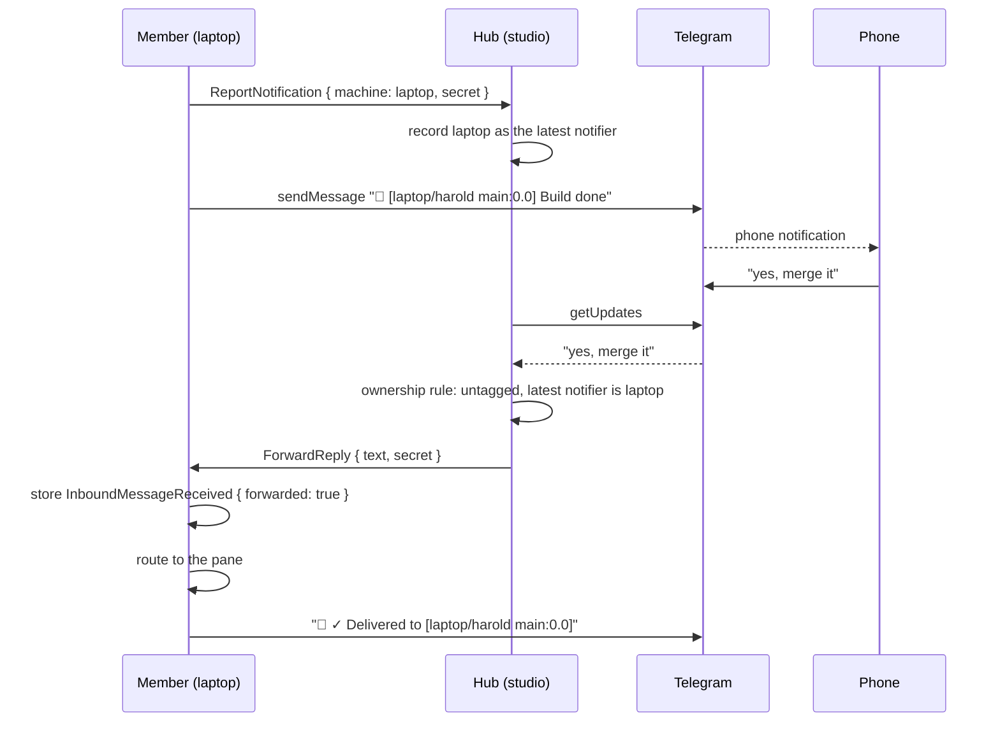
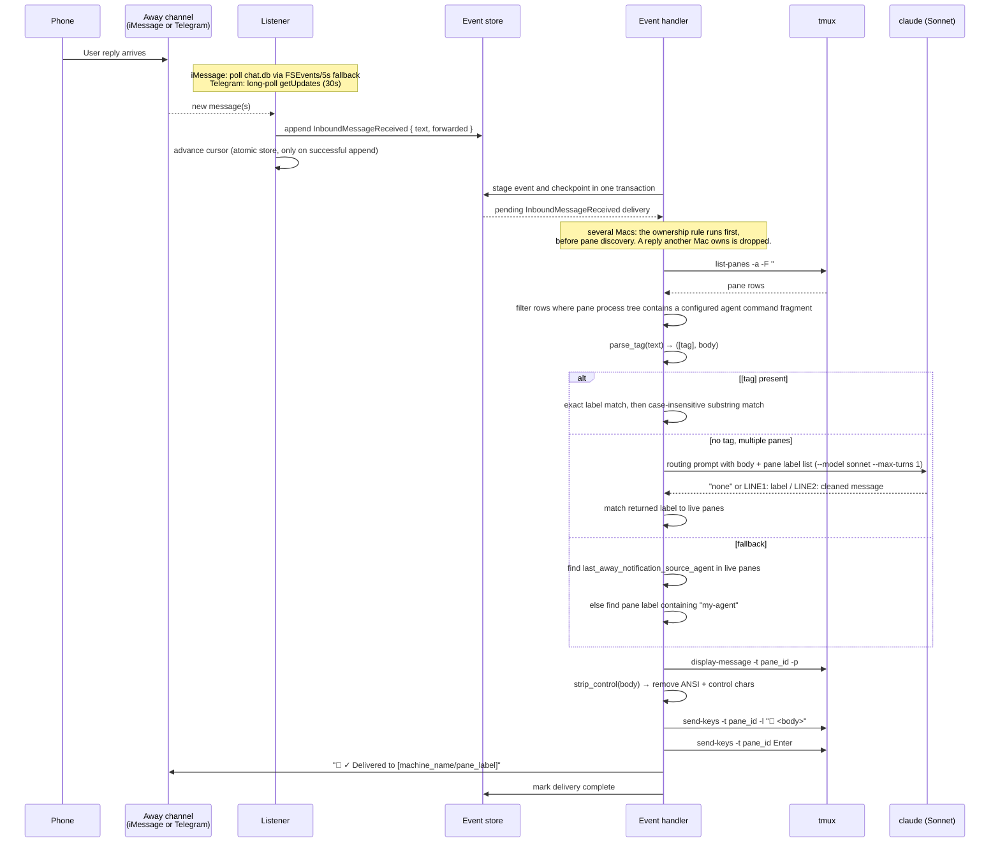

# Inbound Message Routing

Inbound message routing routes messages from your phone (via iMessage or Telegram, depending on the configured away channel) to the correct agent running in a tmux pane.

## Problem

Messaging from your phone means you know which agent you meant but the message arrives as plain text with no agent context. With multiple agents running, there is no obvious way to get your message to the right one.

## Architecture

Routing has two stages: inbound collection and routing resolution.

**Inbound collection** — The listener is channel-specific, selected by `[notify] away_channel`:

**iMessage** — Watches `chat.db` for filesystem changes (via FSEvents on macOS) and runs two separate queries on each change, each with its own ROWID cursor. A 5-second fallback poll ensures messages are still detected if the filesystem watcher is unavailable:

- **Inbound** — `handle_id IN (handle_ids) AND is_from_me = 0` — messages sent by the user from the recipient's device
- **Self** — `handle_id IN (handle_ids) AND is_from_me = 1` — the sent copy of a message the Mac sends to the user's own number, which includes replies typed in Messages on the Mac

Each cursor is advanced only after a successful `append_inbound_message`, so a crash before the append causes the message to be reprocessed on the next poll rather than skipped.

A reply typed in Messages on the Mac is stored as two rows with the same text, one matched by each query, so the listener records a row only once when both arrive: a row is skipped if a row with identical text from the other query was recorded within the last 10 seconds and has not already been matched this way. A skipped row still advances its cursor but appends no event. Two rows with the same text from the same query are both recorded (the user sent it twice), and rows discarded while messaging is paused are not remembered. Two limits are known: if the two copies are stored more than 10 seconds apart, or Harold restarts between them, the reply is routed twice.

**Telegram** — Long-polls the Telegram Bot API `getUpdates` endpoint (30s timeout). On startup, drains any pre-existing updates to avoid replaying old messages. Only messages from the configured `chat_id` are processed; messages starting with `🤖` (Harold's own messages) are filtered out. With [several Macs](#several-macs), only the hub calls `getUpdates`; a member starts no Telegram listener.

**Routing resolution** — Harold's event handler stages `InboundMessageReceived` events in its durable outbox and calls `route_inbound_message(text, forwarded)` in stream-version order. Live pane discovery runs at resolution time via `tmux list-panes -a`, then reads the process tree under each pane's `pane_pid`. A pane is considered an agent when the pane process or a descendant process command contains one of the configured `agents[].command_contains` fragments. Agents are addressed via the `AgentAddress` enum (currently only `TmuxPane { pane_id, label }`).

An `InboundMessageReceived` event carries two fields:

| Field | Type | Meaning |
|---|---|---|
| `text` | string | The reply as the user typed it, tag included. |
| `forwarded` | bool, `false` when absent | `true` means ownership was decided before the event was stored, so routing does not consult the latest notifier and never forwards the reply. |

The `ForwardReply` handler writes `forwarded = true`. The Telegram listener writes `forwarded = true` for every reply it keeps, because the hub decides ownership when it reads the reply. The iMessage listener writes `forwarded = false`, and routing decides. Events stored before the field existed read as `false`.

## Paused messaging

While messaging is paused (`SetMessagingPaused`, see [Operation](../operation/README.md#pausing-messaging)) nothing on this page happens:

- **Listeners** — fetched iMessage rows and Telegram updates still advance the ROWID cursors and the update offset, but no `InboundMessageReceived` event is appended. Messages that arrive while paused are discarded and are not replayed on resume.
- **Routing** — an `InboundMessageReceived` delivery that was already in the outbox is marked as an intentional skip before its payload is read. No pane is discovered, nothing is sent to tmux and no confirmation goes out.
- **Replies** — the confirmation and error replies described under [Delivery](#delivery) are not sent.

## Pane discovery

Harold currently recognizes a pane as an agent when the pane process or one of its descendants has a process command containing a configured fragment:

- Shipped `[[agents]]` providers match `codex`, `claude`, and `opencode` command fragments
- Claude Code example: tmux may report `pane_current_command` as a Node-version-like process, but the pane's descendant command includes `claude`
- Codex example: tmux may report `pane_current_command` as `codex-aarch64-a`, while the pane's descendant command includes `codex`

This is a process-name heuristic. Update `agents[].command_contains` if an agent binary name changes.

Pane label format: `<session_name>:<window_index>.<pane_index>` (e.g. `alir-app main:0.1`).

## Routing resolution

```
route_inbound_message(text, forwarded)
│
├─ decide_ownership(text, forwarded, …) → Owned { pane_tag, body } | NotOwned { owner }
│   ├─ NotOwned → return Skipped (another Mac owns the reply; no pane discovery)
│   └─ Owned → pane resolution below, with the tag and body from the ownership decision
│
├─ tag present?
│   ├─ exact match on pane label → use it
│   └─ substring match (case-insensitive) → use it
│       └─ no match → return None (error iMessage)
│
├─ no tag → semantic_resolve(body, panes)
│   ├─ only 1 pane → skip (returns None, falls through)
│   └─ multiple panes → AI CLI (Sonnet, --max-turns 1, disableAllHooks)
│       prompt asks: "does this message have EXPLICIT routing intent?"
│       ├─ response = "none" → return None
│       └─ response = LINE1: pane label / LINE2: cleaned message → match by label
│
├─ last_away_notification_source_agent → find AgentAddress in live panes
│
└─ my-agent fallback → find pane whose label contains "my-agent"
```

## Several Macs

When Harold runs on more than one Mac, a reply from your phone has to reach one agent on one Mac. Three things get in the way. On iMessage, every Mac signed into your Apple ID has its own copy of the reply in `chat.db`, so every Harold reads it. On Telegram, only one process can read the bot's replies, and that process may not be on the Mac that runs the agent you meant. And a pane label such as `alir-app main:0.1` can exist on two Macs, so the label alone does not say which Mac is meant.

### Example

Two Macs, `studio` and `laptop`, both run Harold.

1. At 10:00 an agent on `studio` finishes and Harold sends `🤖 [studio/alir-app main:0.1] Tests pass (…)`.
2. At 10:05 an agent on `laptop` finishes and Harold sends `🤖 [laptop/harold main:0.0] Build done (…)`.
3. You reply `yes, merge it` from your phone, with no tag.
4. Both Macs read the reply. The latest phone notification, the one sent last, names `laptop`. `laptop` routes the reply and `studio` drops it without a message.
5. You reply `[studio/alir-app main:0.1] revert that`. The tag names `studio`, so `studio` routes it and `laptop` drops it without a message.

The Mac that sent the latest phone notification is called the latest notifier.

### When it is on

Multi-Mac routing is on only when `machines` is set. `machines` lists the machine names of all your Macs, the same list on every Mac, and it includes this Mac's `machine_name`. With `machines` empty, a Harold keeps no latest notifier, recognises no machine name but its own, and owns every untagged reply.

### Message forms

Every message Harold sends to the away channel starts with `🤖`, so the listeners skip it.

| Message | Form |
|---|---|
| Phone notification | `🤖 [<machine_name>/<pane_label>] <body>` |
| Question follow-up | `🤖 <question>`, unchanged |
| Agent message | `🤖 [<machine_name>/<pane_label>] <text>` |
| Confirmation | `🤖 ✓ Delivered to [<machine_name>/<pane_label>]` |
| Error reply | `🤖 [<machine_name>] <detail>` |
| Forwarding failure (Telegram) | `🤖 [<hub machine_name>] could not reach <machine>` |

A tag written at the start of a reply is one of three forms. The text before the first `/` is the machine part.

| Form | Example | Meaning |
|---|---|---|
| `[machine/pane]` | `[studio/alir]` | That Mac, and the pane on it that matches `alir` |
| `[machine]` | `[laptop]` | That Mac, which picks the pane itself |
| `[pane]` | `[alir-app main:0.1]` | No Mac named: the latest notifier owns the reply and uses the tag to pick the pane |

The machine part is matched exactly and case-insensitively against the known machine names: the names in `machines` plus this Mac's own name. If it matches none of them, the whole tag is a pane tag, because a tmux session name may contain `/`. The pane part matches the exact label first, then a case-insensitive substring, as for any tag.

A tag equal to a Mac's own name means "this Mac, you pick the pane", even when a pane label contains that name. On a Mac named `harold`, `[harold] do X` does not select the pane `harold main:0.0` by name.

### Ownership rule

Each Harold applies this rule to every inbound reply before any pane discovery, tmux call or message to you. A reply that another Mac owns causes no side effect and no message on this Mac.

1. The tag has the form `machine/pane` or `machine`. If `machine` is this Mac's `machine_name`, this Mac owns the reply and routes it with the pane part. If it names another Mac, this Mac drops the reply.
2. The tag matches no known machine name (for example `[alir-app]`). Ownership follows rule 3, and the owning Mac uses the tag to pick the pane.
3. The reply has no tag. This Mac owns it only if it is the latest notifier. Otherwise it drops it.
4. A `🤖 [name/…]` message counts as a phone notification only when `name` is a known machine name. No other `🤖` text that starts with a bracket is taken for a Mac's phone notification: not a question that begins `[1/2]`, and not a phone notification in the earlier format such as `🤖 [harold:0.1] …`. A tag for a Mac that has not notified yet is still recognised.
5. No phone notification is found in the recent conversation. Every Mac owns the reply.

A reply with `forwarded = true` skips this rule: this Mac owns it, as described under [Architecture](#architecture). Within the owning Mac, routing is unchanged: tag match, semantic resolution, `last_away_notification_source_agent`, `my-agent` fallback.

### iMessage: the latest notifier

On iMessage the Macs need no network between them. The listener already reads `chat.db`. With `machines` set, it also reads the marked rows: the rows whose text starts with `🤖 [name/…]`. These are the copies this Mac sent and the copies that other Macs' sends leave in this Mac's `chat.db` through Messages in iCloud. The latest notifier is the machine named by the marked row with the greatest `date`, the send time Messages stores with the row. Rows with equal dates are ordered by machine name, ignoring case, and the greater name wins. Two Macs that hold the same rows therefore name the same latest notifier whatever order the rows arrived in.

At startup the listener reads the last 50 marked rows. If the marked rows cannot be read during a poll, no reply is recorded in that poll and no cursor moves, so the replies are judged on the next poll. If the startup read fails, Harold logs it once and retries every 5 seconds, and the listener does not start until the read succeeds. Paused messaging still reads marked rows, so the latest notifier is current on resume.

### Telegram: the hub and members

Telegram lets one process read the bot's updates, and a bot never receives its own messages. So one Mac, the hub, is the only Mac that calls `getUpdates`, and the other Macs, the members, start no Telegram listener. The Macs tell each other what they need to know. The hub-and-member path has unit tests only. It has not been run on two Macs.

- A member calls `ReportNotification` on the hub before it sends a phone notification. The hub records its own phone notifications in the order they happen. The latest report is the latest notifier. No timestamps are compared between Macs.
- When a reply arrives, the hub applies the ownership rule. It keeps a reply it owns and stores it with `forwarded = true`. For any other reply it calls `ForwardReply` on the member that owns it, and the member stores the reply with `forwarded = true`. A forwarded reply is never forwarded again.
- If forwarding fails, the hub sends `🤖 [<hub machine_name>] could not reach <machine>` and does not route the reply itself.
- Both RPCs return `PERMISSION_DENIED` and do nothing when `away_channel = "imessage"`.



### How the Macs reach each other

Every Harold runs a gRPC server, `harold-api`, on `grpc.host` and `grpc.port` (default `127.0.0.1:50060`). On every Mac in a hub-and-member setup, `grpc.host` is set to that Mac's Tailscale address, and each `url` is the other Mac's Tailscale address, for example `http://laptop.tailnet:50060`.

- Each peer RPC opens one connection to the configured `url`, sends one request and closes. Connecting and the RPC each time out after 5 seconds. A failed RPC is not retried.
- The peer RPCs are plain gRPC over HTTP. Tailscale provides the encryption and limits who can reach the port.
- With `grpc.host` on a Tailscale address, Harold no longer listens on `127.0.0.1`. Clients on the same Mac that default to `127.0.0.1` or `localhost` cannot reach it: start `tmx-agent-dash` with `--endpoint http://<tailscale-ip>:50060`, and set `HAROLD_ADDR=<tailscale-ip>:50060` for the OpenCode plugin. The Claude hooks read the address from the service metadata and keep working.
- Only `ReportNotification` and `ForwardReply` check the secret. Harold compares it in constant time, and an empty secret never matches. The existing RPCs check nothing. See the [security audit follow-up](../../security-audit-2026-02-27.md#follow-up-2026-10-11-grpc-beyond-loopback-for-several-macs).

### Settings

| Setting | Type | Default | Used by |
|---|---|---|---|
| `machine_name` | string, not empty, no whitespace, `/`, `:`, `[` or `]` | the output of `hostname -s` | every Harold |
| `machines` | list of machine names, each valid as a `machine_name`; when not empty it contains this Mac's `machine_name` | empty | every Harold |
| `peers.role` | `"hub"` or `"member"` | `"hub"` | Telegram |
| `peers.members` | list of `{ name, url, secret }` | empty | the hub |
| `peers.hub` | `{ url, secret }` | none; required when `role = "member"` | a member |

Harold refuses to start with an error that names the setting when any of these hold:

- `machine_name` is invalid, or cannot be read from the hostname when it is not set.
- `machines` is not empty and does not include `machine_name`.
- `peers.role = "member"` and `peers.hub` is missing, or `peers.members` is not empty.
- `peers.members` is not empty and `machines` is empty.
- A `peers.members` name is this Mac's own name, is not in `machines`, or appears twice.
- A peer `url` does not start with `http://`, or has nothing after it.
- A `secret` is empty or only whitespace.

### Failure modes

- **The latest notifier is asleep or offline.** On iMessage no Mac claims an untagged reply, so it is lost and you get no message. On Telegram the hub sends `could not reach <machine>`. A tagged reply to an awake Mac works.
- **No phone notification is found.** The history was cleared, or `machines` is empty. Every Mac owns an untagged reply, so a Mac without a matching pane sends a "no pane found" error and Macs with matching panes may both deliver.
- **A phone notification lands just before the reply.** Harold decides ownership when it handles the reply, against the latest notifier at that moment.
- **A phone notification is stamped in the future (iMessage only).** A Mac whose clock is ahead stamps its phone notification with a later send time than any real one. It stays the latest notifier until that time passes, a restart does not clear it while the row is among the last 50 marked rows, and the other Macs drop untagged replies meanwhile. Tagged replies still work.
- **Clocks differ between Macs (iMessage only).** The latest notifier follows the send time each Mac stamps on its phone notification. If two Macs notify within their clock difference, the one stamped later is the latest notifier on both Macs, even if it was sent first.
- **Messages in iCloud does not sync a Mac's sent phone notifications to the other Mac.** Each Mac sees only its own phone notifications and owns every untagged reply.
- **Two Macs have the same `machine_name`.** This is a configuration error that Harold does not detect.
- **An old Harold runs on one Mac.** Its phone notifications carry no machine name, so it never becomes the latest notifier. Upgrade all Macs together.
- **The hub is off.** Telegram replies are not read. Telegram queues updates, and Harold discards the queued ones when it starts.
- **The hub restarts.** It keeps its latest notifier in memory only. Until the next phone notification from any Mac, the hub keeps every untagged reply itself.
- **A member's report fails.** The hub is unreachable. The phone notification is still sent, and the hub's latest notifier is stale until the next phone notification.
- **A member is unreachable or not in `peers.members`.** The hub sends `🤖 [<hub>] could not reach <machine>` and does not route the reply itself.
- **A forward times out after the member stored the reply.** The hub waits 5 seconds and then reports `could not reach <machine>`, even though the member may already have stored and routed the reply. You can receive both that message and a `✓ Delivered` from the member. The member does not deliver the reply twice.
- **The hub is paused.** The hub discards every reply it reads, including replies meant for members, because it checks for pause before it decides ownership. A paused Mac discards a reply whether or not it owns it.
- **A member is paused.** It accepts the forwarded reply and discards it, as a paused Mac discards any reply.
- **A member notifies between the hub reading a reply and handling it.** This cannot change the decision. The hub decides once and stores the reply with `forwarded = true`.

## Delivery

Once a pane is resolved:

1. `is_pane_alive(pane_id)` — re-checks `tmux display-message -t <pane_id> -p #{pane_pid}` and the descendant process table to confirm the pane still hosts a known agent process
2. `strip_control(text)` — removes ANSI escape sequences and non-newline control characters
3. `tmux send-keys -t <pane_id> -l "📱 <body>"` — sends text literally (no shell interpretation)
4. `tmux send-keys -t <pane_id> Enter` — submits the message
5. Confirmation sent back via the configured away channel: `"✓ Delivered to [<machine_name>/<pane_label>]"`. The tag in the confirmation can be pasted at the start of a later reply to reach the same agent. Every error reply starts with `[<machine_name>]`, as in `[studio] No active agent sessions found.` On both channels the confirmation and every error reply are sent with the `🤖` prefix (`"🤖 ✓ Delivered to [<machine_name>/<pane_label>]"`, `"🤖 [<machine_name>] <detail>"`). On iMessage the prefix matters because a message to your own number is stored as both a sent and a received row, the listener reads both, and it skips only `🤖`-prefixed text, so an unprefixed confirmation would be routed back in as a new reply and confirmed again without end

If either tmux `send-keys` command fails, the outbox delivery stays pending and is tried again with the waits in the [notification reference](../notification/README.md#architecture); at its 10th failure it is given up, and the reply's phone request counts as `unavailable`. A confirmation failure after tmux accepts the message is logged but does not retry the agent delivery, which avoids duplicating the user's input. If no pane is found, an error message listing the currently available pane labels is sent back via the away channel and the event is recorded as intentionally skipped.

## Semantic routing prompt

The AI CLI is invoked with Sonnet (`--max-turns 1`, `--settings '{"disableAllHooks":true}'`) with this prompt structure:

```
You are a routing classifier. Do NOT answer or respond to the message content.

MESSAGE TO CLASSIFY:
<message>
<body (with </message> tags stripped for injection prevention)>
</message>

ACTIVE TMUX PANES:
- <label1>
- <label2>

Pane labels use hyphens where users may write spaces (e.g. 'my agent' refers to 'my-agent').
Does the message contain EXPLICIT routing intent to a specific pane?
(direct address like 'To X,', 'ask X', '[X]', 'my agent')
If yes, reply on two lines:
LINE1: exact pane label
LINE2: message with routing prefix removed
If no explicit routing intent, reply: none
```

The message body is wrapped in `<message>` tags with `</message>` occurrences stripped to prevent prompt injection. The cleaned message from LINE2 is what gets relayed to the pane, stripping any routing prefix the user included.

## Sequence


