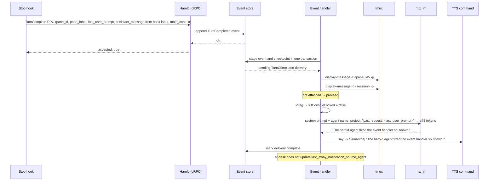
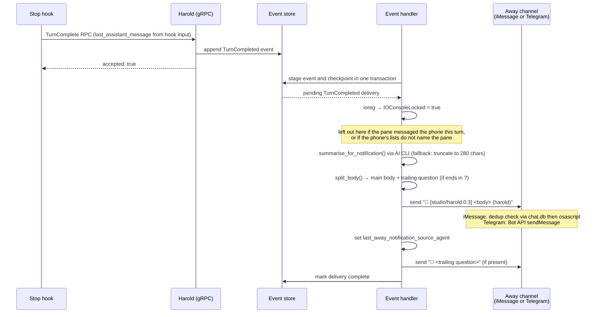

# Notification

This reference covers the turn-end update: how Harold tells the user a turn ended, by voice when at the desk or the configured away channel (iMessage or Telegram) when away.

## Problem

AI agents finish turns silently. Without active monitoring you won't know a task is done until you look — which breaks flow at your desk and leaves agents idle when you're away.

## Architecture

Harold's event handler stages `TurnCompleted` events in its durable outbox and calls `notify()` in stream-version order. Successful deliveries and intentional skips are marked complete. TTS command, Telegram HTTP/configuration, and iMessage process failures remain pending and are tried again, after 1 second, then 2, 4, 8, 16 and 32 seconds, then 60 seconds before each of the last three tries. Meanwhile no later delivery is tried, so deliveries keep their order. The failures are counted with the delivery in the outbox, so a restart does not start the count again, though the first try after a restart comes at once. At the 10th failure Harold gives the delivery up: it is recorded as a terminal failure with its last error, Harold logs `delivery given up` (`outcome = given_up`, `reason = too_many_tries`, never the message or the error), and moves on to the next delivery at once. With the alert address on, Harold also types `harold alert: delivery-given-up firing` into the chief's pane; see [How an alert reaches the chief](../telemetry/README.md#how-an-alert-reaches-the-chief). Malformed payloads and unknown event types are recorded as terminal failures so one poison event cannot block later work. The path of the turn-end update is chosen based on runtime checks: whether the completing pane's tmux session has an attached client, whether the completing pane is the one the user is looking at, and whether the screen is locked.

Summarisation uses different backends depending on the path:

| Path              | Summary backend                      | Max input                     | Output                                            |
| ----------------- | ------------------------------------ | ----------------------------- | ------------------------------------------------- |
| At desk (TTS)     | Local model (`mlx_lm`)               | The agent's name, the project and 500 chars of last_user_prompt | one sentence of at most 25 words naming the agent, ≤48 tokens |
| Away (iMessage)   | AI CLI or 280-char truncation        | Full assistant_message         | `🤖 [machine_name/pane_label] body (context)` + trailing question |
| Away (Telegram)   | AI CLI or 280-char truncation        | Full assistant_message         | `🤖 [machine_name/pane_label] body (context)` + trailing question |

If the local model is not configured, fails, or gives no sentence that names the agent, the turn-end update is the fallback sentence, `<Name> has finished and is waiting.`, such as `The chief has finished and is waiting.`

## Decision flow

```
TurnCompleted event (pane_id from $TMUX_PANE in stop hook)
       │
       ▼
  notify()
  │
  ├─ remove the pane's mark (set when the pane sent a message with
  │   send-message-to-away-device); remember whether it was under 10 minutes old
  │
  ├─ same pane and prompt recorded in the last 30 seconds? → skip (return)
  │
  ├─ skip_if_session_active = true?
  │   └─ tmux display-message -t <session> -p #{session_attached}
  │      attached ≠ 0 and screen unlocked → skip (return)
  │
  ├─ skip_if_pane_active = true?
  │   └─ ioreg → screen unlocked?
  │      tmux display-message -t <session> -p #{pane_id} → active pane
  │      active pane == completing pane → skip (return)
  │
  ├─ ioreg → IOConsoleLocked = true?
  │   ├─ no  → this pane the chief's, or not on notify.machine_audio_output?
  │   │          → leave out (return)
  │   │        notify_at_desk()
  │   └─ yes → messaging paused? → skip (return)
  │           mark was under 10 minutes old? → leave out (return)
  │           pane on neither notify.web_app (the chief, with the app)
  │             nor the away channel's list (notify.imessage or notify.telegram)?
  │             → leave out (return)
  │           channels::notify_away() (iMessage or Telegram per config)
```

`<session>` is resolved from the completing pane via `tmux display-message -t <pane_id> -p #{session_name}`.

## At-desk: TTS

1. `ask_model()` — runs `uv run mlx_lm.generate` in `ai.local_model_dir` with a system prompt asking for one plain past-tense sentence of under about 20 words that says who did what, given the agent's name (`the chief`, `the architect` or `the <main_context> agent`), the project (`main_context`) and the last request
2. The answer is made one sentence: `<think>...</think>` blocks and outer quotes are stripped, lines are joined, the text is cut at the first `.`, `!` or `?` followed by a space or the end, and one full stop is added. An empty answer, one over 25 words, or one that does not contain the agent's name (case and hyphens ignored) is refused, and the message is the fallback sentence; Harold logs `turn-end update fell back` with its `reason` and `channel`, never the text
3. TTS command run: `<tts.command> [tts.args...] [-v tts.voice] "<message>"`
4. If the primary command fails to start or exits non-zero, Harold runs the fallback command when configured: `<tts.fallback_command> [tts.fallback_args...] [-v tts.fallback_voice] "<message>"`

Config keys (`[tts]`):

| Key                | Description                                               |
| ------------------ | --------------------------------------------------------- |
| `command`          | TTS binary (e.g. `say`)                                   |
| `voice`            | Optional voice name passed as `-v`                        |
| `args`             | Optional extra args prepended before `-v` and the message |
| `fallback_command` | Optional backup TTS binary when `command` fails           |
| `fallback_voice`   | Optional fallback voice name passed as `-v`               |
| `fallback_args`    | Optional fallback args prepended before `-v` and message  |

### Muting voice

`SetTtsMuted(muted)` turns the at-desk TTS channel off or on. The flag is stored as a `TtsMuteChanged` stream event and projected into the `settings` table, so it persists across daemon restarts until changed back. It is part of the agent-state snapshot (`tts_muted`), which is how `tmx-agent-dash` shows `VOICE ON` / `VOICE MUTED`.

- Mute gates only the at-desk TTS channel. The delivery is recorded as an intentional skip. Turn-end updates to the away channel (iMessage, Telegram) are unaffected; they have their own switch, described below.
- A `TurnCompleted` delivered in the same projection batch as a mute change observes the post-batch value.
- Limitation: `SetTtsMuted` compares the requested value against the daemon's last published snapshot, so two opposite requests from a non-dash client within the projection window may drop the second. The dash always sends from confirmed state and is unaffected.

### Pausing messaging

`SetMessagingPaused(paused)` is the counterpart for the away channel. While paused, a `TurnCompleted` that would go to iMessage or Telegram is recorded as an intentional skip before anything is summarised or sent, and it is not sent later. At-desk TTS is unaffected, just as the voice mute does not affect the away channel. The flag is stored as a `MessagingPausedChanged` stream event, projected into the `settings` table, and published in the snapshot as `messaging_paused`. It also stops inbound routing and replies; see [Operation](../operation/README.md#pausing-messaging).

## Away: iMessage or Telegram

The away channel is selected by `[notify] away_channel` (`"imessage"` or `"telegram"`). Both channels share the same delivery flow and prefix all outgoing messages with `🤖`. This serves two purposes:

- **Inbound filtering** — the listener skips messages starting with `🤖` so Harold doesn't route its own messages back to agents as user replies
- **Visual distinction** — on your phone you can immediately tell which messages are from Harold vs from you

### Common steps (both channels)

1. `summarise_for_notification()` — uses AI CLI to summarise `assistant_message` into 2–3 sentences under 280 chars; falls back to `truncate_body()` (first 280 chars, newlines flattened)
2. `split_body()` — splits the last sentence ending in `?` into a separate follow-up message
3. Message assembled: `🤖 [<machine_name>/<pane_label>] <main body> (<main_context>)`. `machine_name` is this Mac's name, which defaults to the output of `hostname -s`.
4. Trailing question (if present) sent as a second `🤖`-prefixed message, `🤖 <question>`, without a tag

Confirmations and error replies carry the machine name too: `🤖 ✓ Delivered to [<machine_name>/<pane_label>]` and `🤖 [<machine_name>] <detail>`. The machine name tells you which Mac a message came from and lets a reply reach that Mac. See [Several Macs](../inbound-message-routing/README.md#several-macs).

### iMessage-specific

5. Duplicate check — queries `chat.db` for the most recent outgoing message to first configured handle ID; skips if identical (after stripping `🤖` prefix)
6. Messages sent via AppleScript: `tell application "Messages" to send "🤖 ..." to buddy "..."`

Config keys (`[imessage]`):

| Key          | Description                                                          |
| ------------ | -------------------------------------------------------------------- |
| `recipient`  | Phone number or email of the iMessage recipient                      |
| `handle_ids` | All `chat.db` handle IDs for your Apple ID (dedup and inbound poll)  |

### Telegram-specific

5. Before a message is sent, the Mac records which Mac sent the latest message, so that a reply with no tag can be routed to it. The hub records itself as the latest notifier. A member calls `ReportNotification` on the hub with its machine name and the shared secret. A failed report is logged and the message is still sent. On iMessage nothing is reported: the other Macs read the message's row in `chat.db`.
6. Messages sent via Telegram Bot API `sendMessage` to the configured chat ID

Config keys (`[telegram]`):

| Key         | Description                                |
| ----------- | ------------------------------------------ |
| `bot_token` | Telegram bot token from @BotFather         |
| `chat_id`   | Numeric chat ID for the chat Harold sends to  |

## Updates Harold leaves out while you are away

With the screen locked, an agent's finished turn sends an update to the phone unless one of two rules leaves it out. Rule A (below) covers a pane that messaged the phone this turn. The channel lists (see [Channels](#channels)) cover which panes may use the phone at all, and they also drop a message an agent asked Harold to send. At the desk the same lists decide who is spoken; see [Updates Harold does not speak at the desk](#updates-harold-does-not-speak-at-the-desk).

### After a message the agent sent itself

An agent that runs `harold send-message-to-away-device` and then ends its turn would put two messages on the phone: its own, and Harold's summary of a turn that only reports the message was sent. Harold sends the agent's message and leaves the update out.

When Harold sends an agent's message, it records the pane and the time. The pane's next `TurnCompleted` removes the record, and if the record is under 10 minutes old the update is left out with the log line `notification skipped (pane messaged the phone this turn)`. The record affects one turn: the pane's following turn sends its update. The 10-minute limit is there because Harold is not told about every turn end (Claude Code runs no hook for a turn you interrupt), and without it an old record would hide the update of a later turn. The record is kept in memory, so after a daemon restart between the message and the end of the turn the update is sent.

### Channels

Harold has four ways to reach you. Each is a **channel** with its own list in `[notify]` of the folders whose agents may use it, and `chief` names the chief's pane:

```toml
[notify]
chief = "chief-of-pods"                   # which pane is the chief, matched by folder
imessage = ["chief-of-pods"]              # who may reach the phone by iMessage
telegram = ["chief-of-pods"]              # who may reach the phone by Telegram
web_app = ["chief-of-pods"]               # who may reach the phone through the web app
machine_audio_output = ["chief-of-pods"]  # who may be spoken aloud on the Mac
```

These are Harold's defaults (`default.toml`). With nothing in `local.toml`, only an agent in a folder called `chief-of-pods` is heard on any channel, and a Mac where no agent runs in such a folder hears nothing from any agent until `local.toml` says otherwise.

| Key | The channel | What goes out on it |
| --- | --- | --- |
| `imessage` | iMessage to the phone, when `away_channel = "imessage"` | Turn-end updates while the screen is locked, messages agents ask Harold to send, and spoken lines while away (as voice notes) |
| `telegram` | Telegram to the phone, when `away_channel = "telegram"` | The same as iMessage |
| `web_app` | The web app on the phone (`[web_app]`): its thread, its push and its call | The same, as text in the thread with a push, or a spoken line played in the phone's call |
| `machine_audio_output` | Speech on the Mac: the `[tts]` command, and the Mac's call | Turn-end updates at the desk, `harold speak` lines at the desk, and other agents' updates said into a call at the Mac |

Only one of `imessage` and `telegram` is in use at a time, the one `away_channel` names. The other's list is read and checked, but not used.

**What a list holds.** Each entry is a folder:

| Entry | Matches | Example |
| --- | --- | --- |
| Starts with `/` | the pane's folder exactly | `/Users/you/Dev/p/chief-of-pods` |
| Starts with `~/` | the same, with `~` as the home folder | `~/Dev/p/chief-of-pods` |
| `*` | every pane, whatever its folder (lists only) | `["*"]` |
| Anything else | a folder whose last whole path components are the entry's | `chief-of-pods` matches `/Users/x/Dev/p/chief-of-pods`, but not `/Users/x/chief-of-pods-old` or `/Users/x/Dev/p/chief-of-pods/tools` |

Each comparison ignores one trailing `/` on either side, keeps case and does not resolve symbolic links. A subfolder of a matching folder does not match. **An empty list lets no agent use that channel** (`machine_audio_output = []` is a silent desk while the phone still works), and `["*"]` lets every agent use it. `*` also matches a pane Harold has no folder for, and is refused in `chief`. A partial entry such as `chief-of-pods` matches any folder with that name, a second clone included; write the full path to rule that out.

Harold takes a pane's folder, the working directory tmux reports for it, from its latest listing of tmux panes each time it decides. A failed listing keeps the last good one. A pane Harold has no folder for yet may use no channel (except through `*`), and a pane that `cd`s out of a listed folder is held back from the next listing. While no agent runs in a listed folder, such as while the chief restarts, nothing goes out on that channel.

**The chief.** `chief` is one entry that names the chief's pane. It gets typed answers from the question tool, alerts, the Mac's calls and the web app's route; whether it may use a channel is up to that channel's list, like any pane. `"*"` is refused in `chief`. When more than one agent pane matches `chief`, the chief is the first agent pane (by window index, then pane index) of the chief's tmux session. That session is the one `chief_session` names, when an agent in the folder runs in a session with exactly that name; otherwise it is the session of the longest-running agent in the folder. Other panes in the folder never hide the chief, and still use the channels their folders match. Harold logs `chief pane changed` (`info`, with `state` as `found` or `none`, `count` for the agents in the folder, `pane_id` for the pane picked and `session_by` as `setting` or `longest`, no folder) each time the pane picked or `session_by` changes, from the one resolver that every part of Harold uses to find the chief's pane. `session_by = longest` while `chief_session` is set means no agent ran in the named session and Harold fell back.

`chief_session` is the tmux session name of the chief, for example `chief_session = "chief"`. It must not be empty or hold `:` or `.`, which tmux does not allow in a session name. It picks the session among the agents in the chief's folder, not which folder is the chief's. Unset keeps the longest-running rule.

**What each request meets.**

| What a pane asks for | Channel and list | Not on the list |
| --- | --- | --- |
| A turn-end update, at the desk | `machine_audio_output`, except the chief's own | `spoken update left out (not in notify.machine_audio_output)` |
| A turn-end update during a call at the Mac | `machine_audio_output` | the same line |
| A line it asks Harold to speak, at the desk | `machine_audio_output` | `spoken line dropped (not in notify.machine_audio_output)` |
| A turn-end update, screen locked | the phone, below | `notification skipped (not in notify.<key>)` |
| An agent message it asks Harold to send | the phone, below | `agent message dropped (not in notify.<key>)` |
| A line it asks Harold to speak, screen locked or in the phone's call | the phone, below | `spoken line dropped (not in notify.<key>)` |

**The phone** checks, in order: with `[web_app]` set and the chief on `web_app`, the message goes to the app (its thread with a push, or played in the phone's call when it is open; the call also takes a spoken line from any pane on `web_app`). Otherwise, or when the app can't take it (no phone has push turned on, or the push is refused), it goes by `away_channel` if the pane is on that channel's list, and a message the app couldn't take starts `(app unreachable)`. Otherwise it is held back, and the line names the last list checked. The voice mute and the messaging pause are looked at before any list.

Harold writes each of these lines at `INFO` with the pane in a `pane_id` field, and with `channel` (the key of the list that held the pane back), `kind` (`turn_end_update`, `agent_message` or `spoken_line`), `reason` (`not_listed`; `chief` for the chief's own turn-end update at the desk; `messaged_this_turn` for the line above) and `agent` (the pane's folder below the home folder, such as `Dev/p/harold/main`, so it holds no user name). None holds message or spoken text. `<key>` is the channel's key.

**Held back.** An update or message a channel's rules keep from going out is held back: a turn-end update is "left out" and an agent message or spoken line is "dropped". The `harold.delivery` span of a held-back turn-end update has `outcome = held_back` and a `reason`, and its `channel` is the key of the list that held it, not `imessage` for every update. A pane that sent a message this turn is left out by its own choice and is `skipped`, not held back.

**What is counted.** `harold.notifications` counts by `agent`, `channel` and `outcome`: `sent` when the channel took a turn-end update, agent message or spoken line, and `kept` when the channel's list held it back (`not_listed`). It counts only on a channel that is set up and turned on: `imessage` has `[imessage] recipient`, `telegram` has `bot_token` and `chat_id`, `web_app` has the `[web_app]` table, and `machine_audio_output` is always set up; `imessage` or `telegram` is on only when `away_channel` names it, `machine_audio_output` while the voice mute is off, and the phone channels while messaging is not paused. The chief rule, the mute, the pause and a message sent this turn count neither. See the [telemetry reference](../telemetry/README.md).

**When the chief's message is held back.** An agent message or spoken line from a pane in the chief's folder (matched by folder, so it works while another pane is the chief) that a list holds back with reason `not_listed`, on a channel that is set up and turned on, makes Harold type `harold alert: chief-message-held-back firing` into the chief's pane. The voice mute, the messaging pause and a message sent this turn are the user's choice or by design, so they do not fire it.

The terms "left out" (a turn-end update Harold chose not to say or send) and "dropped" (an agent message or spoken line) keep the glossary's meaning; the lines above name the list that held the pane back.

| Key | Description |
| --- | --- |
| `chief` | An entry (above). Harold checks it at start: an empty entry, one of only slashes, or one holding `..` or `.` as a folder stops the daemon, naming the key and the entry. |
| `imessage`, `telegram`, `web_app`, `machine_audio_output` | Lists of entries. Harold checks every list at start, including the one `away_channel` does not use; `*` is allowed. |

A key inside `[notify]` that Harold does not know, such as `imesage`, stops the start. `away_updates_only_from` stops it with `notify.away_updates_only_from is now notify.away_messages_only_from; rename the key`. Harold reads the lists at start, so a change takes effect at the next restart.

**The old key.** When `local.toml` sets `[notify] away_messages_only_from`, Harold reads its folder as `chief` and as each channel list that `local.toml` does not set, and logs once at start, at `WARN`, `notify.away_messages_only_from is replaced by notify.chief and the channel lists`. Keys set alongside it win. Replace it with the new keys at the next install.

The agent that sent a dropped message is not told. Its command prints nothing and exits 0, as it does when the message is sent: Harold stores the request first and drops it when it comes to send it. Nothing is sent later. The pane does not become the one an untagged reply goes to, and the drop does not set the record described in "After a message the agent sent itself". An agent that messages the phone and then waits for a reply waits without knowing none will come.

- The lists cover every turn of a pane that is not on them, including one you started in that pane yourself.
- Harold's own answers to a reply from your phone, such as `🤖 ✓ Delivered to […]`, are still sent.
- Each Mac's Harold checks its own panes. An agent on another Mac is not seen.

### What leaving an update out means

Harold sends nothing to the phone for that turn: no summary and no trailing question. The event is marked handled and is not retried. The pane does not become the one an untagged reply goes to. The turn is recorded in the 30-second duplicate check, so a repeat of the same `TurnCompleted` is left out as well. The `TurnCompleted` event is still stored, so the dash and the pane's work summary update as usual.

## Updates Harold does not speak at the desk

At the desk, Harold says a short update each time an agent's turn ends. When one agent, the chief, tells the user what the others are doing with [`harold speak`](#lines-the-chief-speaks), those updates would talk over it. So Harold says an update only for a pane on `machine_audio_output` (see [Channels](#channels)), and none for the chief itself while it is tracked. The log line is `spoken update left out (chief)` for the chief and `spoken update left out (not in notify.machine_audio_output)` for any other pane that is held back, written at `INFO` with the pane in a `pane_id` field. A worktree, a base checkout, the architect's folder, a subfolder of a listed folder and a pane Harold has no folder for are all held back unless a list names their folder.

The rule is checked after the voice mute and the two skips for an active session or pane, so an update those skip is logged by them instead. An update the rule leaves out is handled as in [What leaving an update out means](#what-leaving-an-update-out-means): nothing is said, the event is not retried, and a repeat of the turn within 30 seconds is left out too.

The rule applies only with the screen unlocked. With the screen locked, the phone's lists decide (see [Channels](#channels)).

## Messages an agent sends

A turn-end update is Harold's summary of a finished turn. An agent can also send the user text of its own, at a moment it chooses, with one command:

```
~/bin/harold/harold send-message-to-away-device --src-id "$TMUX_PANE" 'Pod 3 is blocked on a merge conflict in store.rs'
```

The phone shows `🤖 [<machine_name>/<pane_label>] Pod 3 is blocked on a merge conflict in store.rs`. A reply to it is routed like a reply to a turn-end update: an untagged reply goes back to the pane that sent the message.

The command calls the daemon's `SendMessageToAwayDevice` RPC and waits up to 3 seconds. The daemon makes the text one line, checks that it has 1 to 1,000 characters, that messaging is not paused and that the pane hosts an agent the agent monitor tracks, and then stores an `AwayMessageRequested` event. The command exits 0 once the event is stored, which is before the phone has the message. Otherwise it prints one line on standard error and exits 1. The event handler takes the event from the delivery outbox in stream-version order and sends it through the away channel. Before it sends, the handler checks the messaging pause and then the phone's lists in [Channels](#channels). A message they drop is never sent, and its command has already exited 0.

It differs from a turn-end update in these ways:

| | Turn-end update | Agent message |
|---|---|---|
| Started by | The agent's turn ending | The agent running the command |
| Text | Harold's summary of the agent's final reply, 280 characters at most | The agent's text as written, made one line, 1,000 characters at most |
| Form | `🤖 [machine_name/pane_label] body (context)`, with a trailing question sent separately | `🤖 [machine_name/pane_label] text`, one message |
| Presence checks | Sent to the phone only when the screen is locked; skipped when the session or pane is active; left out by the rules in "Updates Harold leaves out while you are away" | None: sent whether the screen is locked or not |
| Channel lists | Left out for a pane the phone's lists do not name, while the screen is locked | Dropped for a pane the phone's lists do not name, whether the screen is locked or not; the command still exits 0 |
| Voice mute | Silences the at-desk path | Does not apply |
| Duplicate checks | The 30-second window, and on iMessage the recent-outgoing check | None: the same text sent twice arrives twice |
| Messaging pause | Recorded as an intentional skip | The command is refused with `messaging is paused`; a message already stored is skipped and not sent later |

A send that fails stays pending and is tried again, as a failed turn-end update is, up to 10 tries. The `send-message-to-away-device` skill, which the installer links for Claude Code and Codex, teaches an agent the command; see [setup](../../how-tos/setup.md).

## Lines the chief speaks

The chief hands Harold a sentence or two of its own for the user to hear:

```
~/bin/harold/harold speak --src-id "$TMUX_PANE" 'Release install is on task five of six. Nothing needs you.'
```

At the desk Harold says the line; away from it, Harold sends the line to the phone as a voice note. Harold adds nothing to the line, and its model writes no summary of it.

The command calls the daemon's `SpeakLine` RPC and waits up to 3 seconds. The daemon makes the text one line (line breaks and tabs become spaces), checks that it has 1 to 300 characters and that the pane hosts an agent the agent monitor tracks, and then stores a `SpokenLineRequested` event. The command exits 0 once the event is stored, which is before the line is said or sent. Otherwise it prints one line on standard error, stores nothing and exits 1:

| Refusal | Line printed |
| --- | --- |
| A malformed command, including a text that starts with `--`, which is read as a flag | `invalid argument: usage is speak --src-id ID TEXT` |
| A `--src-id` that is not a tmux pane id | `--src-id must be a tmux pane id such as %47` |
| A text out of range | `the spoken line must be 1 to 300 characters` |
| A pane with no agent | `no agent is running in pane <ID>` |
| A daemon that does not answer | `the Harold daemon is not reachable`, `the Harold daemon did not answer within 3 seconds` or `the Harold daemon could not store the spoken line` |

The command is not refused while messaging is paused, as `send-message-to-away-device` is: the pause covers only the phone, and at the desk the line is said.

Harold stores the line and then handles it:

| Situation | What Harold does |
|---|---|
| The pane is not on the list of the channel the line would use (`machine_audio_output` at the desk, the phone's lists while away) | Drops it and logs `spoken line dropped (not in notify.<key>) pane_id=…`. The voice mute and the messaging pause are looked at first. |
| Screen locked (away), messaging not paused | Makes a voice note of the line (described below) and sends it to the configured iMessage recipient with Messages, as an attachment in the same chat. With Telegram, it sends the line as text. |
| Screen locked, messaging paused | Dropped and logged, as other away messages are |
| Screen unlocked (at the desk), voice on | Says the line with the configured `[tts]` command, as turn-end updates are said, without adding anything to it |
| Screen unlocked, voice off | Dropped and logged |

The event handler takes the event from the delivery outbox in stream-version order, like an agent's message. It looks at the screen lock, the pause and the voice mute on every try, so a line whose send failed while the user was away is said if they are back at the desk for the retry. A line that was said or sent is logged as `spoken line said at the desk` or `spoken line sent to the away device`; the drops are `spoken line dropped (messaging paused)` and `spoken line dropped (voice off)`. Each of these log lines is written at `INFO` with the pane in a `pane_id` field and never holds the spoken text.

Harold makes the voice note with the model it speaks with at the desk: it runs the `[tts]` command and arguments with every `--play` removed, so nothing is heard, and with `--file_prefix <folder>/line --join_audio --audio_format wav` added before the last `--text`, then the line, so the model writes `<folder>/line.wav`. `afconvert -f m4af -d aac` turns `line.wav` into the AAC file `<name>.m4a` (named after the line, as described below), which Harold sends with a fixed AppleScript that takes the file's path and the recipient as arguments, so the line's text never enters the script. When the model exits non-zero, writes no `line.wav` or takes over 120 seconds, Harold makes `<name>.m4a` with `say` instead, reading the line from `<folder>/line.txt`, and logs `voice note made with say (the model failed)`; when `[tts]` does not run `mlx_audio.tts.generate`, it uses `say` directly, and when `say`, `afconvert` or the send fails, the line stays pending and is retried. Each voice note is made in its own folder under `$TMPDIR/harold-voice-notes/`, which is kept after a send, because Messages may read the file after `osascript` returns, and removed once 10 minutes old, when a later voice note is made or the event handler starts; a voice note that could not be made or sent has its folder removed at once.

`<name>` is built from the line, so the phone shows what each voice note says. Harold keeps the line's letters and digits, in any language, removes apostrophes (`'` and `’`), turns every run of any other character (spaces, punctuation, `/`, `:`, emoji, line breaks) into one space and removes spaces at either end. A name over 60 characters is cut after the last whole word that fits, and a first word over 60 characters is cut at 60. A line with no letter or digit gives `voice note`. The line `Release install is on task five of six. Nothing needs you.` arrives as `Release install is on task five of six Nothing needs you.m4a`. A name never holds `/` or `:`, never starts with `-` or `.`, is never empty and is at most 244 bytes; two voice notes with the same name do not clash, because each is in its own folder.

The line's words therefore also reach the voice note's file name under `$TMPDIR/harold-voice-notes/`, removed once 10 minutes old, when a later voice note is made or Harold's event handler starts; the arguments of `afconvert`, `say` and `osascript`, seen only by processes on this Mac; and the attachment's name in Messages, on both Macs and the phone, kept as long as the chat. They do not reach Harold's log: nothing logs the voice note's path, and the output and error output of `osascript` for the attachment send are discarded, as the model's, `afconvert`'s and `say`'s are, so a failed send is logged only as failed, with its exit status. A text iMessage's words and recipient reach `osascript` on its standard input, never its arguments; a voice note's path and recipient still reach its arguments.

The chat is with the user's own Apple ID, so the voice note also comes back into `chat.db` as a received row, with no `🤖` marker and with the attachment placeholder U+FFFC as its text; when Harold reads replies it skips any row whose text, with whitespace removed, is only U+FFFC characters (the file name is not part of that text), so the echo is never typed into a pane, while a reply the user types always has other characters.

## Sequences

### At desk



### Away (screen locked)


