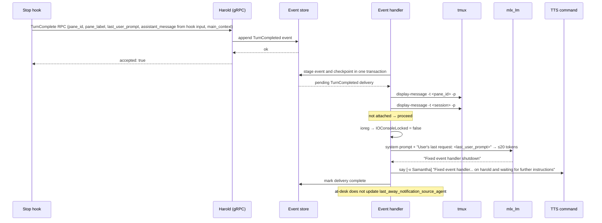

# Notification

Notification notifies the user of completed agent turns, via voice when at the desk or the configured away channel (iMessage or Telegram) when away.

## Problem

AI agents finish turns silently. Without active monitoring you won't know a task is done until you look — which breaks flow at your desk and leaves agents idle when you're away.

## Architecture

Harold's event handler stages `TurnCompleted` events in its durable outbox and calls `notify()` in stream-version order. Successful deliveries and intentional skips are marked complete. TTS command, Telegram HTTP/configuration, and iMessage process failures remain pending for retry. Malformed payloads and unknown event types are recorded as terminal failures so one poison event cannot block later work. The notification path is chosen based on runtime checks: whether the completing pane's tmux session has an attached client, whether the completing pane is the one the user is looking at, and whether the screen is locked.

Summarisation uses different backends depending on the path:

| Path              | Summary backend                      | Max input                     | Output                                            |
| ----------------- | ------------------------------------ | ----------------------------- | ------------------------------------------------- |
| At desk (TTS)     | Local model (`mlx_lm`)               | 500 chars of last_user_prompt | 3–8 words, ≤20 tokens                             |
| Away (iMessage)   | AI CLI or 280-char truncation        | Full assistant_message         | `🤖 [machine_name/pane_label] body (context)` + trailing question |
| Away (Telegram)   | AI CLI or 280-char truncation        | Full assistant_message         | `🤖 [machine_name/pane_label] body (context)` + trailing question |

If the local model is not configured, the TTS summary falls back to `"Work complete"`.

## Decision flow

```
TurnCompleted event (pane_id from $TMUX_PANE in stop hook)
       │
       ▼
  notify()
  │
  ├─ remove the pane's mark (set when the pane sent a message with
  │   send-message-to-away-device); remember whether it was under 10 minutes old
  │
  ├─ same pane and prompt recorded in the last 30 seconds? → skip (return)
  │
  ├─ skip_if_session_active = true?
  │   └─ tmux display-message -t <session> -p #{session_attached}
  │      attached ≠ 0 and screen unlocked → skip (return)
  │
  ├─ skip_if_pane_active = true?
  │   └─ ioreg → screen unlocked?
  │      tmux display-message -t <session> -p #{pane_id} → active pane
  │      active pane == completing pane → skip (return)
  │
  ├─ ioreg → IOConsoleLocked = true?
  │   ├─ no  → away_messages_only_from set, an agent in that folder,
  │   │          and this pane the chief's, a build worker's or a pod session's?
  │   │          → leave out (return)
  │   │        notify_at_desk()
  │   └─ yes → messaging paused? → skip (return)
  │           mark was under 10 minutes old? → leave out (return)
  │           away_messages_only_from set, an agent in that folder,
  │             and this pane outside it? → leave out (return)
  │           channels::notify_away() (iMessage or Telegram per config)
```

`<session>` is resolved from the completing pane via `tmux display-message -t <pane_id> -p #{session_name}`.

## At-desk: TTS

1. `build_short_summary()` — runs `uv run mlx_lm.generate` in `ai.local_model_dir` with a system prompt asking for a 3–8 word completion summary; strips `<think>...</think>` blocks from reasoning models
2. Message assembled: `"<summary> on <main_context> and waiting for further instructions"`
3. TTS command run: `<tts.command> [tts.args...] [-v tts.voice] "<message>"`
4. If the primary command fails to start or exits non-zero, Harold runs the fallback command when configured: `<tts.fallback_command> [tts.fallback_args...] [-v tts.fallback_voice] "<message>"`

Config keys (`[tts]`):

| Key                | Description                                               |
| ------------------ | --------------------------------------------------------- |
| `command`          | TTS binary (e.g. `say`)                                   |
| `voice`            | Optional voice name passed as `-v`                        |
| `args`             | Optional extra args prepended before `-v` and the message |
| `fallback_command` | Optional backup TTS binary when `command` fails           |
| `fallback_voice`   | Optional fallback voice name passed as `-v`               |
| `fallback_args`    | Optional fallback args prepended before `-v` and message  |

### Muting voice

`SetTtsMuted(muted)` turns the at-desk TTS channel off or on. The flag is stored as a `TtsMuteChanged` stream event and projected into the `settings` table, so it persists across daemon restarts until changed back. It is part of the agent-state snapshot (`tts_muted`), which is how `tmx-agent-dash` shows `VOICE ON` / `VOICE MUTED`.

- Mute gates only the at-desk TTS channel. The delivery is recorded as an intentional skip. Away notifications (iMessage, Telegram) are unaffected; they have their own switch, described below.
- A `TurnCompleted` delivered in the same projection batch as a mute change observes the post-batch value.
- Limitation: `SetTtsMuted` compares the requested value against the daemon's last published snapshot, so two opposite requests from a non-dash client within the projection window may drop the second. The dash always sends from confirmed state and is unaffected.

### Pausing messaging

`SetMessagingPaused(paused)` is the counterpart for the away channel. While paused, a `TurnCompleted` that would go to iMessage or Telegram is recorded as an intentional skip before anything is summarised or sent, and it is not sent later. At-desk TTS is unaffected, just as the voice mute does not affect the away channel. The flag is stored as a `MessagingPausedChanged` stream event, projected into the `settings` table, and published in the snapshot as `messaging_paused`. It also stops inbound routing and replies; see [Operation](../operation/README.md#pausing-messaging).

## Away: iMessage or Telegram

The away channel is selected by `[notify] away_channel` (`"imessage"` or `"telegram"`). Both channels share the same notification flow and prefix all outgoing messages with `🤖`. This serves two purposes:

- **Inbound filtering** — the listener skips messages starting with `🤖` so Harold doesn't route its own notifications back to agents as user replies
- **Visual distinction** — on your phone you can immediately tell which messages are from Harold vs from you

### Common steps (both channels)

1. `summarise_for_notification()` — uses AI CLI to summarise `assistant_message` into 2–3 sentences under 280 chars; falls back to `truncate_body()` (first 280 chars, newlines flattened)
2. `split_body()` — splits the last sentence ending in `?` into a separate follow-up message
3. Message assembled: `🤖 [<machine_name>/<pane_label>] <main body> (<main_context>)`. `machine_name` is this Mac's name, which defaults to the output of `hostname -s`.
4. Trailing question (if present) sent as a second `🤖`-prefixed message, `🤖 <question>`, without a tag

Confirmations and error replies carry the machine name too: `🤖 ✓ Delivered to [<machine_name>/<pane_label>]` and `🤖 [<machine_name>] <detail>`. The machine name tells you which Mac a notification came from and lets a reply reach that Mac. See [Several Macs](../inbound-message-routing/README.md#several-macs).

### iMessage-specific

5. Duplicate check — queries `chat.db` for the most recent outgoing message to first configured handle ID; skips if identical (after stripping `🤖` prefix)
6. Messages sent via AppleScript: `tell application "Messages" to send "🤖 ..." to buddy "..."`

Config keys (`[imessage]`):

| Key          | Description                                                          |
| ------------ | -------------------------------------------------------------------- |
| `recipient`  | Phone number or email of the iMessage recipient                      |
| `handle_ids` | All `chat.db` handle IDs for your Apple ID (dedup and inbound poll)  |

### Telegram-specific

5. Before the notification is sent, the Mac records which Mac sent the latest notification, so that a reply with no tag can be routed to it. The hub records itself as the latest notifier. A member calls `ReportNotification` on the hub with its machine name and the shared secret. A failed report is logged and the notification is still sent. On iMessage nothing is reported: the other Macs read the notification's row in `chat.db`.
6. Messages sent via Telegram Bot API `sendMessage` to the configured chat ID

Config keys (`[telegram]`):

| Key         | Description                                |
| ----------- | ------------------------------------------ |
| `bot_token` | Telegram bot token from @BotFather         |
| `chat_id`   | Numeric chat ID for the notification chat  |

## Updates Harold leaves out while you are away

With the screen locked, every agent's finished turn sends an update to the phone. Two rules leave an update out. Both leave out only an update that would go to the phone. At the desk, a separate rule keeps some panes quiet; see [Updates Harold does not speak while the chief runs](#updates-harold-does-not-speak-while-the-chief-runs). The second rule also drops a message an agent asked Harold to send.

### After a message the agent sent itself

An agent that runs `harold send-message-to-away-device` and then ends its turn would put two messages on the phone: its own, and Harold's summary of a turn that only reports the message was sent. Harold sends the agent's message and leaves the update out.

When Harold sends an agent's message, it records the pane and the time. The pane's next `TurnCompleted` removes the record, and if the record is under 10 minutes old the update is left out with the log line `notification skipped (pane messaged the phone this turn)`. The record affects one turn: the pane's following turn sends its update. The 10-minute limit is there because Harold is not told about every turn end (Claude Code runs no hook for a turn you interrupt), and without it an old record would hide the update of a later turn. The record is kept in memory, so after a daemon restart between the message and the end of the turn the update is sent.

### From agents outside one folder

When one agent reports to the phone for the others, name the folder it runs in:

```toml
[notify]
away_messages_only_from = "/Users/you/Dev/chief-of-pods"
```

While an agent Harold tracks is running in that folder, only panes in that folder send to the phone. The rule covers both kinds of message a pane sends:

| Kind | From a pane in the folder | From a pane outside the folder | Log line for the pane outside |
| --- | --- | --- | --- |
| Turn-end update, with the screen locked | Sent | Left out | `notification skipped (updates come from <folder> only)` |
| Message sent with `harold send-message-to-away-device`, with the screen locked or not | Sent | Dropped | `away message dropped (messages come from <folder> only)` |

Harold writes each line at `INFO` with the pane in a `pane_id` field. `<folder>` is the setting as written. Neither line holds the text of a message. While no agent is running in the folder, every pane sends both kinds.

The agent that sent a dropped message is not told. Its command prints nothing and exits 0, as it does when the message is sent: Harold stores the request first and drops it when it comes to send it. Nothing is sent later. The pane does not become the one an untagged reply goes to, and the drop does not set the record described in "After a message the agent sent itself". An agent that messages the phone and then waits for a reply waits without knowing none will come.

| Key | Description |
| --- | --- |
| `away_messages_only_from` | Optional. An absolute path. Harold compares it as text with the working directory tmux reports for a pane (`pane_current_path`), ignoring one trailing `/`. It does not resolve symbolic links, and a subfolder counts as another folder. A value that is empty or does not start with `/` stops the daemon at start. Harold reads it at start, so a change takes effect at the next restart. |

The key was named `away_updates_only_from` while it covered turn-end updates only. Harold does not start with the old name in the configuration: it prints `notify.away_updates_only_from is now notify.away_messages_only_from; rename the key`.

- The rule covers every turn of a pane outside the folder, including one you started in that pane yourself.
- A pane the agent monitor has not listed yet counts as outside the folder.
- A pane in the folder is never affected. After it sends a message of its own, its turn-end update for that turn is still left out by the first rule.
- Harold's own answers to a reply from your phone, such as `🤖 ✓ Delivered to […]`, are still sent.
- Each Mac's Harold checks its own panes. An agent in the folder on another Mac is not seen.
- While the agent monitor cannot list tmux panes, the rule leaves nothing out and drops nothing.

### What leaving an update out means

Harold sends nothing to the phone for that turn: no summary and no trailing question. The event is marked handled and is not retried. The pane does not become the one an untagged reply goes to. The turn is recorded in the 30-second duplicate check, so a repeat of the same `TurnCompleted` is left out as well. The `TurnCompleted` event is still stored, so the dashboard and the pane's work summary update as usual.

## Updates Harold does not speak while the chief runs

At the desk, Harold says a short update each time an agent's turn ends. When one agent, the chief, tells the user what the others are doing with [`harold speak`](#lines-the-chief-speaks), those updates would talk over it. So while the chief runs, Harold says no turn-end update for the chief itself, the build workers and the pod sessions. Any other pane, such as a session the user drives, is spoken as before.

The chief is any agent in the folder `[notify] away_messages_only_from` names (see [From agents outside one folder](#from-agents-outside-one-folder)), and it runs while an agent Harold tracks is running in that folder. Harold sorts the pane whose turn ended by its folder, the working directory tmux reports for it (`pane_current_path`):

| Pane | How Harold recognises it | Log line |
| --- | --- | --- |
| The chief | Its folder is the one `away_messages_only_from` names | `spoken update left out (chief)` |
| A build worker | `<pane folder>/.superpowers/baton/agent-pane` has a line that is the pane's id, such as `%47`. Baton writes this file in the worker's worktree. | `spoken update left out (build worker)` |
| A pod session (pod-coordination or a product manager) | `<pane folder>/.superpowers/pod/agent-panes` has a line that is the pane's id. Pod sessions run in the product's base checkout itself, and `pod start` is to write the file there; until it does, pod sessions are spoken. | `spoken update left out (pod session)` |

Harold writes each line at `INFO` with the pane in a `pane_id` field. It only reads the two files: it trims each line before comparing it with the pane's id, and a file that is missing or cannot be read names no pane. A pane listed in a file after it has closed changes nothing, because Harold asks only about the pane whose turn ended. While no agent runs in the folder, or the setting is not set, or the agent monitor cannot list tmux panes, every pane is spoken.

The rule is checked after the voice mute and the two skips for an active session or pane, so an update those skip is logged by them instead. An update the rule leaves out is handled as in [What leaving an update out means](#what-leaving-an-update-out-means): nothing is said, the event is not retried, and a repeat of the turn within 30 seconds is left out too.

The rule applies only with the screen unlocked. Updates to the phone while away are unchanged: `away_messages_only_from` already keeps every pane but the chief's off the phone.

## Messages an agent sends

A notification is Harold's summary of a finished turn. An agent can also send the user text of its own, at a moment it chooses, with one command:

```
~/bin/harold/harold send-message-to-away-device --src-id "$TMUX_PANE" 'Pod 3 is blocked on a merge conflict in store.rs'
```

The phone shows `🤖 [<machine_name>/<pane_label>] Pod 3 is blocked on a merge conflict in store.rs`. A reply to it is routed like a reply to a notification: an untagged reply goes back to the pane that sent the message.

The command calls the daemon's `SendMessageToAwayDevice` RPC and waits up to 3 seconds. The daemon makes the text one line, checks that it has 1 to 1,000 characters, that messaging is not paused and that the pane hosts an agent the monitor tracks, and then stores an `AwayMessageRequested` event. The command exits 0 once the event is stored, which is before the phone has the message. Otherwise it prints one line on standard error and exits 1. The event handler takes the event from the delivery outbox in stream-version order and sends it through the away channel. Before it sends, the handler checks the messaging pause and then the folder rule in [From agents outside one folder](#from-agents-outside-one-folder). A message that rule drops is never sent, and its command has already exited 0.

It differs from a turn-end notification in these ways:

| | Turn-end notification | Agent message |
|---|---|---|
| Started by | The agent's turn ending | The agent running the command |
| Text | Harold's summary of the agent's final reply, 280 characters at most | The agent's text as written, made one line, 1,000 characters at most |
| Form | `🤖 [machine_name/pane_label] body (context)`, with a trailing question sent separately | `🤖 [machine_name/pane_label] text`, one message |
| Presence checks | Sent to the phone only when the screen is locked; skipped when the session or pane is active; left out by the two rules in "Updates Harold leaves out while you are away" | None: sent whether the screen is locked or not |
| Folder rule (`away_messages_only_from`) | Left out for a pane outside the folder, while the screen is locked | Dropped for a pane outside the folder, whether the screen is locked or not; the command still exits 0 |
| Voice mute | Silences the at-desk path | Does not apply |
| Duplicate checks | The 30-second window, and on iMessage the recent-outgoing check | None: the same text sent twice arrives twice |
| Messaging pause | Recorded as an intentional skip | The command is refused with `messaging is paused`; a message already stored is skipped and not sent later |

A send that fails stays pending and is retried, as a failed notification is. The `send-message-to-away-device` skill, which the installer links for Claude Code and Codex, teaches an agent the command; see [setup](../../how-tos/setup.md).

## Lines the chief speaks

The chief hands Harold a sentence or two of its own for the user to hear:

```
~/bin/harold/harold speak --src-id "$TMUX_PANE" 'Release install is on task five of six. Nothing needs you.'
```

At the desk Harold says the line; away from it, Harold sends the line to the phone as a voice note. Harold adds nothing to the line, and its model writes no summary of it.

The command calls the daemon's `SpeakLine` RPC and waits up to 3 seconds. The daemon makes the text one line (line breaks and tabs become spaces), checks that it has 1 to 300 characters and that the pane hosts an agent the monitor tracks, and then stores a `SpokenLineRequested` event. The command exits 0 once the event is stored, which is before the line is said or sent. Otherwise it prints one line on standard error, stores nothing and exits 1:

| Refusal | Line printed |
| --- | --- |
| A malformed command, including a text that starts with `--`, which is read as a flag | `invalid argument: usage is speak --src-id ID TEXT` |
| A `--src-id` that is not a tmux pane id | `--src-id must be a tmux pane id such as %47` |
| A text out of range | `the spoken line must be 1 to 300 characters` |
| A pane with no agent | `no agent is running in pane <ID>` |
| A daemon that does not answer | `the Harold daemon is not reachable`, `the Harold daemon did not answer within 3 seconds` or `the Harold daemon could not store the spoken line` |

The command is not refused while messaging is paused, as `send-message-to-away-device` is: the pause covers only the phone, and at the desk the line is said.

Harold stores the line and then handles it:

| Situation | What Harold does |
|---|---|
| `away_messages_only_from` is set, an agent runs there, and the line comes from a pane outside that folder | Drops it and logs `spoken line dropped (lines come from <folder> only) pane_id=…` |
| Screen locked (away), messaging not paused | Makes a voice note of the line (described below) and sends it to the configured iMessage recipient with Messages, as an attachment in the same chat. With Telegram, it sends the line as text. |
| Screen locked, messaging paused | Dropped and logged, as other away messages are |
| Screen unlocked (at the desk), voice on | Says the line with the configured `[tts]` command, as turn-end updates are said, without adding anything to it |
| Screen unlocked, voice off | Dropped and logged |

The event handler takes the event from the delivery outbox in stream-version order, like an agent's message. It looks at the screen lock, the pause and the voice mute on every try, so a line whose send failed while the user was away is said if they are back at the desk for the retry. A line that was said or sent is logged as `spoken line said at the desk` or `spoken line sent to the away device`; the drops are `spoken line dropped (messaging paused)` and `spoken line dropped (voice off)`. Each of these log lines is written at `INFO` with the pane in a `pane_id` field and never holds the spoken text.

Harold makes the voice note with the model it speaks with at the desk: it runs the `[tts]` command and arguments with every `--play` removed, so nothing is heard, and with `--file_prefix <folder>/line --join_audio --audio_format wav` added before the last `--text`, then the line, so the model writes `<folder>/line.wav`. `afconvert -f m4af -d aac` turns `line.wav` into the AAC file `<name>.m4a` (named after the line, as described below), which Harold sends with a fixed AppleScript that takes the file's path and the recipient as arguments, so the line's text never enters the script. When the model exits non-zero, writes no `line.wav` or takes over 120 seconds, Harold makes `<name>.m4a` with `say` instead, reading the line from `<folder>/line.txt`, and logs `voice note made with say (the model failed)`; when `[tts]` does not run `mlx_audio.tts.generate`, it uses `say` directly, and when `say`, `afconvert` or the send fails, the line stays pending and is retried. Each note is made in its own folder under `$TMPDIR/harold-voice-notes/`, which is kept after a send, because Messages may read the file after `osascript` returns, and removed once 10 minutes old, when a later note is made or the event handler starts; a note that could not be made or sent has its folder removed at once.

`<name>` is built from the line, so the phone shows what each note says. Harold keeps the line's letters and digits, in any language, removes apostrophes (`'` and `’`), turns every run of any other character (spaces, punctuation, `/`, `:`, emoji, line breaks) into one space and removes spaces at either end. A name over 60 characters is cut after the last whole word that fits, and a first word over 60 characters is cut at 60. A line with no letter or digit gives `voice note`. The line `Release install is on task five of six. Nothing needs you.` arrives as `Release install is on task five of six Nothing needs you.m4a`. A name never holds `/` or `:`, never starts with `-` or `.`, is never empty and is at most 244 bytes; two notes with the same name do not clash, because each is in its own folder.

The line's words therefore also reach the note's file name under `$TMPDIR/harold-voice-notes/`, removed once 10 minutes old, when a later note is made or Harold's event handler starts; the arguments of `afconvert`, `say` and `osascript`, seen only by processes on this Mac; and the attachment's name in Messages, on both Macs and the phone, kept as long as the chat. They do not reach Harold's log: nothing logs the note's path, and the output and error output of `osascript` for the attachment send are discarded, as the model's, `afconvert`'s and `say`'s are, so a failed send is logged only as failed, with its exit status.

The chat is with the user's own Apple ID, so the voice note also comes back into `chat.db` as a received row, with no `🤖` marker and with the attachment placeholder U+FFFC as its text; when Harold reads replies it skips any row whose text, with whitespace removed, is only U+FFFC characters (the file name is not part of that text), so the echo is never typed into a pane, while a reply the user types always has other characters.

## Sequences

### At desk



### Away (screen locked)


