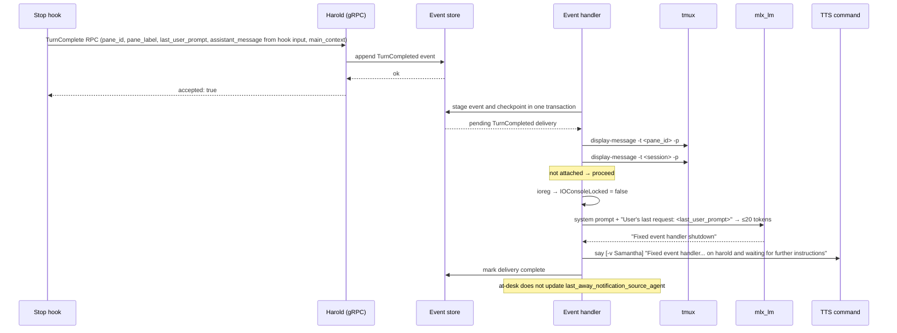
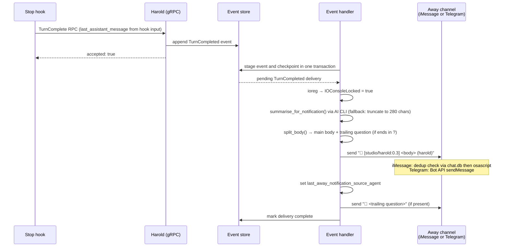

# Notification

Notification notifies the user of completed agent turns, via voice when at the desk or the configured away channel (iMessage or Telegram) when away.

## Problem

AI agents finish turns silently. Without active monitoring you won't know a task is done until you look — which breaks flow at your desk and leaves agents idle when you're away.

## Architecture

Harold's event handler stages `TurnCompleted` events in its durable outbox and calls `notify()` in stream-version order. Successful deliveries and intentional skips are marked complete. TTS command, Telegram HTTP/configuration, and iMessage process failures remain pending for retry. Malformed payloads and unknown event types are recorded as terminal failures so one poison event cannot block later work. The notification path is chosen based on runtime checks: whether the completing pane's tmux session has an attached client, whether the completing pane is the one the user is looking at, and whether the screen is locked.

Summarisation uses different backends depending on the path:

| Path              | Summary backend                      | Max input                     | Output                                            |
| ----------------- | ------------------------------------ | ----------------------------- | ------------------------------------------------- |
| At desk (TTS)     | Local model (`mlx_lm`)               | 500 chars of last_user_prompt | 3–8 words, ≤20 tokens                             |
| Away (iMessage)   | AI CLI or 280-char truncation        | Full assistant_message         | `🤖 [machine_name/pane_label] body (context)` + trailing question |
| Away (Telegram)   | AI CLI or 280-char truncation        | Full assistant_message         | `🤖 [machine_name/pane_label] body (context)` + trailing question |

If the local model is not configured, the TTS summary falls back to `"Work complete"`.

## Decision flow

```
TurnCompleted event (pane_id from $TMUX_PANE in stop hook)
       │
       ▼
  notify()
  │
  ├─ skip_if_session_active = true?
  │   └─ tmux display-message -t <session> -p #{session_attached}
  │      attached ≠ 0 → skip (return)
  │
  ├─ skip_if_pane_active = true?
  │   └─ ioreg → screen unlocked?
  │      tmux display-message -t <session> -p #{pane_id} → active pane
  │      active pane == completing pane → skip (return)
  │
  ├─ ioreg → IOConsoleLocked = true?
  │   ├─ no  → notify_at_desk()
  │   └─ yes → channels::notify_away() (iMessage or Telegram per config)
```

`<session>` is resolved from the completing pane via `tmux display-message -t <pane_id> -p #{session_name}`.

## At-desk: TTS

1. `build_short_summary()` — runs `uv run mlx_lm.generate` in `ai.local_model_dir` with a system prompt asking for a 3–8 word completion summary; strips `<think>...</think>` blocks from reasoning models
2. Message assembled: `"<summary> on <main_context> and waiting for further instructions"`
3. TTS command run: `<tts.command> [tts.args...] [-v tts.voice] "<message>"`
4. If the primary command fails to start or exits non-zero, Harold runs the fallback command when configured: `<tts.fallback_command> [tts.fallback_args...] [-v tts.fallback_voice] "<message>"`

Config keys (`[tts]`):

| Key                | Description                                               |
| ------------------ | --------------------------------------------------------- |
| `command`          | TTS binary (e.g. `say`)                                   |
| `voice`            | Optional voice name passed as `-v`                        |
| `args`             | Optional extra args prepended before `-v` and the message |
| `fallback_command` | Optional backup TTS binary when `command` fails           |
| `fallback_voice`   | Optional fallback voice name passed as `-v`               |
| `fallback_args`    | Optional fallback args prepended before `-v` and message  |

### Muting voice

`SetTtsMuted(muted)` turns the at-desk TTS channel off or on. The flag is stored as a `TtsMuteChanged` stream event and projected into the `settings` table, so it persists across daemon restarts until changed back. It is part of the agent-state snapshot (`tts_muted`), which is how `tmx-agent-dash` shows `VOICE ON` / `VOICE MUTED`.

- Mute gates only the at-desk TTS channel. The delivery is recorded as an intentional skip. Away notifications (iMessage, Telegram) are unaffected; they have their own switch, described below.
- A `TurnCompleted` delivered in the same projection batch as a mute change observes the post-batch value.
- Limitation: `SetTtsMuted` compares the requested value against the daemon's last published snapshot, so two opposite requests from a non-dash client within the projection window may drop the second. The dash always sends from confirmed state and is unaffected.

### Pausing messaging

`SetMessagingPaused(paused)` is the counterpart for the away channel. While paused, a `TurnCompleted` that would go to iMessage or Telegram is recorded as an intentional skip before anything is summarised or sent, and it is not sent later. At-desk TTS is unaffected, just as the voice mute does not affect the away channel. The flag is stored as a `MessagingPausedChanged` stream event, projected into the `settings` table, and published in the snapshot as `messaging_paused`. It also stops inbound routing and replies; see [Operation](../operation/README.md#pausing-messaging).

## Away: iMessage or Telegram

The away channel is selected by `[notify] away_channel` (`"imessage"` or `"telegram"`). Both channels share the same notification flow and prefix all outgoing messages with `🤖`. This serves two purposes:

- **Inbound filtering** — the listener skips messages starting with `🤖` so Harold doesn't route its own notifications back to agents as user replies
- **Visual distinction** — on your phone you can immediately tell which messages are from Harold vs from you

### Common steps (both channels)

1. `summarise_for_notification()` — uses AI CLI to summarise `assistant_message` into 2–3 sentences under 280 chars; falls back to `truncate_body()` (first 280 chars, newlines flattened)
2. `split_body()` — splits the last sentence ending in `?` into a separate follow-up message
3. Message assembled: `🤖 [<machine_name>/<pane_label>] <main body> (<main_context>)`. `machine_name` is this Mac's name, which defaults to the output of `hostname -s`.
4. Trailing question (if present) sent as a second `🤖`-prefixed message, `🤖 <question>`, without a tag

Confirmations and error replies carry the machine name too: `🤖 ✓ Delivered to [<machine_name>/<pane_label>]` and `🤖 [<machine_name>] <detail>`. The machine name tells you which Mac a notification came from and lets a reply reach that Mac. See [Several Macs](../inbound-message-routing/README.md#several-macs).

### iMessage-specific

5. Duplicate check — queries `chat.db` for the most recent outgoing message to first configured handle ID; skips if identical (after stripping `🤖` prefix)
6. Messages sent via AppleScript: `tell application "Messages" to send "🤖 ..." to buddy "..."`

Config keys (`[imessage]`):

| Key          | Description                                                          |
| ------------ | -------------------------------------------------------------------- |
| `recipient`  | Phone number or email of the iMessage recipient                      |
| `handle_ids` | All `chat.db` handle IDs for your Apple ID (dedup and inbound poll)  |

### Telegram-specific

5. Before the notification is sent, the Mac records which Mac sent the latest notification, so that a reply with no tag can be routed to it. The hub records itself as the latest notifier. A member calls `ReportNotification` on the hub with its machine name and the shared secret. A failed report is logged and the notification is still sent. On iMessage nothing is reported: the other Macs read the notification's row in `chat.db`.
6. Messages sent via Telegram Bot API `sendMessage` to the configured chat ID

Config keys (`[telegram]`):

| Key         | Description                                |
| ----------- | ------------------------------------------ |
| `bot_token` | Telegram bot token from @BotFather         |
| `chat_id`   | Numeric chat ID for the notification chat  |

## Messages an agent sends

A notification is Harold's summary of a finished turn. An agent can also send the user text of its own, at a moment it chooses, with one command:

```
~/bin/harold/harold send-message-to-away-device --src-id "$TMUX_PANE" 'Pod 3 is blocked on a merge conflict in store.rs'
```

The phone shows `🤖 [<machine_name>/<pane_label>] Pod 3 is blocked on a merge conflict in store.rs`. A reply to it is routed like a reply to a notification: an untagged reply goes back to the pane that sent the message.

The command calls the daemon's `SendMessageToAwayDevice` RPC and waits up to 3 seconds. The daemon makes the text one line, checks that it has 1 to 1,000 characters, that messaging is not paused and that the pane hosts an agent the monitor tracks, and then stores an `AwayMessageRequested` event. The command exits 0 once the event is stored, which is before the phone has the message. Otherwise it prints one line on standard error and exits 1. The event handler takes the event from the delivery outbox in stream-version order and sends it through the away channel.

It differs from a turn-end notification in these ways:

| | Turn-end notification | Agent message |
|---|---|---|
| Started by | The agent's turn ending | The agent running the command |
| Text | Harold's summary of the agent's final reply, 280 characters at most | The agent's text as written, made one line, 1,000 characters at most |
| Form | `🤖 [machine_name/pane_label] body (context)`, with a trailing question sent separately | `🤖 [machine_name/pane_label] text`, one message |
| Presence checks | Sent to the phone only when the screen is locked; skipped when the session or pane is active | None: sent whether the screen is locked or not |
| Voice mute | Silences the at-desk path | Does not apply |
| Duplicate checks | The 30-second window, and on iMessage the recent-outgoing check | None: the same text sent twice arrives twice |
| Messaging pause | Recorded as an intentional skip | The command is refused with `messaging is paused`; a message already stored is skipped and not sent later |

A send that fails stays pending and is retried, as a failed notification is. The `send-message-to-away-device` skill, which the installer links for Claude Code and Codex, teaches an agent the command; see [setup](../../how-tos/setup.md).

## Sequences

### At desk



### Away (screen locked)


