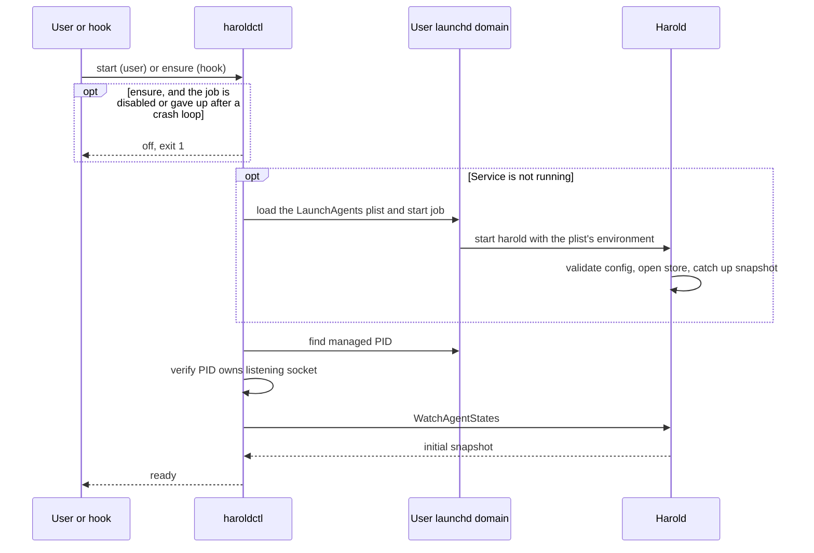

# Operation

Harold runs as a per-user service on macOS. It starts when you log in, and launchd restarts it after a crash, within limits. The installer provides `haroldctl` to start, stop, restart, and check that service; `haroldctl stop` keeps it off, across logins too, until `haroldctl start`.

## Problem

A listening port alone does not tell you which Harold process owns it or which configuration and database it uses. Starting a second daemon from a hook can also race the first process. Installation, login, crash restarts and hook startup therefore use one service owner, one launchd job, and the same readiness check. That job keeps three properties:

- **Two Harolds never race.** Login, launchd's restarts and `haroldctl` all start the same job, with one label, and the store's `harold.lock` refuses a second process.
- **A hook never starts a second Harold.** A hook asks `haroldctl ensure`, which starts that job or nothing.
- **Harold never runs with the wrong configuration or store.** The job carries the managed environment and store path, whichever of them starts it.

## Architecture

The installer writes one launchd job definition, `service.plist`, and puts it in two places: inside the Harold bundle (`~/bin/harold/service.plist`), for reference and rollback, and in `~/Library/LaunchAgents/<label>.plist`, which launchd loads into the user's graphical domain at every login. The label is `com.harold.agent.` followed by 16 hex digits of the prefix's SHA-256. launchd starts the `harold` binary itself, with the environment, working directory and log file the plist names.

| Plist key | Value | Effect |
| --- | --- | --- |
| `RunAtLoad` | true | launchd starts Harold when it loads the job at login |
| `KeepAlive` | `{ SuccessfulExit = false }` | launchd starts Harold again after an exit other than 0 |
| `ThrottleInterval` | 30 | launchd waits at least 30 seconds between starts |
| `EnvironmentVariables` | the managed environment plus `HAROLD_LAUNCHD=1` | tells Harold that launchd started it (below) |

| Component | Responsibility |
| --- | --- |
| Installer | Build, stage, sign, validate, replace files, and verify startup |
| `haroldctl` / `service.py` | Serialize control operations and manage the exact launchd service |
| gRPC server | Accept hook reports and stream current agent snapshots |
| Agent monitor | Resolve agent identity and record lifecycle/screen observations |
| Event handler | Project state, stage delivery work, and dispatch notifications/replies |
| Channel listener | Collect incoming messages for the event stream |

The runtime components share Harold's store and shutdown signal. See [Harold Architecture](../../explanations/architecture.md) for their data flow.

## macOS permissions

Harold with the iMessage channel needs two macOS permissions: Full Disk Access, to read `~/Library/Messages/chat.db`, and control of Messages, to send. macOS charges a permission to the program launchd started, which is `harold`. It stores each grant with `harold`'s designated requirement, the rule `codesign -dr -` prints. The installer signs `harold` and `tmx-agent-dash` with the fixed identifiers `harold` and `tmx-agent-dash`, so a build signed with the same certificate keeps both grants; an ad-hoc build does not. [Keep permissions across installs](../../how-tos/setup.md#keep-permissions-across-installs) has the steps.

`haroldctl` stays a Python script and needs neither permission: `start`, `stop`, `restart`, `status` and `ensure` do not read the Messages database or send to Messages.

## Installation commands

Run these from the repository:

| Command | Behavior |
| --- | --- |
| `./scripts/install.sh` | Install or replace programs; retain existing local settings and managed data |
| `./scripts/install.sh --reinstall` | Archive the old bundle; retain settings and create fresh managed data |
| `--config PATH` | Import local TOML settings instead of retaining or prompting for them |
| `--prefix PATH` | Set executable directory; defaults to `~/bin` |
| `--signing-identity ID` | Sign with this keychain identity and save it for later installs; defaults to the saved identity, else ad-hoc `-` |
| `--offline` | Build with cached locked Cargo dependencies |

`make install` and `make deploy` call the normal installer. `make reinstall` selects fresh storage. Pass installer flags using `INSTALL_ARGS`. Missing prerequisites and invalid configuration stop installation before the running service is replaced. A readiness failure returns nonzero and reports where to find the installed log and configuration.

Reinstall operates only on the managed bundle. It does not convert database schemas or remove an external store mentioned in a copied configuration. Backups are named uniquely and their locations are printed. A normal install moves retained managed data into the new bundle; its archived previous bundle is not a second copy of that data.

## Configuration and environment

The daemon loads configuration in this order:

1. `config/default.toml`, required.
2. `config/local.toml`, optional user settings for an installed service.
3. `HAROLD__<SECTION>__<KEY>` environment overrides.

For a directly run binary, `HAROLD_CONFIG_DIR` selects the directory and `HAROLD_ENV` selects the overlay name. By default, configuration is adjacent to the executable.

The installed service controls its own config directory, `local` overlay, PATH, UTF-8 locale, and store at `<prefix>/harold/data/store`. `haroldctl` and the installer clear inherited Harold settings overrides before applying that environment to their configuration and readiness checks, so they stay pointed at the installation even when the invoking shell contains development overrides. launchd gives the daemon the same environment from the plist. A variable set for all of launchd with `launchctl setenv` also reaches the daemon; the plist's own variables win on a clash.

`service.json` records the service identity, its environment, and the signing identity the installer used. Channel credentials belong in `config/local.toml`, which the installer writes with owner-only permissions. Edit that file and run `haroldctl restart` to apply changes.

## The store

Harold keeps everything it records in one folder: `<prefix>/harold/data/store/` for the installed service, and `[store] path` for a directly run binary. The folder holds four entries:

| Entry | What it holds |
| --- | --- |
| `log/` | The event stream. Each event, such as a reply arriving or an agent finishing a turn, is one record in an OpenData log under the key `harold/main`. Its value is a JSON envelope with the event's `id`, `type`, `payload`, `created_at_ms`, `trace_id`, `span_id` and `actor`. The log stores its data with SlateDB on the local filesystem, under the prefix `harold` inside `log/`. Harold sets no retention, so the log keeps every event. |
| `log-settings.toml` | The log's SlateDB settings. Harold writes this file each time it opens the store, with no settings in it, so SlateDB's defaults apply. Neither an edit to this file nor a `SlateDb.toml` in the working directory changes the log. |
| `harold.lock` | A lock Harold holds while it runs. A second Harold started on the same folder stops at start with `store is in use by another Harold`. macOS releases the lock when Harold exits, including when it is killed. |
| `harold-state.db` and `harold-state.db-wal` | The state database, opened with turso 0.8.3. Its five data tables hold the agent panes and monitor health, the delivery outbox, the settings (mute, pause and each timed prompt's last day), and the cursor: the version of the last event projected into these tables. |

An event's version is its log sequence number plus one, so the first event in an empty store is version 1 and version 0 means no event yet. Versions only rise, but they have gaps, because the log reserves sequence numbers in blocks each time it opens: in a store whose first event is version 1, the first event after a restart is version 4097. `harold --check-ready` prints `through_event_version` in these numbers.

Harold delivers only events that the log has written to the filesystem. Each append returns after the log's `flush()` has written the record to the filesystem, and Harold opens the log so that its reads return only flushed records (`ReadVisibility::Remote`). A record the log has not flushed is therefore never projected or delivered. Flushed records survive Harold being killed. The log's local store does not call `fsync`, so whether they survive a power loss is untested.

On a disk fault, such as a full disk, Harold marks its store failing within 30 seconds and carries on without it until the disk recovers. A write to the disk can hang: SlateDB retries a failed write to the filesystem with no limit, 100 ms to 1 s apart, so the log's `flush()` does not return until the write succeeds. Harold therefore gives each append 30 seconds. An append still waiting then returns an error, and Harold marks the store failing. The delivery loop's three writes to `harold-state.db` (recording a failed try, marking a row undeliverable, marking a row delivered) mark it failing too, when one fails or takes over 30 seconds. Harold logs `store failing` at warning level, with `component = "store"` and `reason` (`write_timed_out` or `state_write_failed`). With the alert address on, it types `harold alert: store-failing firing` into the chief's pane (see the [telemetry reference](../telemetry/README.md#how-an-alert-reaches-the-chief)). On a full disk `harold.log` may not be written, but the exported copy of each line reaches telemetry over the network.

While the store is failing, Harold refuses every event-log append and every one of those three delivery writes at once, with one exception: the first write tried 30 seconds after the last try ended is let through as a new try, with the same 30-second limit. When a try succeeds, Harold logs `store recovered` at info level (`reason = try_succeeded`), types `harold alert: store-failing cleared` if it typed `firing`, and every write goes through again. Meanwhile each part of Harold that writes does this:

- The delivery loop sends nothing, and checks again every 100 ms. A message it sent but could not mark delivered is marked once the store recovers, and is not sent again. A row whose failed try or give-up could not be recorded is tried again after recovery, with its try count as it was. Once the store recovers, the loop carries on from the oldest undelivered row.
- The iMessage poll moves past a reply whose write timed out. That write may still land when the disk recovers, and the reply is then delivered once; if it never lands, the reply is lost. A reply whose write was refused keeps its place: the poll reads no later row of that direction in the same poll, so none moves past it, and reads it again at the next poll.
- The hooks get an error back, as for any store error.
- The agent monitor logs its usual failure line and carries on.

Recovery needs a write to be tried. While the store is failing, the delivery loop writes only to mark a message it already sent, so a quiet Harold, with no agent changes, hooks or replies and no such message, stays failing, with deliveries paused, until something writes. A try that writes only to `harold-state.db` can succeed while the event log still hangs; the store then recovers, and the next append that hangs marks it failing again.

Each event is projected once and has one row in the delivery outbox. Harold projects an event into `harold-state.db` and moves the cursor past it in one transaction, so a crash between the two rolls both back, and the next start projects that event again from the cursor. If the same envelope is ever written to the log twice, both copies carry one `id`, and the delivery outbox keeps one row per `event_id`, so the second copy adds no row. No other table records which ids Harold has seen. Delivery is a separate step: the event handler sends a message and then marks its row delivered, so a crash after the send and before the mark sends that message again at the next start.

Harold refuses to start on a folder whose `harold-state.db` cursor is past every version its `log/` can hold, as after `log/` is deleted, or replaced with an older log or another folder's log. It stops with `harold-state.db has read the event log up to version <cursor>, but the log in <folder>/log ends before it; the store folder is inconsistent`.

A folder with a log and no `harold-state.db` opens, and Harold builds a new `harold-state.db` from every event in the log. The new delivery outbox has nothing marked delivered, so deleting `harold-state.db` while keeping `log/` queues every stored reply, turn end, message for the away device and spoken line for delivery again.

A record whose value is not a Harold envelope does not stop the events after it. Harold reads such a record as an event of type `UndecodableEvent` and logs `stored record is not a Harold event`. The event goes to the delivery outbox like any other. The event handler has no delivery for that type, so it marks the event permanently undeliverable and logs `event is permanently undeliverable; continuing`. The events after it are projected and delivered as usual.

## Starting fresh

Builds before the OpenData log keep their store in `<prefix>/harold/data/events/`. Harold never reads or deletes that folder. When Harold opens a store folder that holds neither `harold-state.db` nor a log, it creates an empty store there, so the first start on `data/store/` keeps none of `data/events/`:

- **Event history.** It stays in `data/events/`, where only an earlier build reads it. No feature of Harold needs that history.
- **Waiting messages.** Messages still waiting in the delivery outbox of `data/events/` are not sent.
- **Mute and pause.** Both start off: voice is on and messaging is unpaused.
- **Timed prompts.** Harold counts each timed prompt whose time today has passed as handled today. It records the prompt with the reason `new_store` and logs `timed prompt marked handled (new store)` with the prompt's name. An install at 08:30 therefore does not type a 07:50 prompt a second time, and a prompt set for later in the day still runs. If the earlier Harold had not yet typed a prompt whose time had passed, that prompt is skipped for the day.

A normal install (without `--reinstall`) over a bundle that has `data/events/` and no `data/store/` keeps `data/events/` in the bundle and ends with these lines, with the bundle's own paths:

```text
New store: ~/bin/harold/data/store
Not carried over from ~/bin/harold/data/events: messages still waiting to be delivered, and the mute and pause settings (voice is on, messaging unpaused). That folder is left as it was.
```

`--reinstall` prints neither line: it moves the whole bundle, `data/events/` included, to the `harold.backup-*` folder it names.

## Rollback

To go back to a build that uses `data/events/`, install that build again with a normal install. It opens `data/events/`, which holds no event recorded only in `data/store/`. After a `--reinstall`, `data/events/` is in the `harold.backup-*` folder, not in the bundle.

## Accepted dependency exceptions

The dependency audit of Harold's `Cargo.lock` accepts five advisories:

| Advisory | Crate | Why it is accepted |
| --- | --- | --- |
| RUSTSEC-2026-0194, RUSTSEC-2026-0195 | quick-xml 0.38.4 | Compiled in through object_store 0.12.5, which SlateDB uses. Harold's store is local only, so the affected code is not reached. No fixed release exists upstream. |
| Unmaintained | bincode 1.3.3, paste 1.0.15, unsafe-libyaml 0.2.11 | Notices that the crates are unmaintained. |

`opendata-log` turns on tokio's `test-util` feature, which compiles the functions that pause and advance tokio's clock into Harold. The test `no_code_outside_tests_pauses_or_advances_tokio_time` fails if code outside test files uses them.

## Start, stop, and inspect

For the default installation:

```sh
~/bin/haroldctl start
~/bin/haroldctl status
~/bin/haroldctl restart
~/bin/haroldctl stop
```

| Command | launchd calls | Result |
| --- | --- | --- |
| `start` | `enable`, then `bootstrap` from the LaunchAgents copy and `kickstart` when the job is not running | Turns start at login back on, deletes the crash file (below), and waits for readiness |
| `stop` | `disable`, then `bootout` | Stops Harold and keeps it off, at the next login too, until `start` |
| `restart` | `bootout`, then as `start` | Applies an edited `config/local.toml`; a restart that fails leaves start at login on |
| `ensure` | `bootstrap` and `kickstart` only when needed | Starts Harold unless `stop` disabled it or it gave up after a crash loop; then prints why and exits 1 |
| `status` | `print`, `print-disabled` | Prints JSON with `ready`, `pid`, `grpc_addr` and `autostart`: `on`, `off (stopped with haroldctl stop)` or `off (gave up after a crash loop)` |

`start` is idempotent. It succeeds only when the launchd service's PID owns the configured listening socket and a read-only gRPC request receives the initial `WatchAgentStates` snapshot. It does not use `TurnComplete` or notification diagnostics as a probe. An unrelated listener is an error, not a process to kill. A start that fails readiness unloads the job and leaves it enabled.

Hooks call `ensure` before sending a completion, so a Harold stopped with `haroldctl stop` stays off and the hook skips its report. They use the managed endpoint and do not spawn a daemon directly.



## Start at login and after a crash

launchd starts Harold at login and after an exit other than 0. Some starts fail the same way every time, so restarting them would loop for ever. When launchd started it (`HAROLD_LAUNCHD=1`), Harold refuses four kinds of start: it logs `startup refused` with a `reason` and exits 0, which `KeepAlive` does not restart.

| `reason` | Cause |
| --- | --- |
| `invalid_config` | The configuration fails to load or validate |
| `store_in_use` | Another Harold holds the store's `harold.lock` |
| `store_incompatible` | The store's state database has a schema this Harold does not know |
| `crash_loop` | This is the third start within 10 minutes after an unclean exit |

The crash count lives in `<bundle>/data/crashes`, beside the store. Its first line is `running` while Harold runs, `clean` after a clean shutdown, or `gave-up`; later lines hold the times of recent starts that followed an unclean exit. A start that finds `running` counts one. At the third within 10 minutes Harold writes `gave-up`, and every later start, at login too, refuses with `crash_loop` until `haroldctl start` deletes the file. A clean shutdown resets the count.

Run any other way, from a terminal or as `--check-config`, Harold exits 1 on these errors. The `startup refused` line carries only fixed text and `reason`. It reaches telemetry only when the exporter has started, which is after the configuration loads; the chief cannot be alerted, because the alert address is not open yet.

The first time the installer writes the LaunchAgents copy, macOS shows a "Background Items Added" notice naming `harold`, and lists Harold in System Settings > General > Login Items & Extensions > Allow in the Background. Three ways turn start at login off:

- `haroldctl stop` keeps Harold off until `haroldctl start`.
- Switching Harold off under Allow in the Background stops launchd loading it at login; `haroldctl start` still starts it for the current login.
- Deleting `~/Library/LaunchAgents/<label>.plist` removes start at login until the next install; `haroldctl start` then loads the bundle's `service.plist` for the current login.

To roll back, run the commands in the archived bundle's `ROLLBACK.md`. Before their last command, `./haroldctl start`, they put back that bundle's LaunchAgents copy, or delete the copy when that bundle does not start at login, and run `launchctl enable gui/$(id -u)/<label>`: their first command, `./haroldctl stop`, disables the label, and an older `haroldctl start` does not enable it. A `ROLLBACK.md` written by an installer without start at login lacks those two steps; run `rm -f ~/Library/LaunchAgents/<label>.plist` and the `launchctl enable` command before its `./haroldctl start`.

## Shutdown

`haroldctl stop` disables the job, unloads it, and waits for its process to stop within a bounded period. A clean shutdown exits 0 and marks the crash file `clean`. Within Harold, SIGINT or SIGTERM closes the shared shutdown signal, ends snapshot streams, drains in-flight RPCs, and joins the event handler and listener. The monitor has a bounded shutdown deadline.

An RPC that appends after the handler has stopped remains durable and is projected at the next start. Event-stream and state-database writes commit as operations complete; shutdown does not require a separate final checkpoint.

## Read-only daemon checks

| Command | Result |
| --- | --- |
| `harold --check-config` | Validates resolved configuration and prints only `grpc_addr` and `store_path` as JSON; does not open storage |
| `harold --check-ready` | Receives one snapshot within five seconds and prints `ready` and `through_event_version`; does not print pane contents or append events |
| `harold accept EVENT --pane ID --adapter NAME` | Reports one event for a pane to the running daemon. `EVENT` is `turn-started` or `still-working`, which report busy, or `turn-completed` or `subagents-finished`, which report idle; any other name is an argument error. Sends no work summary; exits 0 when accepted, otherwise prints one line on standard error and exits 1; waits 3 seconds at most; never starts a daemon |

These direct commands use the invoking process's normal configuration environment. `haroldctl status` runs the readiness check with the installed environment and adds process ownership verification.

## Notification diagnostics

`harold --diagnostics [--delay N]` explicitly tests screen-lock detection, TTS, and the selected away channel. It can speak or send a message. It runs as its own process and does not consult the messaging pause, so it sends on the away channel even while messaging is paused. A bare `--delay` defaults to ten seconds, allowing time to lock the screen.

Use diagnostics only when intentionally testing notification delivery. See [installation and setup](../../how-tos/setup.md) for the manual macOS permissions and provider-hook steps that remain after the service is ready.

## Pausing messaging

Harold has a kill switch for the away channel. While messaging is paused the daemon keeps running, and so do the agent monitor, the dashboard stream and at-desk TTS, but nothing moves over iMessage or Telegram:

- no away notification, confirmation or error reply is sent;
- no inbound message is routed to a pane, including messages already waiting in the delivery outbox;
- messages that arrive are discarded, not queued. The listener still moves its cursor past them, so nothing is replayed on resume;
- `harold send-message-to-away-device` is refused: it prints `messaging is paused` and exits 1. A message the daemon stored before the pause is skipped and is not sent on resume.

Use it when the away channel misbehaves, for example when Harold keeps answering its own messages. Pausing keeps the agent monitor, the dashboard stream and at-desk TTS running, which `haroldctl stop` turns off with the rest of Harold. The pause is stored as a `MessagingPausedChanged` stream event and projected into the `settings` table of the Turso state database, so it survives a restart and stays on until you resume.

From `tmx-agent-dash`: press `/`, type `messaging`, and run `Messaging: pause`. The masthead of every connected dash then shows `■ MSG PAUSED`. `Messaging: resume` turns messaging back on.

Without a dash, call the RPC with `grpcurl` from the repository's `harold-api/proto` directory:

```sh
grpcurl -plaintext \
  -import-path . \
  -proto harold.proto \
  -d '{"paused": true}' \
  localhost:50060 \
  harold.Harold/SetMessagingPaused
```

Send `{"paused": false}` to resume. The RPC handler flips the in-process switch itself once the event is stored, without waiting for the projection; the event handler then confirms the value from the projected snapshot, so the switch is settled within one delivery cycle. A delivery that is already being dispatched at that moment still completes. Overlapping requests are applied one at a time, in the order they are stored.

## Inventory timeout

If the dashboard reports `MONITOR DEGRADED inventory:timeout`, check
`~/bin/harold/harold.log` for the component's failure and recovery messages.
Inventory scans can take longer when macOS schedules Harold in the background.
The inventory deadline defaults to 3000 ms and can be overridden in local.toml:

```toml
[agent_monitor]
inventory_timeout_ms = 5000
```

Restart with `~/bin/haroldctl restart` after changing it. This controls process
inventory scanning and identity resolution, and a retried scan gets twice that; a
screen capture has a fixed 500 ms deadline, and 2,000 ms when it is retried. A
worker still finishing after a timeout is not launched again; the previous health
state and panes remain until another acquisition completes.
